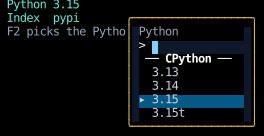
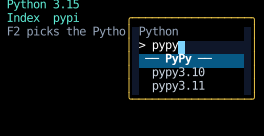
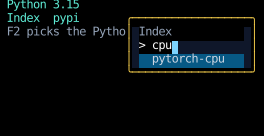

# Autocomplete

An autocomplete field suggests completions as you type,
in a list that opens under the field and lays over whatever is there.
The list has to reach past the box the field is in,
which here is a form that [scrolls](../layout/scrolling.md) inside a [`fill(1)`](../layout/splitting-space.md) panel,
and so clips its children.

The field edits its text with [`use_text_input`](../headless/use_text_input.md),
which makes it focusable and handles typing, moving the cursor, and pasting,
and leaves drawing the text and the list to the field.
It draws the text in a row that [scrolls sideways](../headless/use_text_input.md#scrolling-a-long-value),
with the cursor's cell holding the hook's `cursor_cell` handle,
so a value wider than the field keeps the cursor in view.

<!-- example: autocomplete.py:example -->

Typing `py` into the package field opens the list,
which reaches past the bottom of the panel and over the text below it:

## Matching

The field matches its candidates with [`subsequence_matches`](../headless/options.md#matching)
and keeps which match is highlighted with a [`Highlight`](../headless/options.md#highlighting),
both covered on the [Pickers](../headless/options.md) page, with the keys and scrolling a long list.
This page is about where the list goes.

## The list

The list is a `Div` the field renders only while it's focused and has matches,
so it closes when focus moves away:
Tab with the list closed bubbles to the root's `tab_focus`,
and a press anywhere that doesn't claim it bubbles to the root's `clear_focus`.

It's [absolutely positioned](../layout/layering.md#absolute-positioning) against the field,
so it doesn't push the fields below it down.
`inset_top=Percent(1.0)` puts its top edge at the bottom of the field,
and `inset_x(0)` makes it as wide as the field.
It's raised with `z(1)`, so it's drawn over the fields and text that follow it.
It's at most `SHOWN_ROWS` matches tall, and [scrolls](../headless/options.md#a-long-list) the rest.

## Choosing a match

Down and Up move the highlight through the list, wrapping at the ends.
The field keeps its text in one state with its `Highlight` and whether the list is dismissed,
and the setter it passes to `use_text_input` applies each edit to that state,
resetting the highlight whenever the edit changes the text,
so moving the cursor leaves it where it was.
Each key decides from that state as the keys before it left it, read with `get_state`,
so keys typed ahead of a render act on the text they follow:

Enter or Tab replaces the text with the highlighted match, and closes the list:

Escape closes the list too, and it stays closed until the text changes.
Each of these keys is handled only while the list is open.
Every other event goes to `use_text_input`'s handler, which passes on the keys it doesn't edit with,
so with the list closed, Tab moves focus and Enter bubbles to whatever handles it outside the field.

A press on a match chooses it, through [`on_click`](../input-handling/handlers.md).
`on_click` claims the press, so it never reaches the root's `clear_focus`, and focus stays in the field.

## Escaping the panel

The list sets [`clip_to_screen`](../layout/clipping.md#escaping-every-clip), so no ancestor clips it.
With the default, `clip_to_padding`, the panel would cut the list off at its padding box:

`clip_to_screen` changes only what clips the list.
The list is still positioned against the field, and still needs its `z` to cover what follows it.

## Inside a scroll container

The form scrolls, with [`scroll_on_wheel`](../input-handling/handlers.md#scrolling),
and has its border and title on the panel around it, so they stay put while the fields move.
The open list is positioned against its field, so it moves with the field as the form scrolls.
It's part of the form's content, so it also extends how far the form scrolls:
the four fields and the gaps between them reach two rows past the form,
but with the Python field's list open, the form scrolls three rows down, and further still to show all of it.

## Opening upward

A field near the bottom of the screen, below the panel, opens its list above it instead,
with `inset_bottom=Percent(1.0)`, when there's more room above it than below.
The field compares its own border box, from [`use_rects`](../hooks/use_rects.md),
with the screen around it, which the same `Rects` carry as
[`screen`](../hooks/use_rects.md#measuring-the-room-around-an-element):

`use_rects` reports the previous frame's rectangles, and empty ones on the first render.
The list only opens once something has been typed, by which time the field has been laid out.

Choosing a package with Down and Enter, then tabbing to the recipe field, whose list opens upward:

<!-- cast: autocomplete -->

## Opening a picker with a key

A picker is the same field and list, opened by a key over the corner of the screen,
as a command palette or VS Code's quick pick is,
to choose one of a few settings and close again.
Here F2 picks the Python and F3 the package index:

<!-- example: picker.py:settings -->

The picker draws the same field as above, with `use_text_input`,
and narrows its list with `subsequence_matches`, which lists everything while nothing is typed.
It opens with the current choice marked and highlighted, and choosing one, or Escape, closes it.

<!-- example: picker.py:picker -->

### Sections

The options can come in sections, each under a bar naming it.
A bar is listed and chosen as an option is, by its title, so typing narrows to it as well,
and whatever handles the choice decides what choosing it means:
here a bar chooses its section's newest version, as `uv python install pypy` does.

<!-- example: picker.py:sections -->

### Focus

Nothing has focus before the picker opens, so `use_text_input`'s `auto_focus` would take it,
but a picker opened while another is open has to take focus from that one, and `auto_focus` takes it from nothing.
So the key that opens a picker returns [`FocusOn`][counterweight.controls.FocusOn] for its field's
[`FocusHandle`][counterweight.focus.FocusHandle],
with a [`ScrollIntoView`](../layout/scrolling.md#scrolling-an-element-into-view) for the highlighted option,
which can start past the rows the list shows.
Returned with the state change that opens the picker, both apply to the frame it opens in.
Choosing, or Escape, returns [`ClearFocus`][counterweight.controls.ClearFocus],
so the keys go back to the screen behind it.

### A handle for each opening

The handles belong to one opening of a picker, a `Picking`, not to the screen,
and each `Picking` makes its own:

<!-- example: picker.py:picking -->

Pressing F3 while the Python picker is open opens the index picker in the frame the Python picker closes in.
A `FocusOn` names its target by handle, and resolves as soon as it's handled, against the frame on screen.
With one handle shared by every opening, that's still the Python picker's field,
so focus would go there, then leave with the field as it unmounts, and the index picker would open without focus.
With a handle of its own, the index picker's field isn't on screen yet, so the `FocusOn` waits for the render that mounts it:

Choosing a Python version, a bar, then switching pickers with F3:

<!-- cast: picker -->
