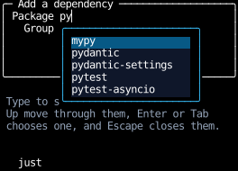
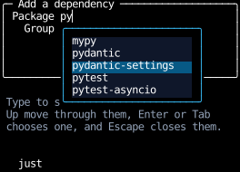
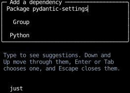
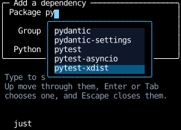
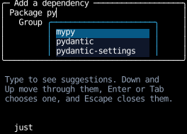
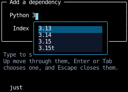
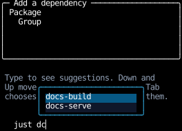

# Autocomplete

An autocomplete field suggests completions as you type,
in a list that opens under the field and lays over whatever is there.
The list has to reach past the box the field is in,
which here is a form that [scrolls](../layout/scrolling.md) inside a [`fill(1)`](../layout/splitting-space.md) panel,
and so clips its children.

Counterweight has no text input element, so the recipe builds a minimal one:
a [focusable](../hooks/use_focus.md) component that keeps its text in state,
and appends each typed grapheme to it or, for Backspace, removes the last one.

```python
--8 < --"autocomplete.py:example"
```

Typing `py` into the package field opens the list,
which reaches past the bottom of the panel and over the text below it:



## Matching

A candidate matches when the typed letters appear in it in order, with anything between them,
so `py` matches `mypy` as well as `pytest`.
`matches` builds a pattern with a `*` between and around the typed letters,
each escaped with `glob.escape`, so a typed `[` or `?` matches itself rather than starting a pattern.
It lowercases both sides and compares them with `fnmatchcase`,
since `fnmatch` folds case only where `os.path.normcase` does, which is on Windows alone.

The list shows every match, in the order of the candidates.

## The list

The list is a `Div` the field renders only while it's focused and has matches,
so it closes when focus moves away:
Tab with the list closed bubbles to the root's `tab_focus`,
and a press anywhere that doesn't claim it bubbles to the root's `clear_focus`.

It's [absolutely positioned](../layout/layering.md#absolute-positioning) against the field,
so it doesn't push the fields below it down.
`inset_top=Percent(1.0)` puts its top edge at the bottom of the field,
and `inset_x(0)` makes it as wide as the field.
It's raised with `z(1)`, so it's drawn over the fields and text that follow it.
It's at most `SHOWN_ROWS` matches tall, and [scrolls](#a-long-list) the rest.

## Choosing a match

Down and Up move the highlight through the list, wrapping at the ends.
The field keeps which match is highlighted in state, and resets it whenever the text changes:



Enter or Tab replaces the text with the highlighted match, and closes the list:



Escape closes the list too, and it stays closed until the text changes.
Each of these keys is handled only while the list is open,
so with it closed, Tab moves focus and Enter bubbles to whatever handles it outside the field.

A press on a match chooses it, through [`on_click`](../input-handling/handlers.md).
`on_click` claims the press, so it never reaches the root's `clear_focus`, and focus stays in the field.

## A long list

The list is a [scroll container](../layout/scrolling.md) with a maximum height,
so a long list of matches stays a few rows tall, and the wheel scrolls it.
Down and Up have to keep the highlighted match in view as they move it past either end,
but focus stays in the field, so moving focus can't do it, as it does for a list whose options take focus.

The field gives one [`ElementHandle`][counterweight.focus.ElementHandle] to whichever match is highlighted,
and every key it handles returns
[`ScrollIntoView`](../layout/scrolling.md#scrolling-an-element-into-view) for that handle, with `block="nearest"`,
beside whatever state the key changed.
`ScrollIntoView` applies to the layout of the render that change causes, before it paints,
and names the element that has the handle in that render: the newly highlighted match.
So the list scrolls in the same frame the highlight moves, and only as far as it takes:



A key that resets the highlight, by changing the text, scrolls the first match back into view the same way,
and one that closes the list names no element, so it scrolls nothing.
The list is unclipped, so `ScrollIntoView` scrolls only the list, not the form around it:
no container above an element with `clip_to_screen` clips it, so none has to scroll to show it.

This is how a web combobox does it, keeping focus in its input,
marking the highlighted option with `aria-activedescendant`,
and calling `scrollIntoView({block: "nearest"})` on it each time the highlight moves.

## Escaping the panel

The list sets [`clip_to_screen`](../layout/clipping.md#escaping-every-clip), so no ancestor clips it.
With the default, `clip_to_padding`, the panel would cut the list off at its padding box:



`clip_to_screen` changes only what clips the list.
The list is still positioned against the field, and still needs its `z` to cover what follows it.

## Inside a scroll container

The form scrolls, with [`scroll_on_wheel`](../input-handling/handlers.md#scrolling),
and has its border and title on the panel around it, so they stay put while the fields move.
The open list is positioned against its field, so it moves with the field as the form scrolls.
It's part of the form's content, so it also extends how far the form scrolls:
the four fields and the gaps between them reach two rows past the form,
but with the Python field's list open, the form scrolls three rows down, and further still to show all of it.



## Opening upward

A field near the bottom of the screen, below the panel, opens its list above it instead,
with `inset_bottom=Percent(1.0)`, when there's more room above it than below.
The field compares its own border box, from [`use_rects`](../hooks/use_rects.md),
with the screen's height, which the root takes from its own `use_rects` and passes down:



`use_rects` reports the previous frame's rectangles, and empty ones on the first render.
The list only opens once something has been typed, by which time the field and the root have been laid out.
