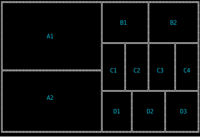
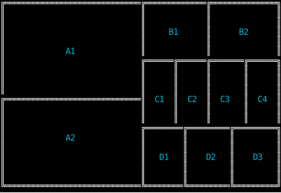
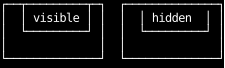
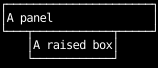
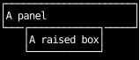

# Border Healing

When border elements for certain border types are adjacent to each other and appear as if they
should "join up", but don't because they belong to different elements, they will be joined up.

```python
--8<-- "border_healing.py:example"
```

With border healing **enabled**:



With border healing **disabled**:



## Healing and clipping

A box that hides its overflow cuts off the borders inside it at its padding box,
and the part that's cut off doesn't join anything.
Here each container holds a box pushed up onto its top border.
Where overflow is visible, the box's top corners are drawn on the container's border and join it;
where it's hidden, they're clipped away, and the container's border stays straight:

```python
--8<-- "border_healing.py:clipped"
```



A box whose border sits just inside its container's border doesn't join it either,
since the container's `─` and `│` beside the box's corners don't point toward them.

Boxes that clip still join each other where their borders meet.
Every box in the grid above is a `fill(1)` item, which [hides its overflow](../layout/clipping.md),
and each box's corners are inside its own clip, so they join across the shared edges.

## Healing across `z`

Healing doesn't compare `z` or border styles,
so a raised box whose border lies on another box's border joins it as any border would:

```python
--8<-- "border_healing.py:raised"
```



With border healing disabled, the raised box's corners are drawn over the panel's border as they are:



An [unclipped](../layout/clipping.md#escaping-every-clip) box, such as a dropdown, joins borders beneath it the same way.
To keep a raised box from joining, keep its border off other borders.
[#74](https://github.com/JoshKarpel/counterweight/issues/74) tracks whether healing should require matching `z` and styles.
