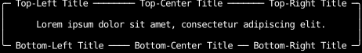

# Border Titles

To add title text to a border,
use an absolutely-positioned `Text`
inside a `Div` that provides the border,
inset by `-1` onto the border's row.

Give the title `clip_to_border`.
A box that hides its overflow, as every `fill(1)` and other constraint item does,
clips its children to its padding box, which would erase a title on its border.
`clip_to_border` clips the title to the border box instead
(see [Drawing on the parent's border](../layout/clipping.md#drawing-on-the-parents-border)).

```python
--8<-- "border_titles.py:example"
```


