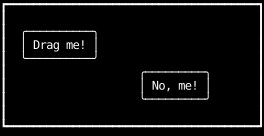
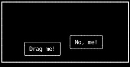
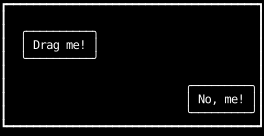

# Draggable Components

To make a component draggable,
position it absolutely at an offset kept in state,
and give it a handler that claims button `1` presses.
On the `MouseDown`, remember where the pointer was and what the offset was.
On each `MouseMoved`, set the offset to where it started
plus how far the pointer has moved since then,
[clamped](#keeping-it-inside-its-parent) so the component stays inside its parent.

```python
--8<-- "draggable.py:example"
```



After a press on "Drag me!" and a drag down and to the right:



Claiming the `MouseDown` [captures the press](../input-handling/events.md#presses),
so every move reaches the component until the button is released,
even when the pointer moves faster than the component follows and leaves it behind.

## Keeping the grab in a ref

The grab goes in a [ref](../hooks/use_ref.md), not in state,
because a handler sees the values of the render that built it.
Setting state schedules a render; it doesn't change what `offset` or any other state holds in the handler.
The terminal often reports a press and the first moves of a drag together,
and Counterweight handles every event that has arrived before it renders again.
If the grab were state, the moves after the press would read the grab from before the press,
and the component would jump.
A ref is one box shared by every call to the handler,
so a move sees what the press just wrote.

## Setting the offset from the grab alone

Each move computes the offset from the grab and the pointer, not from `offset`,
so it doesn't matter how many moves arrive before the next render:
every one of them sets where the component belongs for that pointer position,
and the last one wins.
Adding each move's distance to `offset` instead would need the previous move's pointer position,
which is one more thing to keep in a ref.

## Keeping it inside its parent

An absolutely positioned element's insets place it relative to its parent's
[padding box](../layout/layering.md),
so an offset keeps the component inside its parent
while it runs from `0` to the padding box's size less the component's own border box.
The parent passes its padding box from [`use_rects`](../hooks/use_rects.md) as `bounds`,
and the handler takes the component's size from its receiver, then clamps each axis.

After a drag that carries the pointer past the bottom-right corner, "No, me!" stops against the border:



The clamp happens when the offset is set, so the state always holds where the component is drawn,
and the next press grabs it there.
Once the pointer comes back inside, the component follows it again from the cell the press grabbed.

`use_rects` reports the previous frame's rectangles, and empty ones on the first render,
which doesn't matter here, because handlers only run once the parent has been laid out.
A parent that shrinks, such as when the terminal is resized,
can leave a component outside it until it's dragged again.
To keep it inside then too, clamp the offset when rendering as well,
from the same `bounds` and the size the component gets from its own `use_rects`.
