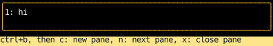
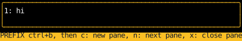
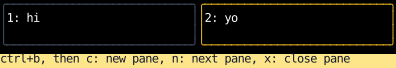

# Prefix Keys

A prefix key changes what the next key does, as tmux's Ctrl+B does:
Ctrl+B, then `c`, opens a pane, while `c` on its own is typed into the focused one.
Vim's modes and Emacs's chords are the same thing with more states.
This one has panes that take typing, and Ctrl+B followed by `c` to open a pane, `n` to focus the next, or `x` to close one.
Any other key after Ctrl+B is dropped.

<!-- example: prefix_keys.py:example -->

After Ctrl+B, the status bar shows the prefix is waiting for its key:

Then `c` opens a second pane and focuses it, so the next keys go there:

## Keeping the mode in a ref

Whether the prefix is waiting for its key, `is_armed`, is a [ref](../hooks/use_ref.md), not state,
because a handler sees the state of the render that built it.
A terminal often delivers Ctrl+B and the key after it in one read, such as when they're typed quickly or pasted,
and Counterweight handles every event that has arrived before it renders again.
If the mode were state, the handler for `c` would still see the prefix unarmed, and type `c` into the pane.
A ref is one box shared by every call to the handler, so the `c` sees what the Ctrl+B just wrote.

Drawing the status bar does need state, since changing a ref doesn't render anything,
and a component [mustn't read a ref while rendering](../hooks/use_ref.md#not-reading-or-writing-a-ref-while-rendering).
So `arm` writes both: the ref for the handlers to read, and `shows_armed` for the status bar to draw.

## Putting the prefix first

Keys go to the focused pane first and [bubble](../input-handling/events.md#key-presses) up from there,
so a prefix handler on an ancestor alone would never see the `c`: the pane would type it first.
Each pane puts the prefix ahead of its own typing with `first(prefix, type_key)`,
so the prefix decides before the pane does.
The root's element has the prefix too, for when no pane is focused, such as after the last one closes.

The prefix claims Ctrl+B and the key after it, returning `()` or a control, and passes on everything else,
so a key it doesn't bind reaches the pane, and anything the pane doesn't take reaches the root.

## Opening a pane focused

Opening a pane creates its focus handle in the handler,
keeps it in state with the pane, and returns [`FocusOn`](../hooks/use_focus.md#focusing-a-component-as-it-mounts) with it.
The pane doesn't exist until the next render, so `FocusOn` waits for that render,
and the new pane is focused in the first frame that shows it.
Keys that arrive in the same read as the `c` still go to the pane that was focused when they arrived.

The new pane's number comes from the latest panes, inside the update function passed to `set_panes`,
rather than from the `panes` the render saw,
so two panes opened in one read get different numbers, and different keys.
