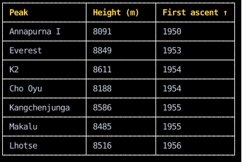

# Sortable Tables

A table is a column of rows whose cells share their borders,
which [`border_collapse`](../layout/spacing-and-borders.md#sharing-borders-between-neighbors) draws once between neighbors,
as CSS's `border-collapse: collapse` does.
To sort it by the header clicked, keep which column it's sorted by, and which way, in state,
and sort the rows by it each render:

<!-- example: sortable_table.py:example -->

Clicking a header sorts by its column, and clicking it again sorts the other way:

<!-- cast: sortable-table -->

Each cell has the width of its column, so the cells of a column line up from row to row.
`Sort.by` is a function of the latest sort, passed to the setter,
so two clicks that arrive together sort by the second one the way the first one left it.
