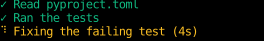

# Spinners

To show that something is still working, such as each step of a coding agent,
animate a spinner with [`use_clock`](../hooks/use_clock.md):

```python
--8<-- "spinner.py:example"
```



`spinner` reads the clock once per frame of the animation,
and computes which frame to show from how long it has been mounted,
so the animation keeps pace with real time however long the step takes
(see [Why compute from elapsed time?](../hooks/use_clock.md#why-compute-from-elapsed-time)).
The same reading gives the elapsed seconds beside the label.

Each frame re-runs `spinner` alone, since it's the only component that reads the clock.
`progress` re-runs only when its steps change,
and gives the spinner a new key for each step,
which remounts it and starts its time again from zero.
