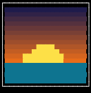
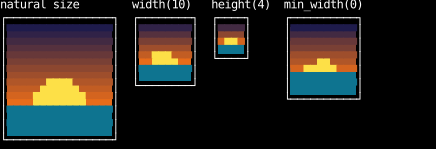
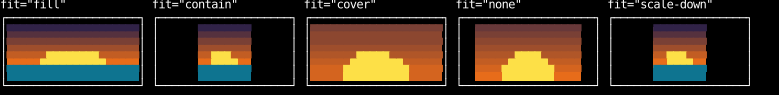
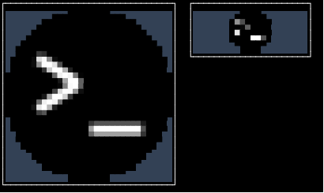
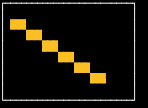
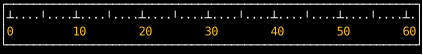

# `Canvas`

A `Canvas` is a leaf element whose content box its painter draws, cell by cell,
for pictures, plots, game boards and anything else that isn't text.
A `Text` of chunks can draw the same cells,
but layout measures and wraps a `Text` every frame, which a picture never needs.
A canvas skips all of that: its painter says how big it is, and draws whatever box it ends up with.

This page covers drawing pixels, how a canvas is sized,
loading an image, mouse input, and writing a painter of your own.

## Drawing Pixels

`counterweight.painters.pixels` splits a picture from how it's drawn:

- [`Pixels`][counterweight.painters.pixels.Pixels] is the picture:
  a width, a height, and RGBA bytes, with nothing about cells or terminals.
  `Pixels.blank`, `Pixels.from_points` and `with_points` build one from colors,
  and the constructor takes raw RGBA bytes from any decoder.
- [`HalfBlocks`][counterweight.painters.pixels.HalfBlocks] is a painter that draws a `Pixels` in cells,
  two pixels to a cell, one above the other, as `▀` with the top pixel as its foreground
  and the bottom one as its background.
  A cell is about twice as tall as it is wide, so the pixels come out about square.

<!-- example: canvas.py:pixels -->

A canvas compares its painter with `==` to the one it had last frame,
and doesn't draw again while it's equal and its box is the same size.
Two `HalfBlocks` are equal when their pixels' bytes, `fit` and `position` are,
so a component that holds a `Pixels` in state can build its `HalfBlocks` in every render,
and the canvas is drawn again only when the pixels or its box change.
Changing a picture means making a new `Pixels`, as `with_points` does.

## Sizing

A canvas is sized as HTML's replaced elements (``, `<canvas>`) are.
Its painter's natural size is its intrinsic size, which it takes on each axis that its style
and its parent's layout leave undetermined, as an `` takes its picture's.
A `HalfBlocks` is as wide as its picture and half as tall, rounded up.

<!-- example: canvas.py:sizing -->

- A size from the style, or from a parent that stretches or flexes it, wins on its axis,
  and the painter draws at the size the canvas's content box ends up.
- A painter that keeps its aspect ratio, as `HalfBlocks` does,
  gives a canvas sized on only one axis its other axis by that ratio,
  so `width(10)` or `height(4)` alone keeps the picture's proportions.
  The ratio is between content boxes, so a border or padding doesn't distort it.
- **In a flex row, a canvas shrinks no narrower than its intrinsic width**, as an `` doesn't,
  so a canvas wider than its row overflows it and draws over what's beside it.
  `min_width(0)` lets it shrink, as `min-width: 0` does for an ``.
- A `max_width` on a canvas in a column that doesn't stretch its children,
  such as one with `align_children_start`, narrows it without shortening it.
  Set a `width` instead, or let the column stretch it.

## Fitting a Picture to Its Box

When the box isn't the picture's natural size, `HalfBlocks`'s `fit` scales the picture as CSS's
[`object-fit`](https://developer.mozilla.org/en-US/docs/Web/CSS/object-fit) does,
and `position` places it in the space left over as
[`object-position`](https://developer.mozilla.org/en-US/docs/Web/CSS/object-position) does.
`fit` is on the painter rather than the canvas's style,
because only a painter with pixels has a picture to scale.

<!-- example: canvas.py:fit -->

- `"fill"`, the default, stretches the picture to the box on each axis.
- `"contain"` scales it to fit inside the box, keeping its proportions.
- `"cover"` scales it to cover the box, keeping its proportions, and cuts off what overflows.
- `"none"` leaves it at its natural size, cut off where it overflows.
- `"scale-down"` is whichever of `"none"` and `"contain"` is smaller.

`position` is the fractions of the space left over on each axis to put to the left of and above the picture,
`(0.5, 0.5)` by default, which centers it.
It places the picture in whole pixels, so a picture can start halfway down a cell.

Each cell shows the pixels nearest the middle of its two halves, which is fast but rough
when shrinking a photo a long way. For a smoother picture, scale it to the size you'll show it at first,
such as with Pillow's `Image.thumbnail`.

## Transparency

A pixel less than half opaque is transparent, and so is any part of the box the picture doesn't cover.
A transparent half of a cell shows the canvas's background:
its `text_bg` if its style sets one, and its `content_color` otherwise,
so a canvas with only a `content_color` shows it everywhere the picture doesn't.

## Loading an Image

`Pixels.from_image` takes a [Pillow](https://pillow.readthedocs.io/) `Image`,
or anything else with Pillow's `size`, `convert` and `tobytes`,
so counterweight doesn't depend on Pillow itself.
Decoding costs as much as the image has pixels, so do it once, before the app starts,
or in an effect that sets state, never in a render.

<!-- example: canvas.py:image -->

## Mouse Input

A canvas takes an `on_input` handler as any element does,
and mouse events arrive in cells, as positions on the screen.
`HalfBlocks.pixels_at` turns a cell of a box into the pixels of the picture that cell shows,
scaled and placed by `fit` and `position`,
so a paint program sets the pixels under the mouse:

<!-- example: canvas.py:paint -->

## Writing a Painter

A painter is any object with the three members of [`Painter`][counterweight.elements.Painter]:
a `natural_size` in cells, whether it `keeps_aspect_ratio`,
and `draw(width, height)`, which returns rows of `StyledGrapheme`s
for a box of that size, top to bottom, each drawn rightward from the box's left edge.
Cells past the box's edges are cut off, and any part of the box the rows don't reach shows the canvas's background.
Whatever a cell's style leaves unset comes from the canvas, as it does for a `Text`'s chunks,
so a painter never needs the canvas's style.

A painter that takes whatever box it gets has a natural size of zero, and is sized with its style.
This ruler draws a tick in every column of its box and a label in every tenth, however wide the box is:

<!-- example: canvas.py:painter -->

Since a canvas draws again only when its painter isn't equal to the last one,
`draw` must depend only on the painter and the size it's given.
A frozen dataclass is the easiest way to get that:
two built from the same values are equal, so a component can build its painter in every render.

## API

::: counterweight.elements.Canvas

::: counterweight.elements.Painter

::: counterweight.painters.pixels.Pixels

::: counterweight.painters.pixels.HalfBlocks

::: counterweight.painters.pixels.SupportsRGBA
