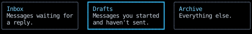

# `Div`

A `Div` is a box that holds other elements and components, as HTML's `
` does.
It has no content of its own: what it shows comes from its `children`, which it lays out,
and from its `style`, which decorates the box around them.

- `children` is a tuple of elements and components, laid out in order as flexbox items by default,
  or as grid items (see [Choosing a layout model](../layout/choosing-a-layout-model.md)).
  A component among them runs and is replaced by the element it returns.
- `style` sets how the `Div` lays its children out (direction, gap, alignment),
  how big it is, and what it draws: a border, padding and margin colors, and a `content_color` that fills its box.
  A `Div` with no border, padding, `margin_color` or `content_color` draws nothing, not even its background,
  so a plain one used only for layout leaves whatever lies beneath it visible.
- `on_input` receives the [input events](../input-handling/events.md) whose target is the `Div` or anything inside it,
  since an event bubbles from its target up through every ancestor until a handler handles it.

Each card below is a `Div` holding two `Text`s, with its own selected state.
The `Text`s have no handlers,
so a click on either one bubbles up to the card's `on_click`, as a click on the border does,
and the selected card merges in a heavier, brighter border.

<!-- example: elements_div.py:example -->

<!-- cast: elements-div -->

A `handle` names the `Div` for the [scroll controls](../layout/scrolling.md#scrolling-from-a-handler),
which scroll it when it's a scroll container or [scroll it into view](../layout/scrolling.md#scrolling-an-element-into-view),
and for [`use_scroll`](../hooks/use_scroll.md).

## API

::: counterweight.elements.Div
