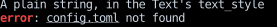
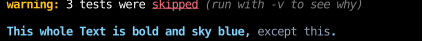
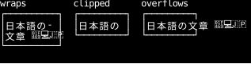
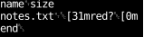

# `Text`

A `Text` is a leaf element that draws text.
Layout sizes it by measuring its content, and wraps it only when its style sets a wrap mode:
see [Text in layout](../layout/text.md) for how a `Text` takes space,
and [Text wrapping](../styles/text-wrapping.md) for the wrap modes.

## Styling Parts of the Text

A `Text`'s `content` is a string, drawn in the `Text`'s `text_style`,
or a tuple of [`Chunk`][counterweight.elements.Chunk]s, each drawn in its own style merged over the `Text`'s `text_style`,
for text whose style changes partway through, as a `` inside a `
` is.
Whatever a chunk's style leaves unset, such as the foreground of the plain chunks below, comes from the `Text`.
A newline in a chunk starts a new line, as it does in a string,
and a wrap mode wraps the chunks as one run of text, so a word split across two chunks wraps as one word.

<!-- example: elements_text.py:chunks -->

The chunks keep the `Text`'s slate foreground except where they set their own:
`error` is red and bold, and `config.toml` is underlined in slate.

A chunk's style can be a `CellStyle`, as above, or a `Style`, of which it takes the `text_style`,
so the [utilities](../styles/utilities.md) that style a whole `Text` style a chunk the same way:

<!-- example: text_chunks.py:example -->

The second `Text` is bold, so the chunk that shouldn't be merges `text_not_bold` over it.

A chunk ignores the rest of a `Style`, such as padding or a border, as a browser ignores a ``'s width,
so put those on the `Text` or a `Div` around it.
`Chunk.style` holds the `CellStyle` either way.
[Syntax highlighting](../rich-text/syntax-highlighting.md) and [Markdown](../rich-text/markdown.md)
build their output from chunks too, and a chunk can be a [hyperlink](../rich-text/hyperlinks.md).

## Wide Characters

A `Text` measures, wraps and paints its content by grapheme cluster,
the unit a reader sees as one character,
so an accented letter written with a combining mark
or an emoji joined from several (`👩‍💻`) stays whole.

Counterweight measures each cluster with [wcwidth](https://github.com/jquast/wcwidth)'s `wcswidth`.
Most clusters take one terminal cell.
CJK characters, most emoji and flags take two,
and zero-width characters (zero-width spaces and joiners, bidirectional marks) take none and aren't drawn.
No cluster takes more than two,
which matches terminals that draw a cluster as one unit, such as Ghostty, foot and Windows Terminal.
Terminals that add up the widths of a cluster's code points instead
draw some clusters wider, such as a joined emoji as its separate parts,
and text after one is drawn to the right of where layout put it.

A two-cell cluster is never split across lines or cut in half.
When one would cross the right edge of its `Text`,
it moves to the next line if the text wraps,
or overflows the box with the rest of its line if it doesn't.
Where a [clip](../layout/clipping.md) cuts across one, it is left out, with a space in its place.

<!-- example: elements_text.py:wide -->

- In `wraps`, ten cells wide, the first word is too long for a line, so it's [broken with a hyphen](../styles/text-wrapping.md#long-words-and-hyphenation).
  That leaves nine cells for the word, and `文` would take the ninth and tenth,
  so it starts the next line and the first line ends a cell short.
- In `clipped`, nine cells wide, `overflow_hidden` cuts across `文`,
  which is left out, with a space in the ninth cell.
- In `overflows`, the unwrapped line runs past the pane's border.

## Control Characters

Newlines (`\n` and `\r\n`) start a new line.
Every other control character, such as tab or escape,
is drawn as a symbol (`␉`, `␛`) rather than written to the terminal,
where it would run as a command instead of drawing anything.

<!-- example: elements_text.py:control -->

The tabs, the escape sequences that would have turned the text red, and the bell at the end
are each drawn as one symbol, while `\n` and `\r\n` break the lines.
To color text, use [chunks](#styling-parts-of-the-text) instead of escape sequences.
To show a program's colored output, run it in a [terminal emulator](../terminals/emulators.md).

## API

::: counterweight.elements.Text

::: counterweight.elements.Chunk
