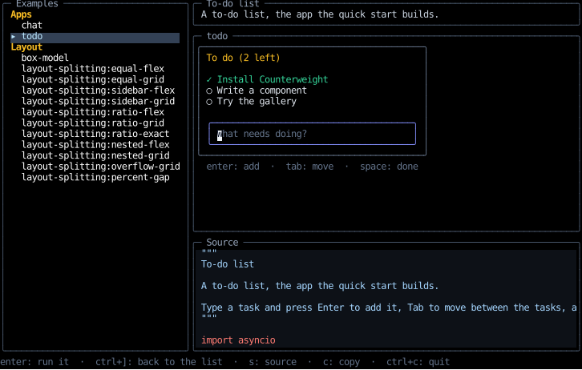

# Examples

Counterweight ships with its examples: a few complete apps, and the snippets these docs show,
each of which runs on its own.
This page covers finding, running, reading and copying them from the `counterweight` command,
and the gallery, which browses them all and runs each one in place.

## Apps and snippets

An example is one of two kinds:

| | App | Snippet |
| --- | --- | --- |
| Shows | Many features composed into something useful | One idea, the one its docs section is about |
| Runs | Its one root | One or more roots, the first by default |
| Copying it gives you | A starting point for an app | A pattern to paste into one |

The apps are a [to-do list](index.md#quick-start), a chat, a Markdown viewer, a terminal multiplexer,
Wordle, and a presentation whose slides run commands; the [home page](index.md#showcase) shows them.

## Running, reading and copying them

`counterweight examples list` lists them, apps first, by name and title:

```bash
counterweight examples list
```

```text
chat                         Chat
markdown-viewer              Markdown viewer
multiplexer                  Terminal multiplexer
...
box-model                    The box model
...
```

An example's name is its module's, with hyphens, as `layout-splitting` is.
A snippet with several roots runs its first unless you name one after a colon,
as `layout-splitting:equal-grid`, and `counterweight examples list --roots` lists every root by that name.

| Command | Does |
| --- | --- |
| `counterweight examples run <name>` | Runs the example in the terminal |
| `counterweight examples show <name>` | Prints its source, highlighted and paged through `$PAGER` (`less -R` without one) on a terminal, and plain otherwise |
| `counterweight examples show <name> -o <path>` | Writes its plain source to a file |
| `counterweight examples copy <name> [path]` | Writes a file of your own that runs the example, in the current directory unless you give a path |
| `counterweight examples gallery` | Opens the gallery |

A copy leaves out what only the docs and the tests use, the steps that put the example in a state worth a screenshot,
so it's the example as it runs, and runs as it is with `python <file>`.
It won't write over a file that's already there.

## The gallery

The gallery lists every example beside the one selected, with its description and its source,
and runs it in place when you press Enter:



<!-- cast: gallery -->

| Key | Does |
| --- | --- |
| Up, Down, PageUp, PageDown, Home, End | Move through the list, as the wheel scrolls it and a click selects |
| Enter | Runs the selected example, and moves focus into it |
| Ctrl+] | Brings focus back to the list, leaving the example running until the selection moves |
| S | Shows and hides the source |
| C | Copies the example into the current directory, as `counterweight examples copy` does |
| Ctrl+C | Quits |

Ctrl+] is the key `telnet` and `virsh console` leave a session with.

### How an example runs in the gallery

The gallery mounts the example's root in its own tree, so it starts instantly,
and focuses it, so keys and the mouse reach it as they would in an app of its own:
the component the example's root `auto_focus`es takes focus,
and an example that handles keys on its root, with nothing focused, gets them.
A key the example doesn't claim bubbles up to the gallery, which is how Ctrl+] gets there.

That's in place of the isolation a separate app would give, so a few things the example does reach the gallery:

- **Tab can leave the example.** Its focusable components join the gallery's focus order,
  unless the example moves focus within itself, as one with a dialog does.
- **Suspending suspends the gallery**, which comes back when the program ends, as the example would alone.
- **Quitting quits the gallery**, so the examples quit on Ctrl+C, the app's default, wherever they can.
  The two whose focused terminal sends Ctrl+C to its program can't:
  the terminal snippet quits on Ctrl+Q, and the multiplexer once its last pane closes.

An embedded terminal claims every key, so the examples that focus one let Ctrl+] through with `skips`
(see [Embedded Terminals](terminals/embedding.md)),
and an app of your own that embeds a terminal inside an app with keys of its own can do the same.

## Not public API

`counterweight.examples` is importable, since the examples ship in the package,
but it's no part of Counterweight's public API: an example can change, or go, in any release.
To build on one, copy it.
