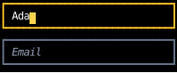

# Headless Components

A headless component gives a component the behavior of a common control,
such as which keys edit text and where the cursor goes, or which keys scroll a box,
and leaves drawing it to the component,
as [Headless UI](https://headlessui.com/)
and [React Aria](https://react-spectrum.adobe.com/react-aria/hooks.html) do for the web.
Each one is a hook in `counterweight.headless`,
and `counterweight.widgets` draws each one way, for when you don't need your own look:

| Hook                                    | Widget        | Behavior                                    |
|-----------------------------------------|---------------|---------------------------------------------|
| [`use_text_input`](use_text_input.md)   | `text_input`  | Edits one line of text                      |
| [`use_text_area`](use_text_area.md)     | `text_area`   | Edits text that wraps onto rows             |
| [`use_scroll_area`](use_scroll_area.md) | `scroll_area` | Scrolls a box with the keys and the wheel   |
| [`use_terminal`](../terminals/embedding.md#the-hook) | `terminal` | Runs an interactive program in a box |

## Styling the widgets

The text field widgets take a `style`, merged over their box's own style, for a size or a border,
and `styles`, a [`TextFieldStyles`][counterweight.widgets.TextFieldStyles] that says how they draw
their box while unfocused, focused, and unfocusable, their cursor, and their placeholder.
Pass the fields you want to change, and share one `TextFieldStyles` between all the fields of a form:

<!-- example: text_input.py:styles -->

The box's styles merge as a stylesheet's rules for an `<input>` apply:
`box`, then the widget's `style`, then `focused_box` while it's focused,
as a rule for `input:focus` overrides one for `input`,
or `unfocusable_box` while it isn't focusable, as a rule for `input:disabled` does.
So a `style` with a border color sets the color the box has while it isn't focused,
and the focused box still shows which field has focus.

[`scroll_area`](use_scroll_area.md#a-styled-scroll-area) takes a `style` and `styles` the same way,
with a [`ScrollAreaStyles`][counterweight.widgets.ScrollAreaStyles] for its box while unfocused and focused.

## API

::: counterweight.widgets.TextFieldStyles
::: counterweight.headless.Highlight
::: counterweight.headless.fuzzy_matches
::: counterweight.headless.substring_matches
