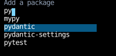
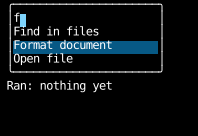
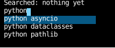
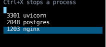
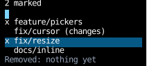
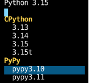
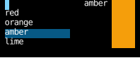
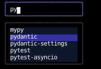

# Pickers

A picker narrows a list of options as you type and lets you choose one:
a combobox, a command palette, a search box's suggestions, or `fzf`.
Counterweight gives pickers their parts rather than a picker:
[`Highlight`][counterweight.headless.Highlight], which option is highlighted as the options change,
and the matchers, which options a typed text keeps.
Each picker wires them to its own keys, state and drawing in a handler of its own,
since pickers differ in exactly those.
The [`combobox`](#the-combobox-widget) widget wires them the one way the WAI-ARIA combobox pattern does.

This page covers the parts, then each kind of picker built from them, then the widget.
It doesn't cover positioning a list over the content around its field,
which the [autocomplete recipe](../cookbook/autocomplete.md) does.

## The parts

### Matching

[`subsequence_matches`][counterweight.headless.subsequence_matches] keeps the options that hold the typed letters
in order, with anything between them, as `fzf` matches, though it doesn't rank them,
so `py` matches `mypy` as well as `pytest`.
[`substring_matches`][counterweight.headless.substring_matches] keeps the ones that contain the text whole,
and [`prefix_matches`][counterweight.headless.prefix_matches] the ones that start with it, as Tab completion does.

All three compare text folded with `casefold`, so `SS` matches `straße`,
keep every option for an empty text,
and keep the options in their own order, but for the one the text names exactly, which comes first,
so typing a whole name and pressing Enter chooses it, even when it's also part of a longer name above it.
`subsequence_matches` escapes each letter with `glob.escape`, so a typed `[` or `?` matches itself.
Each takes a `key`, the text to match an option by, so a picker can match a richer option on part of it
and get the options back:
`substring_matches(text, processes, key=lambda process: f"{process.pid} {process.command}")`.

The caller filters, in the line that computes what to show,
so a picker can match however it likes, as [inline completion](#inline-completion) does.

### Highlighting

A `Highlight` is which of a list of options is highlighted: the one whose key is its `key`, or, when none is,
the one at its `index`.
The key keeps it on its option as options before it come and go,
as React Aria's `focusedKey` does,
and the index is where it lands when its own option goes.
`Highlight()` is the first option, `Highlight(index=len(options) - 1)` the last,
and `Highlight(key=current)` the current one, wherever the list puts it.

It holds no options, so each method takes them:
`index_in` is the highlighted option's index, `moved` is the highlight some options on,
and `landed` is the highlight on the option it's on now, so it follows that option from then on.
At the ends, `moved` wraps (`ends="wrap"`, the default), stops (`"stop"`, as the combobox pattern and `fzf` do),
or releases the highlight to no option at all (`"release"`, which returns `None`).
Each method also takes the option's `key`, which defaults to the option itself,
and `is_disabled`, which marks the options the highlight skips, such as [headings](#headings-the-highlight-skips).

### Deciding from the latest state

Several key presses can arrive before the next render, when typing fast or typing before the first frame,
and each runs a handler the last render made.
A handler that only moves state along passes the setter a function,
but one that decides something, whether to claim a key or which option to choose,
reads the latest state at the top with [`get_state`][counterweight.hooks.get_state]
(see [Deciding from the latest state](../hooks/use_state.md#deciding-from-the-latest-state)),
and matches the latest text again:

```python
now = get_state(set_query)
now_shown = substring_matches(now.text, COMMANDS)
index = now.highlight.index_in(now_shown)
```

Otherwise Enter typed with the text before it chooses from the list as last rendered.
A handler that decides from where the cursor is calls the text hook's `latest_cursor()`,
since its `cursor` is where the last render placed it.

### A long list

A list of options is a [scroll container](../layout/scrolling.md) with a maximum height,
and Down and Up have to keep the highlighted option in view,
but focus stays in the text field, so moving focus can't do it, as it does for a list whose options take focus.
The picker gives one [`ElementHandle`][counterweight.focus.ElementHandle] to whichever option is highlighted,
and every key it handles returns
[`ScrollIntoView`](../layout/scrolling.md#scrolling-an-element-into-view) for that handle, with `block="nearest"`,
after whatever the text field's handler returned for a key it edits with.
[`response_controls`](../input-handling/events.md#counterweight.events.response_controls) turns that handler's response
into a tuple of controls, or `None` if it didn't handle the key, so the picker can return them together.
`ScrollIntoView` names the element that has the handle in the render the key causes,
so the list scrolls in the same frame the highlight moves, and only as far as it takes.
This is how a web combobox does it, marking the highlighted option with `aria-activedescendant`
and calling `scrollIntoView({block: "nearest"})` on it.

## Kinds of picker

Every picker below draws its text and its rows with the same two functions,
and a picker that owns its text keeps it in a `Query` with the highlight,
whose edit puts the highlight back on the first match inside the updater,
so every edit resets it, whether it came from a key, a paste or a click:

<!-- example: options.py:shared -->

Every picker is a set of answers to the same few questions,
and each answer shows up as a piece of state or a case in the handler:

| Decision | Choices | How it shows in code |
|---|---|---|
| Where the options appear | A popup; a list that's always there; not drawn, cycled into the text; ghost text | A popup keeps whether it's open beside the highlight; an always-open list leaves Escape to bubble; cycling draws no rows; ghost text keeps no `Highlight` at all |
| What the value is | Free text the options suggest; one of the options | Free text: the parent owns the text, and choosing writes an option into it. An option: the picker owns the text, and choosing calls the parent with the option |
| What's highlighted after an edit | The first match; nothing until Down or Up | A `Highlight`, reset to `Highlight()`; or a `Highlight \| None`, reset to `None`, where Enter with `None` acts on the text |
| What moving does at the ends | Wrap; stop; release the highlight | `ends=` on `moved`; `"release"` goes with a `Highlight \| None` |
| When matches show | Once something is typed; always | `substring_matches(text, OPTIONS) if text else ()`, or the call alone |
| What matches | Letters in order; the text whole; a prefix; anything else | The matcher, or an expression of the picker's own, with `key=` to match part of an option |
| How the highlight follows changing options | By position; by the option's key | `key` on `Highlight`'s methods, and `landed` after an edit |
| Rows the highlight skips | None; headings | `is_disabled=` on `Highlight`'s methods |
| What choosing does | Fill in the text and close; act and let the parent close; act and stay | The Enter case, and what the parent's callback does |
| Which keys do what | The combobox pattern's; the command line's; the app's own | The cases of the handler's `match` |
| How many | One; several | A `frozenset` of marks beside the highlight |
| Who owns the state | The picker; its parent | Where the `use_state` calls are |

How the examples answer them:

| Example | Appear | Value | After an edit | Ends | Matching | Follows | Choosing |
|---|---|---|---|---|---|---|---|
| [Combobox](#a-combobox-with-free-text) | Popup | Free text | First match | Stop | Subsequence | Position | Fills in the text |
| [Command palette](#a-command-palette) | Always | An option | First match | Wrap | Substring, always | Position | Acts |
| [Search box](#a-search-box-with-manual-selection) | Once typed | Free text | Nothing | Release | Substring, once typed | Position | Acts on the text or the option |
| [Tab cycling](#tab-cycling) | Not drawn | Free text | Nothing | Wrap | Prefix | Position | Writes into the text |
| [Inline completion](#inline-completion) | Ghost text | Free text | (derived) | (none) | Prefix of history | (none) | Fills in the text |
| [Refreshing rows](#rows-that-refresh-with-keys-of-their-own) | Always | An option | First match | Wrap | Substring by `key` | Key | Acts and stays |
| [Marks](#marking-several-options) | Always | Several options | First match | Wrap | Subsequence by `key` | Key | Acts on the marks |
| [Headings](#headings-the-highlight-skips) | Always | An option | First match | Wrap | Substring, by section | Position, skipping headings | Acts |
| [Preview](#a-preview-of-the-highlighted-option) | Always | The highlight | First match | Wrap | Substring | Position | (nothing) |

### A combobox with free text

The parent owns the text, an edit opens the list, Down or Up opens it too,
with every option for an empty text, and Escape or choosing closes it.
Since the parent owns the text, the highlight resets in a wrapper around the parent's setter,
which compares the text before the edit with the text the setter settled at:

<!-- example: options.py:combobox -->



<!-- cast: options-combobox -->

### A command palette

An always-open list whose value is one of its options:
the text is the palette's own, there's no open or closed state,
and Escape isn't handled, so it bubbles to whatever opened the palette:

<!-- example: options.py:palette -->



<!-- cast: options-palette -->

### A search box with manual selection

Nothing is highlighted until Down or Up, so Enter searches what was typed, or the suggestion the keys moved to,
and moving past either end releases the highlight back to the text,
as the combobox pattern's "returns focus to the combobox":

<!-- example: options.py:search -->



<!-- cast: options-search -->

### Tab cycling

As bash completes: no list is drawn, and Tab writes the next match into the text.
The matches come from the text as it was when cycling started, which `Cycling` keeps,
and any edit ends the cycle, since the line's edit drops it:

<!-- example: options.py:cycling -->


<!-- cast: options-cycling -->

### Inline completion

As fish suggests: the rest of the first line from history that starts with the text is drawn dimmed after it,
and Right at the end of the text accepts it.
There's no highlight to keep, since the suggestion is derived from the text.
It matches with `startswith` rather than `prefix_matches`, so the suggestion keeps the case history has,
and it reads whether the cursor is at the end with `latest_cursor()`,
since a Left typed just before the Right moved it after the last render:

<!-- example: options.py:inline -->


<!-- cast: options-inline -->

### Rows that refresh, with keys of their own

As a port or process manager: the rows come from the parent and change between renders,
so the highlight follows its row by `pid_of`,
the keys are the command line's, and Ctrl+X acts on the highlighted row without closing.
An edit lands the highlight on the first match, so it follows that row from the first keystroke,
which the query's own `edited` can't do, since landing needs the rows, so the picker writes its edit out:

<!-- example: options.py:refreshing -->



<!-- cast: options-refreshing -->

### Marking several options

The marks are kept beside the query, so text that hides a marked option leaves it marked,
and the header counts every mark.
Space toggles the highlighted option's mark, which works because branch names can't contain a space;
a picker whose options can picks another key.
A worktree with changes can't be marked, and Enter acts on the marks, doing nothing when there are none:

<!-- example: options.py:marks -->



<!-- cast: options-marks -->

Marks are a recipe rather than part of the library,
since the key that marks collides with typing in a way each picker settles differently.

### Headings the highlight skips

The rows include a heading over each section, which `is_disabled` marks, so Down and Up pass over them,
and the highlight resolves past one, as Downshift's `isItemDisabled` and React Aria's `disabledKeys` do.
A heading is a row like any other, so its section's options come and go under it as the text narrows them:

<!-- example: options.py:headings -->



<!-- cast: options-headings -->

A picker whose headings are of another type than its options can draw them between the options
and highlight only the options instead, which keeps the type of the option it chooses.

### A preview of the highlighted option

The parent owns the text and the highlight, and passes them down with their setter,
so it can preview the highlighted option beside the list,
and agrees with the list about which option that is, since both ask `index_in`:

<!-- example: options.py:preview -->



<!-- cast: options-preview -->

## The combobox widget

[`combobox`][counterweight.widgets.combobox] is the [combobox with free text](#a-combobox-with-free-text),
drawn as a [`text_input`](use_text_input.md#a-styled-text-input) whose list opens in a box over the content below it,
or above it near the bottom of the screen, clipped only by the screen:

<!-- example: options.py:widget -->



<!-- cast: options-widget -->

Its keys are the WAI-ARIA combobox pattern's, but for Tab, which chooses, as in editors' completion lists.
`opens_on` says whether an edit opens the list or focus does, as React Aria's `menuTrigger` does,
`ends` what the ends do, defaulting to stopping there, as the pattern and `fzf` do,
and `opens` which side it opens on, from [`Rects.screen`](../hooks/use_rects.md#measuring-the-room-around-an-element).
For other keys, build a picker of your own from the parts, as the examples above do.

## API

::: counterweight.headless.Highlight
::: counterweight.headless.subsequence_matches
::: counterweight.headless.substring_matches
::: counterweight.headless.prefix_matches
::: counterweight.widgets.combobox
::: counterweight.widgets.ComboboxStyles
