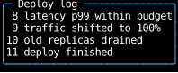
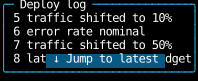
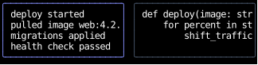
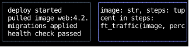

# `use_scroll_area`

`use_scroll_area` scrolls a box with the keys, the wheel and controls,
and leaves drawing it to the component that calls it.
It makes the component focusable, so Tab reaches it and the keys scroll it,
gives the box the style that makes it a [scroll container](../layout/scrolling.md),
and reports how far it's scrolled, for a "jump to latest" button or a position readout.
For a ready-made box, use [`scroll_area`](#a-styled-scroll-area), which is built on this hook.

This page covers the hook and that component.
[Scrolling](../layout/scrolling.md) covers the pieces they're built from,
for a box that needs something they don't do.

## Using the hook

In a browser, a scroll container is keyboard-focusable:
Firefox puts every one in the Tab order,
[Chrome](https://developer.chrome.com/blog/keyboard-focusable-scrollers) only one that has nothing inside it that can take focus,
and while it's focused, the arrows, PageUp, PageDown, Space, Home and End scroll it.
[Radix UI's ScrollArea](https://www.radix-ui.com/primitives/docs/components/scroll-area)
gives a React component the same behavior and leaves drawing the box to it.
`use_scroll_area` does the same for a component.
It puts the area in the Tab order whatever is inside it, as Firefox does,
since a hook can't see which of its descendants are focusable;
pass `in_focus_order=False` for an area whose children should take Tab instead.
It returns a handler, `on_input`, for the element the component returns, which is the one that's focused,
and a `style` and an [`ElementHandle`][counterweight.focus.ElementHandle], `viewport`, for the element that scrolls.
Those can be one element, or the one that scrolls can be inside the other,
as Radix's viewport is inside its root, with things that stay put beside it.

This log puts its border and title on the element it returns, and its lines in the element that scrolls inside it,
with `stick_to_end=True`, so it follows its newest line,
and a button that jumps back to it while it's scrolled back:

<!-- example: scroll_area.py:hook -->

=== "Following the end"

    

=== "After PageUp"

    

=== "After clicking the button"

    

`is_at_end` says whether the area is scrolled to its end, which it is while its content fits,
and `to_end` is the [`ScrollTo`](../layout/scrolling.md#scrolling-from-a-handler) that scrolls it there,
past any end, so it reaches the end of content that grew since the last render.
`is_at_start` and `to_start` do the same for the start, and `scroll` is the
[`Scroll`][counterweight.hooks.Scroll] they're read from, as [`use_scroll`](../hooks/use_scroll.md) reports it,
for a readout such as "rows 5-8 of 11".
Like `use_scroll`, they report the previous frame's scroll,
so the button appears a frame after the scroll that should show it.

The handler is on the element the component returns, so a wheel event or a press anywhere inside it reaches it,
the button included, and the wheel scrolls the log from over the button too.
A press that nothing inside the area claims focuses it,
as a click focuses the nearest focusable element around it in a browser,
so clicking the log focuses it, and clicking the button jumps without focusing it.

## Keys

While the area, or something inside it, is focused,
a key that nothing inside it handles [bubbles](../input-handling/events.md#routing-input-events) to its handler:

| Key               | Scrolls                                                          |
|-------------------|------------------------------------------------------------------|
| Up, Down          | A row up or down                                                 |
| Left, Right       | A column left or right                                           |
| PageUp, PageDown  | A page up or down: 87.5% of the height of the view, as in Chrome |
| Space             | A page down                                                      |
| Home, End         | To the start or the end                                          |

Home and End scroll vertically, as in a browser,
except in an area that only scrolls sideways, which has nothing to scroll vertically,
where they scroll to its first and last columns.
Shift+Space pages up in a browser, but terminals send it as Space, so there's no key for that.
`page` sets the size of a page, as for [`scroll_on_keys`](../layout/scrolling.md#scrolling-with-the-keyboard),
and `wheel_lines` how far each notch of the wheel scrolls, three lines by default.

A key or a wheel event that would move the area past the end of its range bubbles on,
so once a nested area reaches its end, the one around it scrolls,
as the web chains scrolling from one container to the next.
The handler judges that by the scroll as of the previous render, as `is_at_end` does,
so an event that arrives in the same frame as a scroll before it is judged by the scroll before that.

## Which way it scrolls

`axis` is `"y"` for an area that scrolls vertically, the default, `"x"` for one that scrolls sideways,
or `"both"`.
The style clips the axis the area doesn't scroll,
so a line too long for an area that scrolls vertically doesn't spill over its border or its siblings.
For `"y"` it hides the overflow, so the area narrows beside its siblings as a box with hidden overflow does;
for `"x"` it clips the overflow, so the area stays as tall as its content, as a wide code block in a document should.
A browser does much the same: setting only `overflow-y: scroll` makes `overflow-x` `auto`.

## Merging the style

The style sets the element's overflow, and its stickiness with `stick_to_end`, and nothing else.
Merge it after the element's own style, or at least after anything that sets overflow:
the constraint utilities `fill`, `length`, `percentage` and `ratio` hide their box's overflow,
so `area.style | fill(1)` doesn't scroll, and `fill(1) | area.style` does.

## Sizing the area

The area's size is the caller's, as a scroll container's is on the web.
A scroll container's automatic minimum size is 0 on the axes it scrolls
(see [Scroll containers](../layout/scrolling.md#scroll-containers)),
so an area with no size of its own shrinks to fit beside its siblings, and scrolls what doesn't fit.
In a column that's already too short for everything in it, such as a document that scrolls,
that can leave the area no rows at all.
Give it the size you mean:

- `fill(1)` takes the space its siblings leave, as for a pane beside a sidebar or above a prompt.
- `shrink(0) | max_height(8)` makes it as tall as its content, up to eight rows, past which it scrolls,
  even in a column too short for everything in it, as the [text area widget](use_text_area.md#a-styled-text-area) does.
- `height(10)` or `length(10)` fixes it.

The hook doesn't add `shrink(0)` itself, since it can't tell which of those you mean,
and in a row, `shrink(0)` keeps an area with no width of its own as wide as its longest line.

## Scrolling it from outside

The area scrolls the element with the `viewport` handle,
so a parent that creates the handle with `use_state(ElementHandle)` and passes it to the hook
can scroll the area with [`ScrollTo`](../layout/scrolling.md#scrolling-from-a-handler) and `ScrollBy`,
and read its scroll with `use_scroll(handle)`.
The [chat](https://github.com/JoshKarpel/counterweight/blob/main/src/counterweight/examples/apps/chat.py) example
passes its transcript's handle to the transcript's scroll area,
so the root jumps the transcript to its end when a message is sent,
and Shift+PageUp and Shift+PageDown page it while the prompt has focus,
which takes PageUp and PageDown itself to move its cursor.
Tab moves focus to the transcript, where PageUp and PageDown scroll it.

Pass a [`FocusHandle`][counterweight.focus.FocusHandle] as `handle` to focus the area from outside
with [`FocusOn`][counterweight.controls.FocusOn],
and `in_focus_order=False` to leave it out of Tab's order, as `tabindex="-1"` does,
for an area that a press or a `FocusOn` focuses but Tab passes by, such as a page's body.

## A styled scroll area

[`scroll_area`][counterweight.widgets.scroll_area] puts its children in a bordered box that scrolls,
and takes the hook's parameters, a `style` merged over its own, for a size,
and [`styles`][counterweight.widgets.ScrollAreaStyles] for its colors.
A browser draws a focus ring around a focused scroll container as an outline, which takes no space;
a terminal draws nothing outside a box, so its border changes color with focus instead,
as the [text field widgets'](index.md#styling-the-widgets) borders do,
and its content stays where it is as focus comes and goes:

<!-- example: scroll_area.py:widget -->

=== "The first focused"

    

=== "After Tab and Right twelve times"

    

Its children are in a column, unless its `style` says otherwise,
and its style merges over the box's, and the hook's style over both,
so a `style` such as `fill(1)` sizes it and it still scrolls.
For a box without a border, pass `ScrollAreaStyles(box=default)`
with a `focused_box` that takes no space, such as a background color.

## API

::: counterweight.headless.use_scroll_area
::: counterweight.headless.ScrollArea
::: counterweight.headless.ScrollAxis
::: counterweight.widgets.scroll_area
::: counterweight.widgets.ScrollAreaStyles
