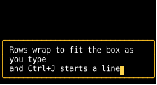
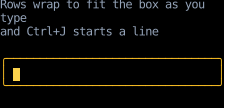
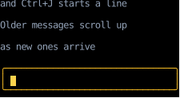
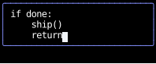
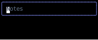
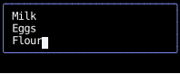
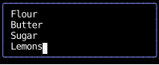

# `use_text_area`

`use_text_area` edits text that wraps onto rows:
it handles typing, deleting, moving the cursor along a row and between rows, and pasting,
and leaves drawing to the component that calls it.
It wraps the value itself, at the width the component gives it,
so the cursor moves between the rows the value is drawn on.
For a ready-made box, use [`text_area`](#a-styled-text-area), which is built on this hook.

This page covers the hook and that component.
Selection isn't supported yet.

## Using the hook

As with [`use_text_input`](use_text_input.md), the calling component owns the value and passes it with its setter,
and the hook owns the cursor and makes the component [focusable](../hooks/use_focus.md).
It also takes the `width` to wrap at,
which here is the content width that [`use_rects`](../hooks/use_rects.md) reports for the box.
The box gets its width from its parent, not from its text,
since the text is wrapped to fit it.
The hook returns the rows, joined by line breaks, split around the cursor,
so the component draws them with `text_wrap_none`, without wrapping them again:

<!-- example: text_area.py:hook -->

Enter isn't an edit, so it [bubbles](../input-handling/events.md#routing-input-events),
and here the composer takes it to send the draft.
Alt+Enter and Ctrl+J insert a line break:

Enter sends it, keeping its line break:

The conversation holds the messages and the draft together,
so `send` reads the latest draft from the conversation it updates,
rather than the draft this render saw, which misses keys typed since.

The messages are in a [scroll container](../layout/scrolling.md) that fills the space above the composer,
with [`stick_to_end_y`](../layout/scrolling.md#following-the-end), so it stays scrolled to the newest message,
and `justify_children_end`, so the first few messages sit just above the composer, as chats show them.
Older messages scroll up out of view, and the wheel scrolls back to them:

## Line breaks

Pass `enter_inserts_newline=True` for Enter to insert a line break, as in a text editor,
rather than bubble, as for a form or a chat that submits on Enter.
Alt+Enter and Ctrl+J insert one either way.
Shift+Enter can't stand in for them: most terminals send Shift+Enter as plain Enter,
so terminal programs that submit on Enter, chat prompts among them, take Alt+Enter for a new line.
Alt+Enter arrives from terminals that send Alt as an escape,
as [most do by default](../input-handling/events.md#keys-pressed-with-alt),
and Ctrl+J from all of them.

A paste keeps its line breaks, however they're written,
and expands each tab to spaces up to the next tab stop, every `tab_size` columns (4 by default),
counting the line's text before the cursor,
so pasted code keeps its indentation and the alignment of its columns:

Tab stops are counted in characters, as [`highlight`](../rich-text/syntax-highlighting.md) counts them,
so a wide character before a tab, such as `日`, pushes what follows one column further than a tab stop.
A browser's `<textarea>` keeps the tab, and CSS's `tab-size` sets how wide it's drawn;
counterweight's text is drawn without tab stops, so the paste expands them instead.

## How the text wraps

A row breaks after the last whitespace that fits, or wherever it fills when a word is wider than a row.
Rows are filled one at a time, as text editors fill them,
rather than evened out as [`text_wrap_pretty`](../styles/text-wrapping.md) evens out a paragraph,
so an edit rewraps its line only from the row above the cursor onward.
The whitespace at a break stays at the end of its row, taking its cells,
and a cell is kept after the end of each line,
so wherever the cursor is, there's a cell to draw it in:
a line that exactly fills its rows puts the cursor at its end on a row of its own.

## Keeping the cursor in view

A text area in a scroll container, such as one with a `max_height`, has to scroll as the cursor moves past its edge.
The hook returns a `cursor_row` [`ElementHandle`][counterweight.focus.ElementHandle]
for the element the component draws the cursor's row in,
and its handler returns [`ScrollIntoView`](../layout/scrolling.md#scrolling-an-element-into-view)
for that handle, with `block="nearest"`, for each key press and paste it handles.
That applies to the layout of the render the edit causes,
so the container scrolls in the same frame the cursor moves, and only as far as it takes,
as a browser's `<textarea>` scrolls to its caret.

The cursor starts at the end of the value, so give a scroll container that holds the rows
[`stick_to_end_y`](../layout/scrolling.md#following-the-end), which starts it scrolled to its end,
so the cursor is in view from the start, as a browser keeps a focused `<textarea>`'s caret in view,
rather than showing the top of a value that's already taller than the container.

To use it, draw the cursor's row as an element of its own and give it the handle.
`before_cursor` and `after_cursor` separate rows with line breaks,
so the rows above the cursor's are everything in `before_cursor` up to its last line break,
and the rows below are everything in `after_cursor` after its first.
The [styled text area](#a-styled-text-area) draws those as a `Text` each, around the cursor's row.
A component that draws all the rows in one element can leave out the handle,
and `ScrollIntoView` then scrolls nothing.

## Moving the cursor with a press

A click in a browser's `<textarea>` focuses it and puts the caret where it lands.
The hook can't know where the component draws the rows, so it returns a second handler, `on_press`,
for the element the rows are drawn in, from the top-left corner of its content box.
It reads a press of the left button as a cell of the rows, moved by that element's scroll if it's a scroll container,
puts the cursor on the character drawn across that cell, or at the end of the row past its text,
taking a press above the first row or below the last as one on that row,
and focuses the component.
The composer above draws its rows in the element it returns,
so it puts both handlers there: `first(field.on_input, field.on_press, on_enter)`.

## Keys

The keys are [`use_text_input`'s](use_text_input.md#keys), with these acting on rows:

| Key               | Edit                                                                           |
|-------------------|--------------------------------------------------------------------------------|
| Up, Ctrl+P        | Move to the row above, at the same column, or to the start from the first row  |
| Down, Ctrl+N      | Move to the row below, at the same column, or to the end from the last row     |
| Home              | Move to the start of the row                                                   |
| Ctrl+A            | Move to the start of the row, or to the start from the start of a row          |
| End               | Move to the end of the row                                                     |
| Ctrl+E            | Move to the end of the row, or to the end from the end of a row                |
| Ctrl+U            | Delete to the start of the row                                                 |
| Ctrl+K            | Delete to the end of the row                                                   |
| PageUp            | Move a page of rows up, at the same column, or to the start from the first row |
| PageDown          | Move a page of rows down, at the same column, or to the end from the last row  |
| Ctrl+J, Alt+Enter | Insert a line break                                                            |
| Enter             | Insert a line break, with `enter_inserts_newline=True`                         |

Up and Down keep aiming for the column they started from,
so the cursor comes back to it after passing through a shorter row.
The end of a row that wraps is the start of the next,
so End on one moves to its last character, usually the whitespace it wrapped at.
Left, Right, Backspace and Delete step over a line break as one character,
and the word keys treat it as whitespace.
Ctrl+T swaps characters within a line, so it does nothing at the start of one.

PageUp and PageDown move the cursor, as they move a browser's caret in a `<textarea>`,
rather than bubbling to a scroll container around the text area,
which would scroll the text area itself out of view.
When the element the handler is on is a [scroll container](../layout/scrolling.md),
a page is as many rows as [`scroll_on_keys`](../layout/scrolling.md#scrolling-with-the-keyboard) pages it by,
87.5% of the height of its view,
and the handler scrolls it by a page too, so the cursor stays where it was in the view.
When it isn't, its content box holds every row, so a page is 87.5% of that.

## Validating and transforming

The setter works as it does for [`use_text_input`](use_text_input.md#validating-and-transforming):
it's called with a function from the latest value to the edited one,
and wrapping it validates or transforms each edit.
The cursor stays where it is when the setter rejects an edit,
and moves to the end of the value when the value changes other than by an edit.

## A styled text area

[`text_area`][counterweight.widgets.text_area] draws a bordered box around the rows,
wrapped at the width of its box,
with the cursor highlighted while it's focused,
and takes focus when it's pressed, with the cursor where the press lands.
It takes the hook's parameters, other than `width`, a `placeholder` to show in an empty box,
a `style` merged over its own,
and [`styles`](index.md#styling-the-widgets) for its colors.
It's as wide as its parent or its `style` makes it, and grows to fit its rows,
up to a `max_height` in its `style`, even in a column too short for everything in it:

<!-- example: text_area.py:widget -->

Past its `max_height` it scrolls, [keeping the cursor in view](#keeping-the-cursor-in-view),
and the wheel scrolls it too.
It starts scrolled to its end, where the cursor starts:

## API

::: counterweight.headless.use_text_area
::: counterweight.headless.TextArea
::: counterweight.widgets.text_area
