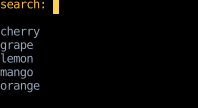
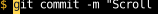
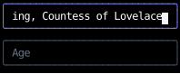

# `use_text_input`

`use_text_input` edits one line of text: it handles typing, deleting, moving the cursor, and pasting,
and leaves drawing to the component that calls it, as [Headless UI](https://headlessui.com/)
and [React Aria](https://react-spectrum.adobe.com/react-aria/hooks.html) do for the web.
The component styles the text and the cursor however it likes,
in whatever layout it's part of.
For a ready-made box, use [`text_input`](#a-styled-text-input), which is built on this hook.

This page covers the hook and that component.
For text that wraps onto rows, use [`use_text_area`](use_text_area.md).
Selection isn't supported yet.

## Using the hook

The calling component owns the value, as with React's controlled `<input>`,
and passes it to the hook with its setter.
The hook owns the cursor, makes the component [focusable](../hooks/use_focus.md),
and returns the value split around the cursor, with the handler that edits it:

<!-- example: text_input.py:hook -->

`before_cursor`, `at_cursor` and `after_cursor` together are the value,
except that `at_cursor` is a space when the cursor is at the end of the value,
so there's always a cell to draw the cursor in.
The hook also returns `cursor`, the cursor's offset into the value in code points,
so `value[:cursor]` is the text before it.
Here the cursor is a highlighted cell, drawn only while the search box is focused:

Typing edits the value, and the list below it re-renders from the new value:

Left, three times, moves the cursor back between the `m` and the `n` of `mngo`,
and an `a` typed there lands at the cursor:

Put `field.on_input` on the element the component returns, which is the one that's focused.
The handler ignores everything while that element isn't focused,
and returns `None` for the keys it doesn't edit with, such as Enter, Tab, Up and Down,
so they [bubble](../input-handling/events.md#routing-input-events) on to a form that submits on Enter
or moves focus on Tab.
Here the search takes Up and Down as they bubble past the box,
and [scrolls](../layout/scrolling.md#scrolling-from-a-handler) the list of matches,
which is at most five rows tall:

Compose it with [`focus_receiver_on_press`](../input-handling/handlers.md#focus)
for the component to take focus when it's pressed,
and with handlers of your own:
`first(field.on_input, on_enter)` handles a key the field passes on,
and `first(on_ctrl_k, field.on_input)` takes over a key the field would handle.

## Moving the cursor with a press

A click in a browser's `<input>` focuses it and puts the caret where it lands.
The hook can't know where the component draws the value, so it returns a second handler, `on_press`,
for the element the value is drawn in, which may be inside the one the component returns.
It reads a press of the left button as a cell of the value,
counted from the left edge of that element's content box and moved by its scroll if it's a scroll container,
puts the cursor on the character drawn across that cell, or at the end of the value past it,
and focuses the component.
In the [command line](#scrolling-a-long-value) below,
it's on the row that scrolls the value rather than on the one that holds the `$ ` prompt too.

## Scrolling a long value

A browser's `<input>` scrolls a value wider than the box sideways, keeping the caret in view.
The hook does its part of that: it returns a `cursor_cell` [element handle](../layout/scrolling.md#scrolling-from-a-handler)
(an `ElementHandle`, which names an element, unlike the focus handle the hook's `handle` parameter takes),
and its handler returns [`ScrollIntoView`](../layout/scrolling.md#scrolling-an-element-into-view)
for that handle, with `block="nearest"` and `inline="nearest"`, for each key press and paste it handles.
The control applies to the layout of the render the edit causes,
so the value scrolls in the same frame the cursor moves, and only as far as it takes.

To use it, draw `at_cursor` as an element of its own, give it the handle,
and put the three parts in a row that scrolls sideways,
with `text_wrap_none` so none of them wraps.
Draw a cell after the value while the cursor is off its end,
so the value is as wide wherever the cursor is,
and doesn't move under the pointer when a press takes the cursor off the end:

<!-- example: text_input.py:scrolling -->

Home moves the cursor to the start, and the row scrolls back to it:

The cursor starts at the end of the value, so the row has [`stick_to_end_x`](../layout/scrolling.md#following-the-end),
which starts it scrolled to its end when the value is already wider than the box.
The same `ScrollIntoView` scrolls every scroll container above the cell,
so a field in a scrolling form comes back into view as soon as you type in it.
A component that draws the value in one element can leave out the handle,
and `ScrollIntoView` then scrolls nothing.

## Keys

The handler follows [Readline](https://tiswww.case.edu/php/chet/readline/readline.html)'s default bindings,
which most terminal programs share:

| Key                            | Edit                                                                     |
|--------------------------------|--------------------------------------------------------------------------|
| Text                           | Insert it at the cursor                                                  |
| Left, Ctrl+B                   | Move one character left                                                  |
| Right, Ctrl+F                  | Move one character right                                                 |
| Home, Ctrl+A, Ctrl+Home        | Move to the start                                                        |
| End, Ctrl+E, Ctrl+End          | Move to the end                                                          |
| Ctrl+Left, Alt+Left, Alt+B     | Move to the start of this word or the previous one                       |
| Ctrl+Right, Alt+Right, Alt+F   | Move to the end of this word or the next one                             |
| Backspace                      | Delete the character before the cursor                                   |
| Delete, Ctrl+D                 | Delete the character at the cursor                                       |
| Ctrl+W                         | Delete back to the start of the whitespace-separated word                |
| Alt+Backspace                  | Delete back to the start of this word or the previous one                |
| Ctrl+Delete, Alt+Delete, Alt+D | Delete to the end of this word or the next one                           |
| Ctrl+U                         | Delete to the start                                                      |
| Ctrl+K                         | Delete to the end                                                        |
| Ctrl+T                         | Swap the characters before and at the cursor, or the last two at the end |

A character is a grapheme cluster, so the cursor steps over an emoji or an accented letter whole.
A word is a run of letters and digits,
so Alt+Backspace stops at punctuation, as Readline's `backward-kill-word` does,
where Ctrl+W, its `unix-word-rubout`, deletes back to whitespace: from the end of `cd ../src`,
Alt+Backspace leaves `cd ../` and Ctrl+W leaves `cd `.
The Alt keys arrive from terminals that send Alt as an escape,
as [most do by default](../input-handling/events.md#keys-pressed-with-alt).
Alt+Enter isn't an edit, so it bubbles as Enter does, as `Key.AltEnter`.

A paste inserts its text in one edit, with each line break and tab turned into a space
and any other control characters dropped,
on terminals that support [bracketed paste](../input-handling/events.md#handling-pastes).
On others, the pasted text arrives as typed keys, and its line breaks arrive as Enter,
or as Ctrl+J from a terminal that sends them as line feeds.

## Validating and transforming

The setter that `use_text_input` takes is called with a function from the latest value to the edited one,
rather than with the edited value.
Several key presses can arrive between renders, as when typing fast,
and each edit has to apply to the result of the one before,
which the value the component rendered with doesn't have yet.
A [`use_state`](../hooks/use_state.md) setter takes such a function and applies it right away.

To validate or transform an edit, wrap the setter in one that applies the edit itself
and decides what to keep.
This one keeps only digits:

<!-- example: text_input.py:widget -->

Typing `3x6` into the age field gives `36`, since the `x` would have made the value something other than digits:

The cursor stays where it is when the setter rejects an edit,
and when the value changes other than by an edit,
such as when a form clears it after submitting or fills in an earlier entry,
the cursor moves to the end of the new value.

## A styled text input

[`text_input`][counterweight.widgets.text_input] draws a bordered box around the value,
with the cursor highlighted while it's focused,
and takes focus when it's pressed, with the cursor where the press lands.
It takes the hook's parameters, a `placeholder` to show in an empty box,
a `style` merged over its own, such as a `width`,
and [`styles`](index.md#styling-the-widgets) for its colors.
The sign-up form above uses it, and shows its placeholders when it starts:

A value wider than the box [scrolls](#scrolling-a-long-value) inside its border, keeping the cursor in view:

Like an `<input>`, it doesn't grow to fit its value:
beside other elements in a row, it shrinks to fit, and scrolls.

## API

::: counterweight.headless.use_text_input
::: counterweight.headless.TextInput
::: counterweight.widgets.text_input
