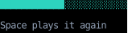
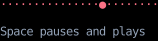

# Animation

Two hooks built on [`use_clock`](use_clock.md) give a component an animation's progress,
a number from 0 to 1 it draws whatever it likes from:
[`use_progress`][counterweight.hooks.use_progress] plays once and holds at its end,
and [`use_loop`][counterweight.hooks.use_loop] repeats.
`counterweight.animation` holds the pure half:
CSS's easing functions, which shape how an animation moves,
and `between`, which picks one phase out of an animation, as a keyframe does.

A browser animates a property for you, given a CSS animation or transition.
Here the component computes each frame itself, from the progress the hook returns,
so anything it can compute from a number can move:
a bar's length, a character's position, a gradient's angle.

## Playing once

`use_progress(duration)` rises from 0 when the component mounts to 1 once `duration` has passed,
and holds there, as a CSS animation that plays once and fills forwards does:

<!-- example: animation.py:progress -->

It starts again whenever one of its `deps` changes, compared with `==` as `use_effect`'s are,
so a component that stays mounted can play it more than once.
Giving the component a new key, which remounts it, starts it again too.

<!-- cast: animation-progress -->

Once it reaches 1, it stops reading the clock,
so a finished animation costs nothing, and never re-runs its component.
A `duration` of zero is at 1 at once, so a component can skip its animation,
as a thumbnail that shows only the last frame would.

## Easing

The progress rises at a steady rate.
Pass it through an [`Easing`][counterweight.animation.Easing] to shape the motion,
as the bar above does with `ease_in_out`.
These are CSS's:

- `linear`, a steady rate, and `piecewise_linear`, straight lines between stops, as CSS's `linear()` function draws.
- `cubic_bezier`, a curve through two control points, as CSS's `cubic-bezier()`,
  and the curves CSS names: `ease`, `ease_in`, `ease_out` and `ease_in_out`.
  A control point's `y` outside 0 to 1 overshoots, going past the end and coming back.
- `steps`, which moves in equal jumps, as CSS's `steps()`,
  and `step_start` and `step_end`, which jump once.

An easing is any function from a float to a float, so a curve CSS doesn't name, such as `lambda t: t**3`, is one too.

Something moving whole, such as a box sliding into place, usually looks best eased in and out.
Something that happens at a steady rate, such as typing or a sweep, usually looks best not eased at all,
since its pace is part of what it shows.

## Phases

One animation can run several motions one after another, or overlapping.
`between(progress, start, stop)` is how far `progress` is through the part from `start` to `stop`:
0 before it, 1 after it, as a CSS keyframe's offsets pick out a phase.
Each phase can take its own easing:

<!-- example: animation.py:phases -->

<!-- cast: animation-phases -->

## Looping

`use_loop(period)` is where in an animation that repeats every `period` the component is, from 0 up to 1,
as a CSS animation whose iteration count is `infinite` is.
For one that goes there and back, as `animation-direction: alternate` does,
fold the loop's progress in half:

<!-- example: animation.py:loop -->

With `is_playing=False`, the loop stops reading the clock and holds where it is,
at 0 if it has never played.
Unlike a paused CSS animation, it doesn't resume from where it stopped:
it carries on from wherever the time since it started puts it,
so the dot here jumps ahead when it plays again.
Like `use_progress`, it starts again from 0 whenever one of its `deps` changes.

<!-- cast: animation-loop -->

## Frames

While an animation moves, its hook reads the clock every `interval`,
[`FRAME_INTERVAL`][counterweight.animation.FRAME_INTERVAL] unless it's given another,
which is 20 frames a second.
Each frame re-runs the component that calls the hook, and nothing else,
so call it in the component that draws the animation,
not in one that also renders things that don't change with it
(see [Performance](../performance.md#which-components-run-in-a-frame)).

Every animation counts from when it started, on the app's clock,
so on a [`FrozenClock`][counterweight.clock.FrozenClock] it moves only when an autopilot moves the clock.
[`advance`][counterweight.autopilot.advance] moves it on a frame at a time,
so a recording or a test shows each frame rather than jumping to the end,
as the recordings on this page do (see [Autopilot and Recording](../autopilot.md#controlling-time)).

## API

::: counterweight.hooks.use_progress
::: counterweight.hooks.use_loop
::: counterweight.animation.Easing
::: counterweight.animation.FRAME_INTERVAL
::: counterweight.animation.linear
::: counterweight.animation.piecewise_linear
::: counterweight.animation.cubic_bezier
::: counterweight.animation.ease
::: counterweight.animation.ease_in
::: counterweight.animation.ease_out
::: counterweight.animation.ease_in_out
::: counterweight.animation.steps
::: counterweight.animation.StepPosition
::: counterweight.animation.step_start
::: counterweight.animation.step_end
::: counterweight.animation.between
