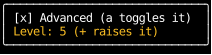

# Hooks

Counterweight uses "hooks",
inspired by [React hooks](https://react.dev/reference/react/hooks),
to manage state and side effects in components.
The [headless components](../headless/index.md), such as `use_text_input`,
are hooks too, built on these, that give a component a common control's behavior.

A component MUST call the same hooks in the same order on every render,
because each hook finds its state by its position in that order.
Don't call a hook inside a condition, a loop whose length can change, or after an early return.
A render that calls a different hook at some position,
or a different number of hooks than the previous render,
raises `InconsistentHookExecution`.

When a component seems to need a hook only some of the time, or one hook per item,
move that hook down into a child component that owns it.
A parent can't conditionally call a hook, but it can conditionally render a component,
and each component has its own hooks.

```python
from counterweight.components import component
from counterweight.elements import Div
from counterweight.hooks import use_state


@component
def settings() -> Div:
    is_advanced, set_advanced = use_state(False)
    if is_advanced:
        level, set_level = use_state(3)  # wrong: raises when is_advanced changes
    ...
```

Here the hook moves into an `advanced_settings` component,
which `settings` renders only when it's needed:

<!-- example: use_state_advanced_settings.py:example -->

`advanced_settings` takes [focus](use_focus.md) as it mounts, so it receives `+`,
and `a`, which it doesn't handle, bubbles up from it to `settings`.



Showing `advanced_settings` mounts it with fresh state, and hiding it unmounts it,
which discards that state.
Here the level is raised to 5, and hiding and showing the advanced settings starts it over at 3:

<!-- cast: use-state-advanced-settings -->

If the state should outlive the child, keep it in the parent and pass it down instead.

The same move handles a hook per item:
render a component per item, rather than calling the hook in a loop over the items.
See [Components](../components/index.md#when-position-isnt-identity)
for how to key those components so each one's state follows its item.
