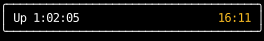

# `use_clock`

`use_clock` gives a component the time, so it can show a clock, an uptime, or a timer
while staying [pure](../components/index.md#keeping-components-pure).
A component that reads the time any other way, such as with `datetime.now()`,
keeps showing the time from whenever it last ran.

```python
--8<-- "use_clock_status_bar.py:example"
```



## Ticks

Each call reads the clock every `interval`.
A component takes a reading when it mounts,
and again on its first render after each new tick starts,
re-running then if nothing else made it.
Every render in between gets the same reading,
so re-running the component for any other reason doesn't change what it shows.

Ticks start at whole multiples of `interval` on the wall clock,
so `wall_clock` re-runs as the minute turns, along with `uptime`,
rather than a minute after the app started.
Components that take a reading in the same frame get the same one,
so two clocks on screen never disagree.

Each tick re-runs the components that read the clock and nothing else,
so call `use_clock` in the component that shows the time,
not in one that also renders things that don't change with it.
See [Performance](../performance.md#which-components-run-in-a-frame).

## Timing from an event

`since_mount` is how long the component has been mounted.
To time something from an event, such as a key press,
render a component that reads the clock and give it a new key when the event happens,
which remounts it and starts its `since_mount` again from zero:

```python
--8<-- "use_clock_lap_timer.py:example"
```


A handler sees the reading from the latest tick,
so a time it records, such as the lap time when a lap ends, is up to one `interval` early.
Choose an `interval` as fine as the precision the time needs.
A timer that can be paused and resumed loses up to that much on each pause,
since it carries the time recorded at the pause into the next run.

## Why compute from elapsed time?

Compute whatever changes over time, such as an animation frame or a countdown,
from `since_mount` or `since_start`.
Don't keep a running total in state and add to it each tick:

```python
@component
def spinner() -> Text:
    frame, set_frame = use_state(0)

    async def step() -> None:
        while True:
            await sleep(0.1)
            set_frame(lambda frame: frame + 1)  # wrong: falls further behind each step

    use_effect(step, deps=())

    return Text(content="|/-\\"[frame % 4])
```

Each step counts a full interval, but takes longer:
`sleep` wakes up late, and a render and any other work run before the next step starts.
The total falls behind the real elapsed time by a little more each step, and the gap only grows.
Measured on an otherwise idle event loop, steps of 10 ms counted 2 seconds when 2.05 had passed.
Adding up the real time between steps instead fixes the drift,
but anything that misses a step or repeats one, such as an effect that restarts, still breaks the total.

Elapsed time from `use_clock` is the difference between two readings of a monotonic clock,
so a value computed from it can't drift, however long the component runs:

```python
@component
def spinner() -> Text:
    frame = use_clock(timedelta(milliseconds=100)).since_mount // timedelta(milliseconds=100)
    return Text(content="|/-\\"[frame % 4])
```

It also needs no state or effect, so a tick re-renders once instead of twice.

## Testing

Pass a [`frozen_clock`][counterweight.clock.frozen_clock] to `app` to fix the time,
and move it on with [`AdvanceClock`][counterweight.controls.AdvanceClock] in the autopilot,
so a test or a screenshot doesn't depend on when it runs or how long it takes:

```python
async def test_the_lap_timer_counts_from_the_last_lap() -> None:
    await app(
        lap_timer(),
        headless=True,
        clock=frozen_clock(datetime(2026, 3, 14, 15, 9, 26)),
        autopilot=[
            AdvanceClock(by=timedelta(seconds=75)),
            KeyPressed(key=Key.Space),
            AdvanceClock(by=timedelta(seconds=42)),
            Screenshot.to_file(Path("lap-timer.txt")),
            Quit(),
        ],
        check_purity=True,
    )
```

## API

::: counterweight.hooks.use_clock
::: counterweight.hooks.Tick
::: counterweight.clock.frozen_clock
::: counterweight.clock.system_clock
::: counterweight.clock.Instant
