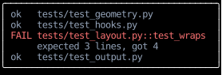

# `use_controls`

An input handler acts on the app by returning [controls](../input-handling/controls.md),
but an effect, or a callback that a program or a timer calls, has no event to return them for.
`use_controls` gives a component a sender that hands the app a control from anywhere.
Here an effect scrolls a test run's first failure into view once the log has rendered,
as a React effect calls `scrollIntoView` on an element through a ref:

<!-- example: use_controls_first_error.py:example -->

The log opens with its failure in the middle of the view, rather than at its start, where the failure would be out of sight.
The effect depends on `failure_index`, so it scrolls again only when a different line is the first failure,
and leaves the log where the reader scrolled it otherwise.

The [multiplexer](https://github.com/JoshKarpel/counterweight/blob/main/src/counterweight/examples/apps/multiplexer.py) example
sends `Quit` when its last pane's shell exits,
and moves focus with `FocusNext` when the focused pane's shell exits.

The app handles a sent control as it handles one a handler returns, after the events already waiting,
so state set just before sending it changes the same frame the control does.
Every render returns an equal sender, so it can be left out of an effect's `deps`.

## API

::: counterweight.hooks.use_controls
::: counterweight.hooks.ControlSender
