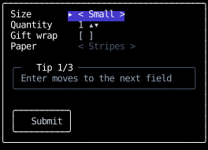
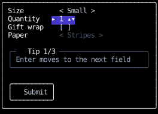
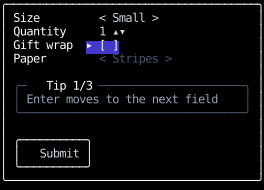
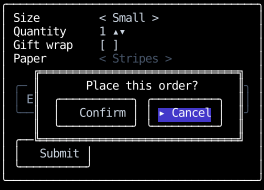
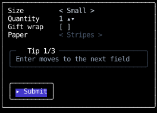
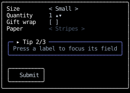

# `use_focus`

Each key press goes to one element: the **focused** one.
A component becomes focusable by calling `use_focus`,
and when it's focused, its top-level element, the one it returns,
receives every key press first.
The key then [bubbles](../input-handling/events.md#routing-input-events) to that element's ancestors,
until a handler returns something other than `None`.
When nothing is focused, key presses go to the root component's element alone.

This page covers making components focusable and moving focus between them.
How a key press travels once it reaches the focused element is on the [Events](../input-handling/events.md) page.

## Making a component focusable

```python
@component
def counter() -> Text:
    focus = use_focus(auto_focus=True)
    count, set_count = use_state(0)

    def on_input(event: InputEvent, _: Receiver) -> InputResponse:
        match event:
            case KeyPressed(key=Key.Up):
                set_count(count + 1)
                return ()
            case _:
                return None

    return Text(
        content=str(count),
        style=text_bg("indigo", 700) if focus.is_focused else default,
        on_input=on_input,
    )
```

`focus.is_focused` says whether the component is focused,
so it can draw a focus ring, and `auto_focus=True` focuses it when it mounts while nothing else is focused.

Put a focusable component's key handler on the element it returns.
Elements inside that one never receive key presses,
since they're descendants of the focused element rather than ancestors.
For the same reason, a component deep in the tree can't own a global shortcut:
a help overlay toggled with `?` puts that binding on the root component's element,
or on an ancestor of whatever is focused, which every key press bubbles through
unless a handler below it stops it.

## An example

This order form uses every way focus moves.
Its fields take keys rather than text:
the size and the wrapping paper cycle with Left and Right,
the quantity steps with Up and Down, and gift wrap toggles with Space.

```python
--8 < --"focus_form.py:example"
```

The first field takes focus at startup, with `auto_focus=True`:



Enter moves to the next field.
No field handles Enter, so it bubbles to the form's element,
whose handler returns `FocusNext(within=receiver.subtree)`:



Each label focuses its field with `focus_on_press`,
and a handle the form keeps in `use_state(FocusHandle)` and passes to both:



With gift wrap off, the wrapping paper field passes `is_focusable=False`, so Enter skips it,
and the help panel passes `in_focus_order=False`, so Enter skips that too, and lands on the submit button:


The submit button handles Enter itself, so the form never sees it.
It opens a confirmation dialog and returns `ClearFocus()`,
so the dialog's Cancel button, which passes `auto_focus=True`, takes focus as it mounts:



The dialog's element has `tab_focus`, so Tab from either of its buttons moves only between them:
two presses of Tab wrap back to Cancel.


Enter on Cancel closes the dialog and returns `FocusOn` with the submit button's handle,
which the form passes to both the button and the dialog:



A press on the help panel focuses it, through `focus_receiver_on_press`,
though Enter and Tab never stop on it, and Right then shows its next tip:



## Moving focus

Focus moves only through [controls](../input-handling/controls.md), `auto_focus`,
and the focused component going away.
No key or press does anything to focus unless a handler on its path returns a control that does:

- [`FocusNext`][counterweight.controls.FocusNext] and [`FocusPrevious`][counterweight.controls.FocusPrevious]
  move to the next or previous component in the focus order, which is tree order,
  wrapping at the ends.
- [`FocusOn`][counterweight.controls.FocusOn] focuses the component with a given [handle](#focusing-a-component-you-render).
- [`ClearFocus`][counterweight.controls.ClearFocus] clears focus, so key presses go to the root component's element.

The [library handlers](../input-handling/handlers.md#focus) return these for the common bindings:
`tab_focus` for Tab and Shift+Tab, `focus_receiver_on_press` and `focus_on_press` for a press,
and `clear_focus` for a press that should blur.
An app without `tab_focus` on some element has no Tab navigation,
and a focusable component without `focus_receiver_on_press` doesn't take focus when it's clicked.
An app that wants Escape to clear focus binds it to `ClearFocus()` on its root.

Focus also changes when a render leaves the focused component unable to keep it.
Unmounting it, hiding it, or making it [unfocusable](#taking-a-component-out-of-focus) clears focus,
rather than moving it to whichever component took the departed one's place.
A component that mounts with `auto_focus=True` in the same render can then take focus.

Wherever focus moves, the newly focused component's element is
[scrolled into view](../layout/scrolling.md#scrolling-an-element-into-view) in any scroll container it's in,
by as little as it takes, as browsers do.

## Focusing a component you render

A [`FocusHandle`][counterweight.focus.FocusHandle] names a focusable component for `FocusOn`.
`use_focus` creates one on the component's first render and keeps it,
but a parent that needs to focus a child it renders creates the handle itself, before the child mounts,
and passes it down:

```python
@component
def labelled_input(label: str) -> Div:
    input_handle, _ = use_state(FocusHandle)
    return Div(
        children=(
            Text(content=label, on_input=focus_on_press(input_handle)),
            text_input(focus_handle=input_handle),
        ),
    )
```

A child that can be focused from outside takes a `FocusHandle | None` parameter and passes it to `use_focus`.
Keep the handle in `use_state`: one built with `FocusHandle()` on every render
makes `use_focus` raise `ChangedFocusHandle` on the second.
Two mounted components given the same handle raise `DuplicateFocusHandle`.
The handle never changes while the component is mounted, so it's safe in an effect's `deps`.

## Moving focus within part of the tree

`FocusNext` and `FocusPrevious` take `within`, a [`Subtree`][counterweight.focus.Subtree]
that limits them to the focusable components inside one element, including the element itself.
A handler gets its own element's from its receiver, as `receiver.subtree`.
From focus outside the subtree, they go to its first or last focusable component.

`tab_focus` passes its receiver's subtree,
so on the root component's element it moves through the whole tree,
and on a dialog's element, which Tab from a field inside the dialog bubbles to first,
it keeps Tab inside the dialog.
A form that moves to its next field on Enter does the same thing for Enter,
from its own element's handler.

A dialog traps Tab and nothing else.
A press beside it still reaches whatever is drawn there,
and if focus clears while the dialog is open, because its focused field unmounted,
key presses go to the root, whose `tab_focus` can move focus out of the dialog.

## Taking a component out of focus

Two parameters take a mounted, visible component partly or wholly out of focus,
each like a browser attribute:

- `is_focusable=False` makes it unfocusable, like `disabled`,
  for a field that's disabled until another is filled in.
  Nothing can focus it, and if it's focused, focus clears.
  It still receives the mouse events routed to it,
  so a press on it is still claimed by its `focus_receiver_on_press`, which then does nothing.
- `in_focus_order=False` takes it out of the focus order only, like `tabindex="-1"`,
  for a component that should take focus when it's pressed or named, but isn't a Tab stop.
  `FocusNext` and `FocusPrevious` skip it,
  while `FocusOn`, `auto_focus` and a press still focus it, and it keeps focus once it has it.
  From it, `FocusNext` and `FocusPrevious` move to its neighbors in tree order.

Either way the component keeps its handle and its place in tree order,
so it's back in the focus order where it was when the parameter flips back,
though making a component focusable again doesn't focus it.
They're parameters, rather than a `use_focus` call to skip,
because a component [can't call a hook conditionally](index.md).

## When focus changes

Every key press in a batch of input is routed with the focus as it is when it arrives,
so a Tab followed by a letter delivers the letter to the newly focused component.
A key press that mounts an `auto_focus` component doesn't send the next key press in its batch there,
since the component doesn't exist until the next render.

A control that moves focus re-renders the components that gained and lost focus, as a state change would,
so `is_focused` is current on the next frame.
When a render moves focus itself, to an `auto_focus` component that mounted,
or away from a focused component that unmounted, hid, or became unfocusable,
the components that gained and lost focus re-render before the frame is drawn,
so an `auto_focus` component is focused in the first frame that shows it.
An `auto_focus` component that hides itself because it gained focus would move focus again,
so it raises `UnsettledFocus` instead.
One that a control focuses and that hides itself because it gained focus loses focus in the same render,
like any focused component that hides, and is drawn unfocused.

## API

::: counterweight.hooks.use_focus
::: counterweight.hooks.Focus
::: counterweight.focus.FocusHandle
::: counterweight.focus.Subtree
