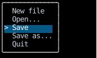
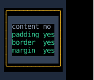

# `use_hovered`

`use_hovered` tells a component whether the mouse is over the element it returns,
as CSS's [`:hover`](https://developer.mozilla.org/en-US/docs/Web/CSS/:hover) does,
so it can highlight itself under the pointer:

<!-- example: use_hovered.py:menu -->

The highlight follows the pointer down the menu, and goes away when the pointer leaves it:

<!-- cast: use-hovered-menu -->

## Which box the mouse is in

[`Hovered`][counterweight.hooks.Hovered] reports each of the element's boxes,
from its content box out to its margin box, so a component can tell the mouse over its border from the mouse over its content.
Each box holds the ones inside it, so the mouse in the content box is in all four:

<!-- example: use_hovered.py:boxes -->

Here the pointer crosses the margin, the border and the padding into the content, then leaves through the bottom:

<!-- cast: use-hovered-boxes -->

Only the parts of the element that are painted count:
the mouse over a part of it that an ancestor clips away, such as a row scrolled out of a scroll container,
is outside all four boxes
(see [Clipping and the mouse](../layout/clipping.md#clipping-and-the-mouse)).

## When it renders again

`use_hovered` is built on [`use_mouse`](use_mouse.md) and [`use_rects`](use_rects.md),
so a component that calls it renders again on every move of the mouse, wherever it is on the screen,
and whenever its boxes move.
It checks the mouse against the boxes as the last layout placed them,
and renders again before a frame that moves them is painted, as `use_rects` does,
so it checks against where the boxes are drawn.

## API

::: counterweight.hooks.use_hovered
::: counterweight.hooks.Hovered
