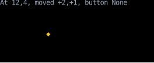
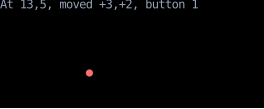

# `use_mouse`

`use_mouse` gives a component the state of the mouse wherever it is on the screen:
where it is, how far it just moved, and which button is held.
Each mouse move or press renders the component again with the new state.

<!-- example: use_mouse.py:example -->

=== "Moving"

    

=== "With a button held"

    

The marker follows the pointer, and turns into a dot while a button is held:

<!-- cast: use-mouse -->

`absolute` counts cells from the top-left corner of the screen, whatever component reads it.
To find the mouse within an element, subtract the element's position from [`use_rects`](use_rects.md),
as in `mouse.absolute - rects.content.top_left`.
Until the mouse first moves over the app, `absolute` is `Position(-1, -1)`, off the screen,
which is why `pointer` checks `is_on_screen` before drawing the marker.

Every component that calls `use_mouse` renders again on every move of the mouse, wherever it is,
so call it in the small component that shows the mouse, not in one that renders much else.
To know only whether the mouse is over a component, use [`use_hovered`](use_hovered.md).

!!! tip "`use_mouse` vs. `on_input`"

    `use_mouse` and an element's `on_input` handler both see the mouse, but `use_mouse` is a hook and `on_input` is an event handler.
    `use_mouse` is more efficient when a component depends only on the *current* state of the mouse
    (e.g., the current position, or whether a button is currently pressed),
    while `on_input` is more convenient when a component needs to respond to *changes* in the mouse state,
    (e.g., a button release ([`MouseUp`][counterweight.events.MouseUp]).
    `use_mouse` sees every change, while a handler sees only the events
    [routed](../input-handling/events.md#routing-input-events) to its element.
    See the [draggable components recipe](../cookbook/draggable-components.md) for a handler that follows the mouse.

## API

::: counterweight.hooks.use_mouse
::: counterweight.hooks.Mouse
