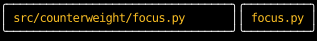

# `use_rects`

`use_rects` tells a component where the element it returns is on the screen,
as [`Rects`][counterweight.geometry.Rects]: the regions of its content, padding, border and margin boxes,
and how much of it its ancestors' clips leave visible.
A component can fit what it shows to the space layout gives it,
as a CSS [container query](https://developer.mozilla.org/en-US/docs/Web/CSS/CSS_containment/Container_queries) does.
Here each label shortens a path to fit its own width:

<!-- example: use_rects_path_label.py:example -->

Left and Right move the border between the panes, and each label follows its pane's width:

<!-- cast: use-rects-path-label -->

The label's width comes from its pane, never from its text, so the path it shows can't change the width it reads.
`full_width` stretches it across its pane, and `min_width(0)` lets it be narrower than its text
(see [Content sets a minimum size](../layout/how-layout-sizes-things.md#content-sets-a-minimum-size)).

!!! tip "Use `use_hovered` for detecting hover state"

    `use_rects` is a low-level hook.
    For the common use case of detecting whether the mouse is hovering over an element,
    use the higher-level [`use_hovered`](./use_hovered.md) hook instead.

## Measuring another element

Given an [`ElementHandle`][counterweight.focus.ElementHandle], `use_rects` reports the rectangles of the element
with that handle instead of the calling component's own top-level element,
as a React component measures an element through a ref and a `ResizeObserver`.
That's how a component measures an element a child component draws,
such as the viewport of a [`scroll_area`](../headless/use_scroll_area.md) it passes the handle to as `viewport`.
The handle comes from `use_state(ElementHandle)`, so it's the same on every render.
A handle that named no visible element in the previous render reports empty rectangles,
as the first render does.

## When it renders again

`use_rects` reports the previous frame's rectangles,
and a component that calls it renders again as soon as any of the rectangles it read move,
whether its own state changed or something else, such as a sibling growing, moved them.
In the example, a key press moves the border between the panes in one frame,
and the labels fit their new widths in the next.
A component whose size depends on the rectangles it reads should settle:
one that grows whenever it reads its own size renders without end.

## API

::: counterweight.hooks.use_rects
::: counterweight.geometry.Rects
::: counterweight.geometry.Region
::: counterweight.geometry.Position
