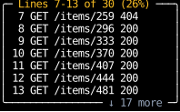

# `use_scroll`

`use_scroll` tells a component how far a [scroll container](../layout/scrolling.md) is scrolled,
how far it can be, and how much of its content is in view, as a [`Scroll`][counterweight.geometry.Scroll],
which holds what the web's `scrollTop`, `scrollHeight` and `clientHeight` say.
Counterweight draws no scrollbars, so this is how a component shows the reader where they are.
Here the title counts the lines in view, and the bottom border counts the lines below them:

<!-- example: use_scroll_position.py:example -->

As the wheel scrolls the log down and back up, the counts follow:

<!-- cast: use-scroll-position -->

The labels sit on the box around the log, not in the log itself,
since a scroll container moves everything inside it by its offset.
So `document` gives the log an [`ElementHandle`][counterweight.focus.ElementHandle] and reads its scroll with `use_scroll(body)`.
Called without a handle, `use_scroll` reports on the calling component's own top-level element.

`max_offset` is how far the content reaches past the view, so it's 0 when everything fits,
which is why `percent` checks it before dividing.

`use_scroll` reports the previous frame's scroll,
and a component that calls it renders again as soon as that scroll changes,
so the counts catch up in the frame after the one the wheel scrolled.
See [Scrolling](../layout/scrolling.md#reading-the-scroll) for an example that renders only the rows in view,
and [Jumping to the end](../layout/scrolling.md#jumping-to-the-end) for a button that appears once the reader scrolls back.

## API

::: counterweight.hooks.use_scroll
::: counterweight.geometry.Scroll
