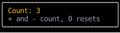
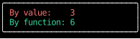

# `use_state`

`use_state` gives a component a value that persists across renders, and a setter that changes it.
Setting a different value re-renders the component.

<!-- example: use_state_counter.py:counter -->



Each key press sets the count, which renders `counter` again with the new value:

<!-- cast: use-state-counter -->

`+` and `-` pass the setter a function, since the new count depends on the old one
(see [below](#updating-state-from-its-previous-value)),
and `0` passes it a value, since the reset doesn't.

## Updating state from its previous value

!!! danger "When the new state depends on the old, pass the setter a function"

    `count` is the value as of the render that built the handler,
    and nothing updates it until the next render.
    A setter given a value replaces the state with it,
    so every update computed from `count` before the next render starts from the same stale `count`,
    and only the last one survives. No error is raised: the other updates just vanish.

    Given a function, the setter calls it right away with the latest state, updates included,
    and stores what it returns:

    <!-- fmt: off -->

    ```python
    set_count(count + 1)            # wrong: loses updates made since this render
    set_count(lambda c: c + 1)      # right: builds on the latest state
    ```

    <!-- fmt: on -->

Several updates can land before the next render in ways that are easy to miss,
because each looks like one update when you read the code.

**Two updates in one handler.**
Each `by_value + 1` is computed from the same `by_value`,
while each function builds on what the one before it returned:

<!-- example: use_state_counter.py:twice -->



After three presses of `+`, `by_value` has gone up by one a press, and `by_function` by two.

**Key presses that arrive together.**
Counterweight routes every event it has read before rendering again,
and a terminal delivers keys together whenever they come faster than one per frame:
fast typing, a held key repeating,
or text pasted into a terminal without [bracketed paste](../input-handling/events.md#handling-pastes).
Each key press's handler sees the same `text`:

```python
text, set_text = use_state("")


def on_input(event: InputEvent, _: Receiver) -> InputResponse:
    match event:
        case KeyPressed(key=key) if len(key) == 1:
            set_text(text + key)  # "abc" typed in one burst leaves text as "c"
            return ()
        case _:
            return None
```

This one hides from tests:
an `autopilot` renders after each event it sends, so every key press there sees the latest `text`,
and so does slow typing by hand.
Write `set_text(lambda t: t + key)`.
For a text field, [`use_text_input`](../headless/use_text_input.md) does this for you,
along with the cursor, the editing keys and pastes.

**An effect that outlives its render.**
An effect closes over the values from the render that started it,
and one with `deps=()` keeps them for as long as the component is mounted:

```python
count, set_count = use_state(0)


async def tick() -> None:
    while True:
        await asyncio.sleep(1)
        set_count(count + 1)  # count stays at 1, since this count is always 0


use_effect(tick, deps=())
```

Pass a value only when the new state doesn't depend on the old,
as in `set_query("")` to clear a field or `set_selected(item.id)` to select an item.
Toggling a flag depends on it, so it takes a function too:
[`toggle`][counterweight.hooks.toggle], as in `set_open(toggle)`.

The setter is the same object on every render,
so a handler that updates state only through functions captures nothing that goes stale,
and can be built once with [`use_memo`](use_memo.md) or passed to a `memo` component.

## API

::: counterweight.hooks.use_state
::: counterweight.hooks.toggle
::: counterweight.hooks.Getter
::: counterweight.hooks.Setter
