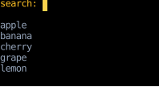
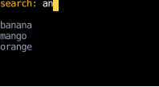
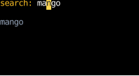
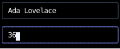
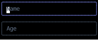

# `use_text_input`

`use_text_input` edits one line of text: it handles typing, deleting, moving the cursor, and pasting,
and leaves drawing to the component that calls it, as [Headless UI](https://headlessui.com/)
and [React Aria](https://react-spectrum.adobe.com/react-aria/hooks.html) do for the web.
The component styles the text and the cursor however it likes,
in whatever layout it's part of.
For a ready-made box, use [`text_input`](#a-styled-text-input), which is built on this hook.

This page covers the hook and that component.
Multi-line editing, selection, and scrolling a value wider than its box aren't supported yet.

## Using the hook

The calling component owns the value, as with React's controlled `<input>`,
and passes it to the hook with its setter.
The hook owns the cursor, makes the component [focusable](use_focus.md),
and returns the value split around the cursor, with the handler that edits it:

```python
--8<-- "text_input.py:hook"
```

`before_cursor`, `at_cursor` and `after_cursor` together are the value,
except that `at_cursor` is a space when the cursor is at the end of the value,
so there's always a cell to draw the cursor in.
Here the cursor is a highlighted cell, drawn only while the search box is focused:



Typing edits the value, and the list below it re-renders from the new value:



Left, three times, moves the cursor back between the `m` and the `n` of `mngo`,
and an `a` typed there lands at the cursor:



Put `field.on_input` on the element the component returns, which is the one that's focused.
The handler ignores everything while that element isn't focused,
and returns `None` for the keys it doesn't edit with, such as Enter, Tab, Up and Down,
so they [bubble](../input-handling/events.md#routing-input-events) on to a form that submits on Enter
or moves focus on Tab.
Compose it with [`focus_receiver_on_press`](../input-handling/handlers.md#focus)
for the component to take focus when it's pressed,
and with handlers of your own:
`first(field.on_input, on_enter)` handles a key the field passes on,
and `first(on_ctrl_k, field.on_input)` takes over a key the field would handle.

## Keys

The handler follows [Readline](https://tiswww.case.edu/php/chet/readline/readline.html)'s default bindings,
which most terminal programs share:

| Key                         | Edit                                                   |
|-----------------------------|--------------------------------------------------------|
| Text                        | Insert it at the cursor                                |
| Left, Ctrl+B                | Move one character left                                |
| Right, Ctrl+F               | Move one character right                               |
| Home, Ctrl+A                | Move to the start                                      |
| End, Ctrl+E                 | Move to the end                                        |
| Ctrl+Left                   | Move to the start of this word or the previous one     |
| Ctrl+Right                  | Move to the end of this word or the next one           |
| Backspace                   | Delete the character before the cursor                 |
| Delete, Ctrl+D              | Delete the character at the cursor                     |
| Ctrl+W                      | Delete back to the start of the whitespace-separated word |
| Ctrl+Delete                 | Delete to the end of this word or the next one         |
| Ctrl+U                      | Delete to the start                                    |
| Ctrl+K                      | Delete to the end                                      |

A character is a grapheme cluster, so the cursor steps over an emoji or an accented letter whole.
A word is a run of letters and digits.

A paste inserts its text in one edit, with each line break turned into a space,
on terminals that support [bracketed paste](../input-handling/events.md#handling-pastes).
On others, the pasted text arrives as typed keys, and its line breaks arrive as Enter.

## Validating and transforming

The setter that `use_text_input` takes is called with a function from the latest value to the edited one,
rather than with the edited value.
Several key presses can arrive between renders, as when typing fast,
and each edit has to apply to the result of the one before,
which the value the component rendered with doesn't have yet.
A [`use_state`](use_state.md) setter takes such a function and applies it right away.

To validate or transform an edit, wrap the setter in one that applies the edit itself
and decides what to keep.
This one keeps only digits:

```python
--8<-- "text_input.py:widget"
```

Typing `3x6` into the age field gives `36`, since the `x` would have made the value something other than digits:



The cursor stays where it is when the setter rejects an edit,
and when the value changes other than by an edit, such as when a form clears it after submitting,
the cursor stays put, moved back to the end of the value if it's past it.

## A styled text input

[`text_input`][counterweight.widgets.text_input] draws a bordered box around the value,
with the cursor highlighted while it's focused,
and takes focus when it's pressed.
It takes the hook's parameters, a `placeholder` to show in an empty box,
and a `style` merged over its own, such as a `width`.
The sign-up form above uses it, and shows its placeholders when it starts:



## API

::: counterweight.hooks.use_text_input
::: counterweight.hooks.TextInput
::: counterweight.widgets.text_input
