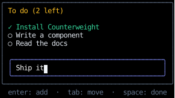
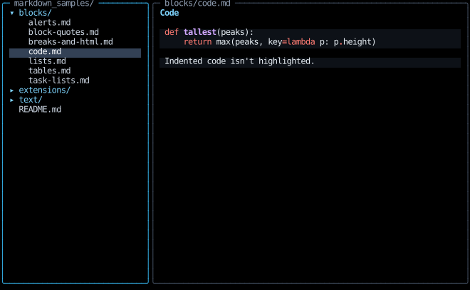
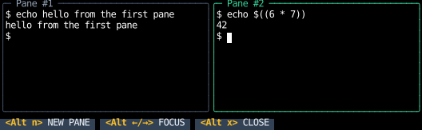
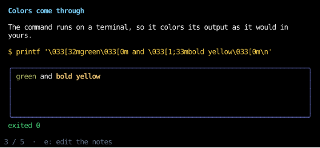

{ .wordmark }
{ .wordmark }

Counterweight is an experimental text user interface (TUI) framework for Python,
inspired by [React](https://react.dev/) and [Tailwind CSS](https://tailwindcss.com/).

A TUI application built with Counterweight is a tree of declarative
[**components**](components/index.md),
each of which represents some piece of the UI by bundling together
a visual [**element**](elements/index.md) along with its
[**state**](hooks/use_state.md) and how that state should change due to
[**events**](input-handling/events.md) like user input.

As an application author,
you define the components and their relationships as a tree of Python functions.
You use [**hooks**](hooks/index.md) to manage state and side effects,
and [**styles**](styles/index.md) to change how the elements look.

Counterweight takes this declarative representation of the UI and **renders** it to the terminal,
updating the UI when state changes in response to user input or side effects
(by calling your function tree).

## Installation

Counterweight is available [on PyPI](https://pypi.org/project/counterweight/),
and needs Python 3.15 or newer:

```bash
pip install counterweight
```

## Quick start

This to-do list is a complete app.
Save it as `todo.py`, or have `counterweight examples copy todo` write it there, and run it with `python todo.py`;
Ctrl+C quits.

<!-- example: todo.py -->

After adding "Read the docs", with "Ship it" typed but not yet added:



Adding tasks, then moving to them with Tab and marking them done with Space:

<!-- cast: home-quick-start -->

What's in it:

- `root` and `task_row` are [components](components/index.md):
  functions decorated with `@component` that return [elements](elements/index.md),
  a `Div` that lays out its children and a `Text` that shows a string.
  Counterweight calls them again whenever their state changes.
- [`use_state`](hooks/use_state.md) holds the tasks and the draft.
  Each setter takes a new value, or a function from the latest value to the next.
- `text_input` is a [widget](headless/use_text_input.md), a text box built on a headless hook,
  which edits `draft` through `set_draft`.
- Each `on_input` [handler](input-handling/events.md) matches the events it cares about
  and returns `()` to claim them, or `None` to let them bubble up to the element's parent.
  Enter bubbles out of the text input to `add_task` on the root.
- [`use_focus`](hooks/use_focus.md) makes each row focusable,
  [`tab_focus`](input-handling/handlers.md) moves focus with Tab,
  and [`on_click`](input-handling/handlers.md#clicks) marks a task done when you click it.
- The [style utilities](styles/utilities.md), such as `col`, `border` and `text_color("amber", 400)`,
  merge with `|`, as Tailwind's classes combine.

## Showcase

Counterweight ships with [complete apps](https://github.com/JoshKarpel/counterweight/tree/main/src/counterweight/examples/apps),
each standing for a kind of app people build with it, beside the snippets these docs show.
Run one with `counterweight examples run <name>`, such as `counterweight examples run wordle`,
or browse them all, and run each in place, with `counterweight examples gallery`
(see [Examples](examples.md)).

### Chat

[`chat.py`](https://github.com/JoshKarpel/counterweight/blob/main/src/counterweight/examples/apps/chat.py)
is a chat with a canned bot whose Markdown replies stream in a word at a time,
in a transcript that stays scrolled to the newest message.

<!-- cast: chat -->

### Markdown viewer

[`markdown_viewer.py`](https://github.com/JoshKarpel/counterweight/blob/main/src/counterweight/examples/apps/markdown_viewer.py)
browses the working directory's Markdown files, in a tree beside the one it's showing.



### Multiplexer

[`multiplexer.py`](https://github.com/JoshKarpel/counterweight/blob/main/src/counterweight/examples/apps/multiplexer.py)
[embeds terminals](terminals/embedding.md) running shells in panes side by side, with hotkeys as zellij has.



### Wordle

[`wordle.py`](https://github.com/JoshKarpel/counterweight/blob/main/src/counterweight/examples/apps/wordle.py)
is the word game, with a daily word or a random one,
played on the keyboard or by clicking the keys on screen.


### Slides

[`slides.py`](https://github.com/JoshKarpel/counterweight/blob/main/src/counterweight/examples/apps/slides.py)
is a presentation whose slides each [run a command](terminals/commands.md) and show what it printed
beneath their Markdown notes, which [open in your editor](terminals/programs.md) to change.


