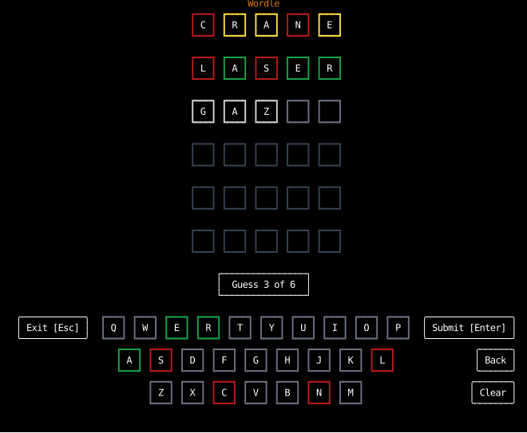
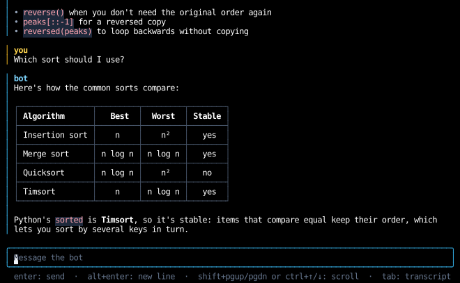
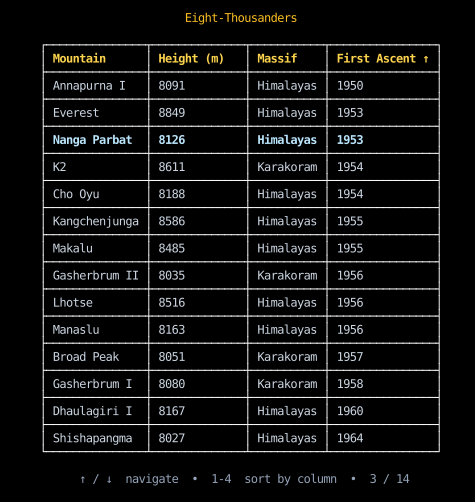
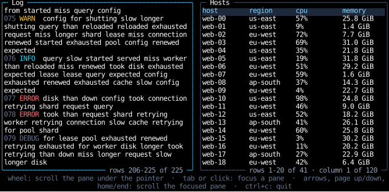
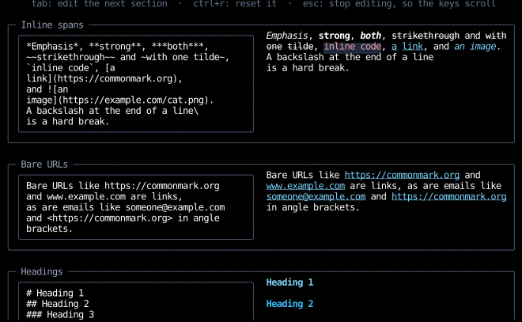
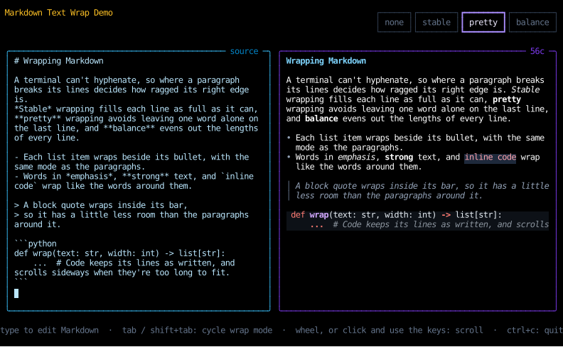
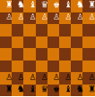

{ .wordmark }
{ .wordmark }

Counterweight is an experimental text user interface (TUI) framework for Python,
inspired by [React](https://react.dev/) and [Tailwind CSS](https://tailwindcss.com/).

A TUI application built with Counterweight is a tree of declarative
[**components**](components/index.md),
each of which represents some piece of the UI by bundling together
a visual [**element**](elements/index.md) along with its
[**state**](hooks/use_state.md) and how that state should change due to
[**events**](input-handling/events.md) like user input.

As an application author,
you define the components and their relationships as a tree of Python functions.
You use [**hooks**](hooks/index.md) to manage state and side effects,
and [**styles**](styles/index.md) to change how the elements look.

Counterweight takes this declarative representation of the UI and **renders** it to the terminal,
updating the UI when state changes in response to user input or side effects
(by calling your function tree).

## Installation

Counterweight is available [on PyPI](https://pypi.org/project/counterweight/),
and needs Python 3.15 or newer:

```bash
pip install counterweight
```

## Quick start

This to-do list is a complete app.
Save it as `todo.py` and run it with `python todo.py`;
Ctrl+C quits.

<!-- example: home_quick_start.py:example -->

After adding "Read the docs", with "Ship it" typed but not yet added:


Adding tasks, then moving to them with Tab and marking them done with Space:

<!-- cast: home-quick-start -->

What's in it:

- `todo_list` and `task_row` are [components](components/index.md):
  functions decorated with `@component` that return [elements](elements/index.md),
  a `Div` that lays out its children and a `Text` that shows a string.
  Counterweight calls them again whenever their state changes.
- [`use_state`](hooks/use_state.md) holds the tasks and the draft.
  Each setter takes a new value, or a function from the latest value to the next.
- `text_input` is a [widget](headless/use_text_input.md), a text box built on a headless hook,
  which edits `draft` through `set_draft`.
- Each `on_input` [handler](input-handling/events.md) matches the events it cares about
  and returns `()` to claim them, or `None` to let them bubble up to the element's parent.
  Enter bubbles out of the text input to `add_task` on the root.
- [`use_focus`](hooks/use_focus.md) makes each row focusable,
  [`tab_focus`](input-handling/handlers.md) moves focus with Tab,
  and [`on_click`](input-handling/handlers.md#clicks) marks a task done when you click it.
- The [style utilities](styles/utilities.md), such as `col`, `border` and `text_color("amber", 400)`,
  merge with `|`, as Tailwind's classes combine.

## Showcase

The [`examples`](https://github.com/JoshKarpel/counterweight/tree/main/examples) directory holds complete apps.
Run one from a clone of the repository with `uv run python -m examples.<name>`,
such as `uv run python -m examples.wordle`.

### Wordle

[`wordle.py`](https://github.com/JoshKarpel/counterweight/blob/main/examples/wordle.py)
is the word game, with a daily word or a random one,
played on the keyboard or by clicking the keys on screen.



### Chat

[`chat.py`](https://github.com/JoshKarpel/counterweight/blob/main/examples/chat.py)
is a chat with a canned bot whose Markdown replies stream in a word at a time,
in a transcript that stays scrolled to the newest message.



### Stopwatch

[`stopwatch.py`](https://github.com/JoshKarpel/counterweight/blob/main/examples/stopwatch.py)
is three stopwatches, each a component with its own state, timed by [`use_clock`](hooks/use_clock.md).
Tab moves between them, and Space starts and stops the focused one.

<!-- cast: showcase-stopwatch -->

### Table

[`table.py`](https://github.com/JoshKarpel/counterweight/blob/main/examples/table.py)
is a table of the mountains over 8000 meters, with collapsed borders between its cells.
The number keys sort it by a column, and the arrow keys select a row.



### Mouse

[`mouse.py`](https://github.com/JoshKarpel/counterweight/blob/main/examples/mouse.py)
draws on [`Canvas`](elements/canvas.md)es with half blocks:
a pixel that follows the pointer, the last cell clicked, and the rectangle dragged out,
and below them, text you can drag around.

<!-- cast: showcase-mouse -->

### Scrolling

[`scrolling.py`](https://github.com/JoshKarpel/counterweight/blob/main/examples/scrolling.py)
has two [scroll areas](headless/use_scroll_area.md):
a log of lines that wrap to different heights, which stays scrolled to its end,
and a table wider than its pane, which scrolls both ways.



### Markdown gallery

[`markdown_gallery.py`](https://github.com/JoshKarpel/counterweight/blob/main/examples/markdown_gallery.py)
shows each feature that [Markdown rendering](rich-text/markdown.md) supports,
with its source beside it to edit.



### Text wrapping

[`text_wrap.py`](https://github.com/JoshKarpel/counterweight/blob/main/examples/text_wrap.py)
renders Markdown with each of the [text wrapping](styles/text-wrapping.md) modes,
switched with Tab, beside its source to edit.



### Chess

[`chess.py`](https://github.com/JoshKarpel/counterweight/blob/main/examples/chess.py)
draws a chessboard from rows of styled `Text` elements.



### More examples

These run programs or read files, so they're best seen running:

- [`slides.py`](https://github.com/JoshKarpel/counterweight/blob/main/examples/slides.py)
  is a presentation whose slides each [run a command](terminals/commands.md) and show what it printed.
- [`multiplexer.py`](https://github.com/JoshKarpel/counterweight/blob/main/examples/multiplexer.py)
  [embeds terminals](terminals/embedding.md) running shells in panes, as tmux does.
- [`markdown_viewer.py`](https://github.com/JoshKarpel/counterweight/blob/main/examples/markdown_viewer.py)
  browses a directory's Markdown files.
- [`suspend.py`](https://github.com/JoshKarpel/counterweight/blob/main/examples/suspend.py)
  picks a file and [opens it in your editor](terminals/programs.md), suspending the app until the editor exits.
- [`canvas.py`](https://github.com/JoshKarpel/counterweight/blob/main/examples/canvas.py)
  animates random walkers on canvases.
