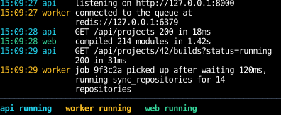
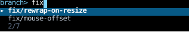
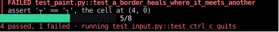

# Inline Apps

An inline app draws in a region below the prompt, rather than taking over the whole screen,
and prints finished output above that region, into the terminal's scrollback, where it stays after the app exits.
It's the shape of a dev loop whose processes' logs scroll up over a status bar,
a picker that prints what was picked, and a test runner's live progress.
This page covers drawing inline, printing, and testing an inline app;
[Running an App](app.md) covers the rest of what `app` takes.

Pass [`Inline()`][counterweight.Inline] as `app`'s `viewport`:

```python
asyncio.run(app(dev_loop(), viewport=Inline()))
```

## A dev loop

This app stands in for a dev loop running three processes.
Each prints its log lines above a status bar of how the processes are doing,
with the time and the process's name in its color, and the line wrapping under itself:

<!-- example: inline_dev_loop.py:dev-loop -->



<!-- cast: inline-dev-loop -->

The status bar is the app's region: the root, rendered every frame as in any app.
The log lines are never in the region, or in any state.
The effect that reads a process's output prints each line as it arrives, with a [`Print`][counterweight.controls.Print],
which renders its content once and writes it above the region, where nothing changes it again.
Each line is a row of a fixed-width prefix and a body that takes the rest of the width,
so the body wraps under itself:

<!-- example: inline_dev_loop.py:log-line -->

## How the region is drawn

The region starts on the cursor's row when the app starts, and is as tall as the root's content,
growing and shrinking with it, up to the terminal's height.
A root taller than that is cut off at the bottom, as any overflow is.
To keep a status bar on screen under content that grows, put the content in a
[`scroll_area`](layout/scrolling.md) that sticks to its end, and give the root `min_height(0)`:
the root is a flex item of a column at most as tall as the terminal,
and as on the web, a flex item is at least as tall as its content unless its `min_height` lets it shrink.

The app never learns which row of the screen the region starts on, and doesn't need to:
it moves the cursor relative to the region's top-left corner, and leaves it there between frames.
When the terminal is resized, the terminal rewraps everything on screen, the region included,
and the app erases from the region's first row down and draws it again at the new width,
so none of the rewrapped region is left behind.
What's already in the scrollback is rewrapped as the terminal does it, which the app can't change,
and each printed row ends at its last cell that isn't blank, so a narrower terminal doesn't rewrap padding.

When the app stops, it leaves its last frame on the screen, with the prompt below it,
unless it's given `Inline(keep_last_frame=False)`, which erases the region.
The last frame shows the state the handlers set before the app quit,
since [`Quit`][counterweight.controls.Quit] stops the app after one more render.
While the app is [suspended](terminals/programs.md), it erases its region,
after printing anything printed in the same cycle as the `Suspend`,
so the program it hands the terminal to starts where the region was,
and it draws the region again wherever that program left the cursor.

## The mouse

An inline app doesn't track the mouse by default, so the wheel scrolls back through the terminal's scrollback,
and the terminal's own selection works on what the app drew.
`Inline(mouse=True)` tracks it, as [`FullScreen`][counterweight.FullScreen] does,
at the cost of the wheel, which goes to the app while the pointer is over its region.

The terminal reports where the mouse is on its screen, not on the region, so the app has to know where the region is.
It asks the terminal where the cursor is (`CSI 6 n`) after drawing the region from scratch,
when it starts and after a resize or a suspension, while the cursor is at the region's top-left,
and works out where the region is from then on from what each frame prints above it and how tall it draws it.
Mouse events above the region are over the scrollback, not the app, so they're dropped,
as are any that arrive before the terminal answers,
except while a press that started in the region is held: its element keeps getting the moves and the release,
with a negative `y`, as a browser keeps sending a captured pointer's events outside the target.
The answer, `CSI row ; 1 R`, is also what Ctrl+F3 sends on some terminals, but with a modifier of at least 2
where the answer has 1, since the app only asks while the cursor is in the first column.

## Printing

`Print` takes a component or an element, and the stream to print it to, `"stdout"` or `"stderr"`,
as `print(file=sys.stderr)` picks one.
It renders the content once, as React's `renderToStaticMarkup` does:
its components run with each hook's initial state, and their effects never start.
Every `Print` that arrives in a render cycle is printed in that cycle's frame, in order,
beside the render the same events caused,
so a handler that prints an item and drops it from the region's state does both in one frame,
with no frame showing it twice or not at all.

`app` takes the two streams as `stdout` and `stderr`, which default to `sys.stdout` and `sys.stderr`.
A stream that's the app's terminal, as both are when a program runs at a prompt with nothing redirected,
shows what's printed above the region.
Any other stream is written to as it is: with its styles if it's a terminal of its own,
and as plain text if it isn't, such as a pipe or a file, laid out as wide as the content is.

## A picker

That's the shape of a picker, as `fzf` has it.
This one draws on standard error, so standard output is free to carry the branch picked
to whatever reads it, as in `git switch "$(python inline_picker.py)"`:

<!-- example: inline_picker.py:picker -->

```python
asyncio.run(app(branch_picker(), viewport=Inline(keep_last_frame=False), output_stream=sys.stderr))
```



<!-- cast: inline-picker -->

Enter returns a `Print` of the branch and a `Quit`, and the picker erases itself as it stops,
so the branch is all that's left, on the line where the picker started,
when standard output is the terminal too.
It matches with `subsequence_matches` and moves its `Highlight` with `ends="stop"`, as `fzf` does,
which [Pickers](headless/options.md) covers, with the other kinds of picker built from the same parts.

## A test run

A test runner shows its progress in the region and prints each failure above it as it happens,
then quits when the last test finishes, which leaves the summary in its last frame:

<!-- example: inline_test_run.py:test-run -->



<!-- cast: inline-test-run -->

## Stray prints

A `print` or a warning written to standard error while an inline region is on screen
would land in the middle of it.
So while an app that isn't headless runs, `sys.stdout` and `sys.stderr` are replaced with streams
that print each line written to them, as a `Print` of its text to `stdout` or `stderr`, from any thread.
A full-screen app gets the same, printed when it hands the main screen back,
rather than garbling the alternate screen.
The streams are put back while the app is suspended and when it stops,
which writes out any line left without its newline.
A replaced stream that something kept, such as a `logging.StreamHandler` made while the app ran,
writes straight to the stream it replaced while the app is suspended, prints again once it resumes,
and writes straight to the stream it replaced once the app stops.
Pass `capture_output=False` to `app` to leave them alone.
A program that writes to the terminal itself, such as a subprocess, isn't caught.

## Full-screen apps print too

A [`FullScreen`][counterweight.FullScreen] app's main screen isn't showing while it runs,
so it holds what it prints to its own terminal until it hands the main screen back,
when it stops or is suspended, and prints it there, at the width the terminal has then.
That lets a full-screen app leave a summary behind, at the cost of holding everything it prints until then.

## Testing an inline app

A headless inline app draws on a terminal emulator the size of its `dimensions`,
which starts empty, with the region at its top.
A [`Screenshot`][counterweight.controls.Screenshot] shows the region,
as [`use_rects`][counterweight.hooks.use_rects] measures it,
unless it's given `include_scrollback=True`, which shows everything the terminal holds:
the rows that scrolled off the top, then the screen, with what was printed above the region and the region below.
A test drives the app with an autopilot, resizes it with `TerminalResized(dimensions=...)`,
and checks the whole terminal's text:

```python
frames: list[Frame] = []
await app(
    dev_loop(),
    headless=True,
    dimensions=(60, 12),
    viewport=Inline(),
    autopilot=[AdvanceClock(by=timedelta(seconds=3)), Screenshot(frames.append, include_scrollback=True), Quit()],
)
```

What an app prints to a stream that isn't its terminal is written there,
so a test reads what a picker sends down standard output by passing `stdout=io.StringIO()`.

## How other libraries do it

On the web, an inline app is a document in normal flow, as tall as its content,
with a footer held to the bottom of the viewport by `position: sticky; bottom: 0`.
What's scrolled above the footer is still the document, live and editable,
where a terminal's scrollback is write-once:
once a row scrolls above the region, the app can't change it, so it's printed exactly once, when it's finished.
[Ink](https://github.com/vadimdemedes/ink) renders inline by default,
and prints finished output above with `<Static>`, as `Print` does here.
[Bubble Tea](https://github.com/charmbracelet/bubbletea) and [Ratatui](https://ratatui.rs/)
erase from the region's top down after a resize, which is how counterweight avoids leaving a rewrapped region behind.
