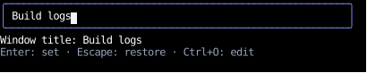
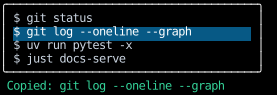

# Controls

**Controls** are objects that can be returned from an element's `on_input` handler
to instruct Counterweight to take some action during the render loop,
such as gracefully quitting the application or playing the
[terminal "bell" sound](https://en.wikipedia.org/wiki/Bell_character).

A handler returns one control (`return Quit()`),
or a tuple of controls, which Counterweight applies in order (`return Bell(), Screenshot.to_file(path)`),
skipping any `None` in it, as `merge` skips `None` styles.
Returning `()`, a tuple of no controls, says the handler handled the event with nothing more to do,
and returning any control or tuple stops the event, as `()` does (see [Events](events.md#handling-input)).
Code outside a handler, such as an effect, sends controls with [`use_controls`](../hooks/use_controls.md).

## Returning controls

This app sets the terminal window's title to what's typed in its field when Enter is pressed:

<!-- example: input_controls.py:example -->

Each key it binds returns a different control:

- Enter returns `SetTitle` with the field's text, or `Bell()` to complain when the field is empty.
- Escape returns `RestoreTitle()`, which puts back the title the window had before the app started.
- Ctrl+O returns a [`Suspend`](../terminals/programs.md#editing-text-in-the-users-editor)
  that hands the terminal to the user's editor to edit the title in, and calls `edited` when the editor exits.

The text field handles typing,
and passes Enter, Escape and the Ctrl keys it doesn't edit with on to the `Div` around it.
A screenshot can't show the window's title, so the app shows the title it set below the field:



<!-- cast: input-controls-title -->

Other pages show the rest of the controls at work:

- The focus controls move focus through the [order form](../hooks/use_focus.md#an-example)
  and the [prefix keys recipe](../cookbook/prefix-keys.md).
- The scroll controls scroll a log to its end and a document to a section,
  in [Scrolling from a handler](../layout/scrolling.md#scrolling-from-a-handler)
  and [Scrolling an element into view](../layout/scrolling.md#scrolling-an-element-into-view).
- `Suspend` runs a pager and the user's editor in [Running Programs on the App's Terminal](../terminals/programs.md).
- `ToggleBorderHealing` turns [border healing](../cookbook/border-healing.md) off and on.
- `Screenshot`, `AdvanceClock` and `Marker` drive and record an app from an [autopilot](../autopilot.md).
- `CopyToClipboard` copies a command from a list, [below](#copying-to-the-clipboard).
- `Print` prints finished output above an [inline app](../inline.md#printing)'s region.

## Copying to the clipboard

`CopyToClipboard` copies text to the system clipboard,
as a browser's [`navigator.clipboard.writeText`](https://developer.mozilla.org/en-US/docs/Web/API/Clipboard/writeText) does,
for an app's own "copy" buttons and keys.
Here Up and Down move through a list of commands, and Enter or a click copies one:

<!-- example: input_clipboard.py:example -->

The handler that copies also sets state, so the app can say what it copied,
since nothing else shows that the copy happened:



<!-- cast: input-clipboard -->

The app asks the terminal to set the clipboard with
[OSC 52](https://invisible-island.net/xterm/ctlseqs/ctlseqs.html#h3-Operating-System-Commands),
so it works only where the terminal supports that, and the app can't tell whether it did.
Some terminals turn it off, or ask before letting a program set the clipboard,
and tmux passes it on only with `set -g set-clipboard on`.
A headless app copies nothing, and a [recording](../autopilot.md#recording) leaves the copy out,
since playing it back in a terminal would set the viewer's clipboard.

To send copies somewhere else, such as to a list a test checks or to the system clipboard through a library,
give `app` a `clipboard_handler`, which takes the text of every copy, headless or not,
in place of the terminal's clipboard:

```python
copied: list[str] = []
await app(command_list(), headless=True, autopilot=[KeyPressed(key=Key.Enter), Quit()], clipboard_handler=copied.append)
```

A `CopyToClipboard` given a `handler` of its own sends its text there instead, whatever `app` was given,
as a `Screenshot`'s handler chooses where its frame goes.

## API

::: counterweight.controls.AnyControl

::: counterweight.controls.Quit
::: counterweight.controls.Bell
::: counterweight.controls.SetTitle
::: counterweight.controls.RestoreTitle
::: counterweight.controls.CopyToClipboard
::: counterweight.controls.Screenshot
::: counterweight.paint.Frame
::: counterweight.paint.SCREENSHOT_FOREGROUND
::: counterweight.paint.SCREENSHOT_BACKGROUND
::: counterweight.controls.Print
::: counterweight.controls.PrintStream
::: counterweight.controls.Suspend
::: counterweight.controls.ToggleBorderHealing
::: counterweight.controls.AdvanceClock
::: counterweight.controls.Marker

### Focus

These controls move [focus](../hooks/use_focus.md),
which decides the element that key presses go to.
The [focus handlers](handlers.md#focus) return them for Tab and for presses.

::: counterweight.controls.FocusNext
::: counterweight.controls.FocusPrevious
::: counterweight.controls.FocusOn
::: counterweight.controls.ClearFocus

### Scrolling

These controls scroll a [scroll container](../layout/scrolling.md).
[`scroll_on_wheel`](handlers.md#scrolling) returns `ScrollBy` for the wheel,
and [`scroll_on_keys`](handlers.md#scrolling) returns `ScrollBy` for the keys that scroll by a step or a page,
and `ScrollTo` for Home and End.
`ScrollIntoView` brings an element into view in every container above it:
moving focus applies it to the newly focused element,
[`use_text_area`'s handler](../headless/use_text_area.md#keeping-the-cursor-in-view) returns it for the cursor's row,
and a [picker](../headless/options.md#a-long-list) returns it for the highlighted option.

::: counterweight.controls.ScrollTo
::: counterweight.controls.ScrollBy
::: counterweight.controls.ScrollIntoView
::: counterweight.controls.ScrollAlignment
