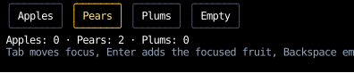
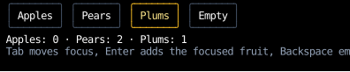
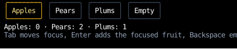
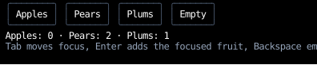
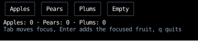

# Handlers

`counterweight.handlers` holds handlers for common behaviors,
and combinators that compose several handlers into the one an element's `on_input` takes.
Nothing happens to an input event unless a handler on its path does it,
so a behavior an element should have is a handler composed onto it.

Each library handler is a pure function of the event and the receiver,
so it can be tested by calling it, without running an app.

## An example

This basket has a button for each fruit, which adds one to the basket when it's clicked,
or when Enter is pressed while it's focused,
and a button that empties the basket:

<!-- example: input_handlers.py:example -->

Each fruit button composes three handlers:
its own `add_on_enter` for Enter, then, for presses, [`on_click`](#clicks) and [`focus_receiver_on_press`](#focus).
The Empty button isn't focusable, and composes [`clear_focus`](#focus) with its `on_click` instead.
The root's element composes the app's shortcuts, Tab navigation with [`tab_focus`](#focus),
and `clear_focus` for a press that lands on no button.

=== "Tab, Tab, Enter, Enter"

    

=== "A press on Plums"

    

=== "A press on Apples, released below it"

    

=== "A press beside the buttons"

    

=== "A press on Empty"

    

Tab from nothing focused focuses Apples, and the second Tab focuses Pears,
which handles Enter itself, so the two Enters add two pears.
A press on Plums both focuses it and adds a plum, since `each` runs both press handlers.
A press on Apples that's released below it focuses Apples, which happens on the `MouseDown`,
but adds no apple, since `on_click` acts only on a release over its element.
A press beside the buttons reaches only the root's element, whose `clear_focus` clears focus,
and a press on Empty empties the basket and clears focus too.

<!-- cast: input-handlers -->

## Composing Handlers

`first` tries handlers in order and stops at the first that handles the event,
so the order states their precedence.
In `first(on_click(open_menu), drag_panel)`, `drag_panel` never sees a button `1` press, which `on_click` handles.
`each` runs every handler and combines their controls,
which is how two handlers that both act on a `MouseDown` share one element:
only the element that stops a press's first `MouseDown` [receives the rest of it](events.md#presses),
so they can't sit on an element and its parent.
In the basket, `on_click` and `focus_receiver_on_press` both claim a press's `MouseDown`,
so `each` runs them both, where `first` would run only `on_click`, and the press would never move focus.

::: counterweight.handlers.first
::: counterweight.handlers.each

## Headless Components

A [headless component](../headless/index.md) returns its behavior as a handler, `on_input`,
for the component to put on the element it returns, composed with any others:

```python
field = use_text_input(value, set_value)
Text(content=..., on_input=first(field.on_input, submit_on_enter, focus_receiver_on_press))
```

The hook's handler returns `None` for the keys it doesn't edit with, such as Enter and Tab,
so a handler after it in `first`, or on an ancestor, gets them.

## Clicks

`on_click` makes a button: it claims a press's `MouseDown`, so the rest of the press comes to its element,
and calls its action on the press's `MouseUp`, if the pointer is still over the element.
As on the web, a press that's dragged off a button before it's released doesn't click it,
which is how a user backs out of a click they've started.

::: counterweight.handlers.on_click

## Focus

Nothing moves [focus](../hooks/use_focus.md) unless a handler returns a control that does,
so Tab navigation and click-to-focus are handlers an app composes in, as the [basket](#an-example) does.
`focus_on_press` focuses some other component, by its focus handle,
as the labels of the [order form](../hooks/use_focus.md#an-example) focus their fields.

`tab_focus` moves within the element it's attached to,
so on the root component's element it moves through the whole tree,
and on a dialog's element it keeps Tab inside the dialog.
A focused component that wants Tab for itself, such as a code editor that indents with it,
handles it and returns `()`, so it never bubbles to `tab_focus`.
The [headless text components](../headless/index.md) don't: they pass Tab on, so it moves focus out of them.

Every handler here that acts on a press claims its `MouseDown`,
so of nested elements with press handlers, the innermost takes the press:
with `focus_receiver_on_press` on nested focusable components, a press focuses the innermost one under the pointer.
A press on a non-focusable element that claims presses, such as a button made with `on_click`,
leaves focus where it was, unless the element composes `clear_focus` in too, as the basket's Empty button does.

::: counterweight.handlers.tab_focus
::: counterweight.handlers.focus_receiver_on_press
::: counterweight.handlers.focus_on_press
::: counterweight.handlers.clear_focus

## Scrolling

Nothing scrolls a [scroll container](../layout/scrolling.md) unless a handler returns a control that does,
so a container the wheel scrolls composes `scroll_on_wheel` in,
and one the keyboard scrolls composes `scroll_on_keys` in, on a focusable component's element:

```python
from counterweight.handlers import first, scroll_on_keys, scroll_on_wheel

use_focus()
Div(style=fill(1) | col | overflow_y_scroll, on_input=first(scroll_on_keys(), scroll_on_wheel()), children=...)
```

[Scrolling](../layout/scrolling.md#scrolling-with-the-wheel) shows them at work,
and binds paging to other keys with `page_down` and `page_up`.

::: counterweight.handlers.scroll_on_wheel
::: counterweight.handlers.scroll_on_keys
::: counterweight.handlers.page_down
::: counterweight.handlers.page_up
