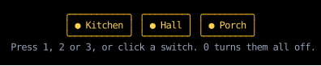

# Input Handling

Counterweight reads the terminal's input as **events**:
a `KeyPressed` for each key, a `Pasted` for each paste, and a mouse event for each change of the mouse.
It delivers each one to an element's `on_input` handler,
a function of the event and a receiver that describes the element,
whose return value says whether it handled the event and what the app should do about it.

This page is an overview of how an event travels and what a handler does with it.
The pages below it cover each part in detail:

- [Events](events.md): what each event holds, and how events are routed to handlers.
- [Handlers](handlers.md): the library handlers for clicks, focus and scrolling,
  and `first` and `each`, which compose them.
- [Controls](controls.md): what a handler returns to act on the app, such as `Quit()`.

## An example

These light switches turn on and off with the `1`, `2` and `3` keys, or with a click:

<!-- example: input_overview.py:example -->

The root component's element handles the keys,
and each switch handles its own clicks with [`on_click`](handlers.md#clicks).
Here it turns on the kitchen and the hall with `1` and `2`, clicks the porch on and the kitchen off,
turns the hall off with `2`, and everything off with `0`:

<!-- cast: input-overview -->

## Where events go

Each event has one **target** element, which depends on the kind of event:

- A key press or a paste goes to the [focused](../hooks/use_focus.md) element,
  or to the root component's element when nothing is focused, as it is in the switches.
- A mouse event goes to the element drawn on top under the pointer, such as one of the switches.

Counterweight calls the target's handler first, then its parent's, and so on up to the root component's element,
until one returns something other than `None`.
That's **bubbling**, as in the DOM:
a [text field](../headless/use_text_input.md) doesn't handle Enter,
so Enter pressed in a field reaches the handler of a form around it, which can submit on it.
See [Routing Input Events](events.md#routing-input-events) for the rules,
including how a press and drag stay with the element they began on.

## What handlers return

A handler returns `None` for an event it doesn't handle, so the event bubbles on.
Anything else stops the event:
a [control](controls.md) for Counterweight to apply, such as the `FocusNext()` that [`tab_focus`](handlers.md#focus) returns for Tab,
a tuple of controls, or `()` when there's nothing more to do than what the handler already did,
such as setting state.

Nothing happens to an event that no handler handles,
except for a few keys with defaults, such as Ctrl+C, which quits
(see [Keys the terminal would act on](events.md#keys-the-terminal-would-act-on)).
Tab doesn't move focus and the wheel doesn't scroll unless a handler on the event's path returns a control that does,
so an app composes in the [library handlers](handlers.md) for the behaviors it wants.
