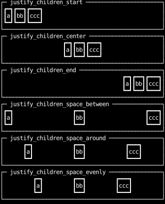
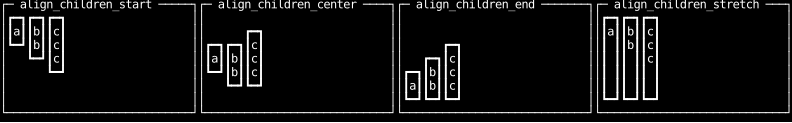
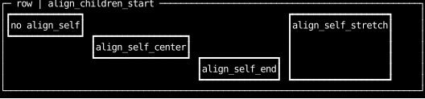
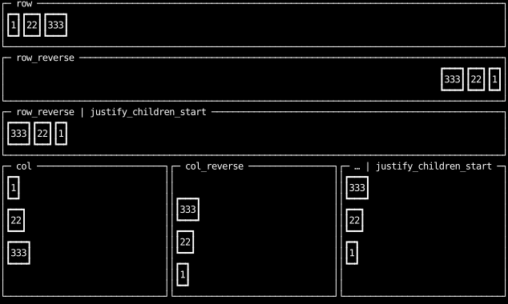
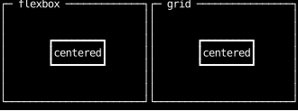
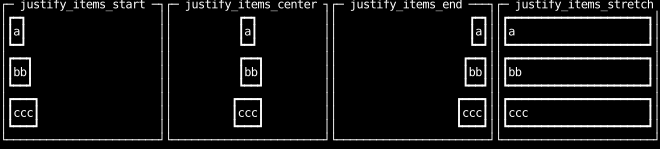
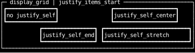
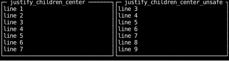

# Alignment and Distribution

A container places its children along two axes.
The `justify_children_*` utilities distribute them along the main axis
(across a `row`, down a `col`),
and the `align_children_*` utilities place them on the cross axis.
A child can override its parent's cross-axis alignment for itself with `align_self_*`.
In a grid, `justify_items_*` and `justify_self_*` place items within their cells along the row.

The examples on this page title each panel with this helper,
which draws its text over the top border:

<!-- example: layout_alignment.py:title -->

## Distributing children along the main axis

The `justify_children_*` utilities share out the free space a row or column has left over
after its children take their sizes.
Children that grow leave no free space, so these only matter when nothing claims it.

<!-- example: layout_alignment.py:justify -->

## Aligning children on the cross axis

The default, `align_children_stretch`, fills the cross axis;
the others keep each child at its content size and place it.

<!-- example: layout_alignment.py:align -->

## Aligning one child

`align_self_*` on a child replaces its parent's `align_children_*` for that child alone.

<!-- example: layout_alignment.py:align-self -->

## Reversing the main axis

`row_reverse` and `col_reverse` lay children out right to left and bottom to top,
as CSS's `flex-direction: row-reverse` and `column-reverse` do,
so the first child ends up last on screen without reordering the children themselves.
They reverse the main axis too, so with no `justify_children_*`
the children pack against the main axis's new start, the right edge or the bottom.

`justify_children_start` and `justify_children_end` are CSS's `start` and `end`, not `flex-start` and `flex-end`:
they name the container's own edges, left and top or right and bottom, whichever way its children run.
So `row_reverse | justify_children_start` keeps the reversed order and packs it against the left edge,
as a toolbar whose newest item goes first would.

<!-- example: layout_alignment.py:reverse -->

## Centering a box

Center a box on both axes with `center_children`,
which is `justify_children_center | align_children_center`.
It works in a grid too: there it centers the grid's tracks,
and a grid with no template sizes its one track to fit its lone child.
To center a box over other content rather than among it, see
[A dialog centered over the app](layering.md#a-dialog-centered-over-the-app).

<!-- example: layout_alignment.py:center -->

## Aligning grid items in their cells

In a grid, each item sits in a cell, which can be wider than the item.
`justify_items_*` on the grid places every item within its cell along the row,
as CSS's `justify-items` does, and `align_children_*` places them down the column, as on a flex container.
The default, `justify_items_stretch`, fills the cell's width;
the others keep each item at its content width and place it.
Flexbox has no cells, so these do nothing there, as in CSS.

<!-- example: layout_alignment.py:grid-items -->

`justify_self_*` on an item replaces its grid's `justify_items_*` for that item alone,
as `align_self_*` does on the other axis:

<!-- example: layout_alignment.py:grid-self -->

## Content larger than its container

The `*_center` and `*_end` utilities are CSS's _safe_ alignments:
content too large for its container starts at the container's start edge
and overflows only past the end, so its beginning stays in view.
Each has an `*_unsafe` counterpart with CSS's default behavior,
which centers or end-aligns the content anyway and overflows past the start edge too.
These containers are `fill(1)` items, which [clip](clipping.md) what overflows them,
so the unsafe one cuts off the content's beginning as well as its end.

<!-- example: layout_alignment.py:overflow -->

