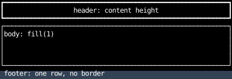
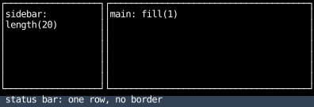
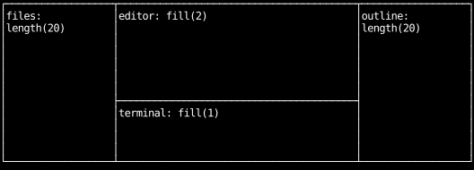

# App Shells

These whole-screen layouts combine the techniques from the other pages.
Each root [fills the screen](how-layout-sizes-things.md#the-root-fills-the-screen)
and is split with flexbox:
fixed parts take a `length` or their content's size, and the part that fills takes `fill(1)`.
When that part holds more than fits, such as a log, a transcript or a long document,
make it a [scroll container](scrolling.md) with `overflow_y_scroll`,
so its content scrolls inside it while the fixed parts stay put.
[Splitting space](splitting-space.md) shows the same splits with grid,
and [Choosing a layout model](choosing-a-layout-model.md) builds a whole shell both ways.

## Header, body and footer

The header and footer take their content's height, and the body takes the rest.

<!-- example: layout_shells.py:header-body-footer -->

## Sidebar, main pane and status bar

A row that fills the rest of a column holds the sidebar and the main pane,
and the status bar takes one row below them.

<!-- example: layout_shells.py:sidebar-status -->

## Three panes

Fixed panes on both sides, and a middle column split 2:1 between two panes.
`border_collapse` on both containers makes neighbors share their borders.

<!-- example: layout_shells.py:three-panes -->

## A dialog over the app

See [A dialog centered over the app](layering.md#a-dialog-centered-over-the-app).
