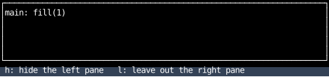
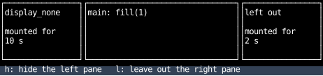

# App Shells

These whole-screen layouts combine the techniques from the other pages.
Each root [fills the screen](how-layout-sizes-things.md#the-root-fills-the-screen)
and is split with flexbox:
fixed parts take a `length` or their content's size, and the part that fills takes `fill(1)`.
When that part holds more than fits, such as a log, a transcript or a long document,
make it a [scroll container](scrolling.md) with `overflow_y_scroll`,
so its content scrolls inside it while the fixed parts stay put.
[Splitting space](splitting-space.md) shows the same splits with grid,
and [Choosing a layout model](choosing-a-layout-model.md) builds a whole shell both ways.

## Header, body and footer

The header and footer take their content's height, and the body takes the rest.

<!-- example: layout_shells.py:header-body-footer -->

## Sidebar, main pane and status bar

A row that fills the rest of a column holds the sidebar and the main pane,
and the status bar takes one row below them.

<!-- example: layout_shells.py:sidebar-status -->

## Three panes

Fixed panes on both sides, and a middle column split 2:1 between two panes.
`border_collapse` on both containers makes neighbors share their borders.

<!-- example: layout_shells.py:three-panes -->

## Hiding a pane

A pane that comes and goes, such as a sidebar the user can collapse, can be hidden two ways,
and they differ in what happens to its components.
`display_none` takes an element out of the layout, as CSS's `display: none` does:
it takes no space and draws nothing, and its siblings fill in where it was.
Its components stay mounted, so they keep their state and their effects keep running.
Leaving the pane out of its parent's children instead, as React's conditional rendering does,
unmounts its components, which start afresh, with new state, when it comes back.

Here each side pane shows how long it has been mounted.
`h` hides the left one with `display_none`, and `l` leaves the right one out:

<!-- example: layout_shells.py:hiding -->

With both gone, the main pane fills the row:

Brought back after a while, the hidden pane has been mounted all along,
while the pane that was left out has only just mounted again:

<!-- cast: layout-shell-hiding -->

Hide a pane with `display_none` when what's in it should survive being hidden,
such as a half-typed draft or a scroll position,
and leave it out when it should start over, or when it's expensive to keep running.

## A dialog over the app

See [A dialog centered over the app](layering.md#a-dialog-centered-over-the-app).
