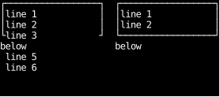
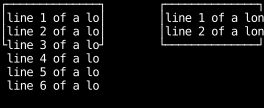
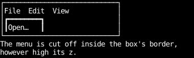
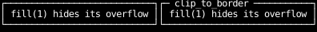
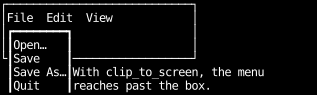
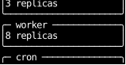
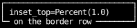

# Clipping

A box's content can be larger than the box.
Its overflow, as in CSS's [`overflow`](https://developer.mozilla.org/en-US/docs/Web/CSS/overflow),
decides whether what doesn't fit is drawn anyway or cut off.
This page covers cutting it off, how a box draws on its parent's border when its parent cuts things off,
and how a box such as a dropdown escapes the clip altogether.

## Hiding overflow

By default a box's overflow is visible:
children that don't fit are drawn past its padding box, over its border and whatever lies beyond.
`overflow_hidden` clips them to its padding box instead,
so nothing inside the box is drawn outside its border.
`overflow_scroll` clips them the same way, and lets them [scroll](scrolling.md).
A `Text`'s lines overflow its box the same way,
and `overflow_hidden` on the `Text` clips them to its own padding box
(see [Text in layout](text.md#long-unwrapped-text-in-a-narrow-pane)).

```python
--8<-- "layout_clipping.py:hidden"
```



Layout doesn't change: the clipped children are just as large, and only the part inside the box is drawn.
The constraint utilities, `length`, `percentage`, `ratio` and `fill`, hide their box's overflow,
so a constrained box always clips its children.

`overflow_clip` clips the same way.
The two differ in layout, as they do in CSS:
a flex item with `overflow_hidden` can shrink below its content's size,
while one with `overflow_clip` keeps the content's size as its minimum, as a visible one does
(see [Content sets a minimum size](how-layout-sizes-things.md#content-sets-a-minimum-size)).

## Clipping one axis

`overflow_x_hidden` clips only at the left and right of the padding box,
and `overflow_y_hidden` only at the top and bottom.
The `overflow_x_*` and `overflow_y_*` utilities each set one axis,
so they combine with each other, as `overflow_x_hidden | overflow_y_clip`.

```python
--8<-- "layout_clipping.py:one-axis"
```



## Clipping applies whatever the `z`

A clip cuts off everything inside the box, wherever it's positioned and however high its `z`,
as on the web: a raised menu inside a box that hides its overflow is cut off at the box's padding box,
unless it [escapes every clip](#escaping-every-clip).

```python
--8<-- "layout_clipping.py:raised"
```



Nested boxes that clip combine: a box inside two of them is drawn only where both let it.

## Drawing on the parent's border

A [border title](../cookbook/border-titles.md) is positioned on its parent's border,
outside the padding box, so a parent that hides its overflow clips it away.
`clip_to_border` clips a box to its parent's border box instead,
so it can draw on the border and is still cut off at the border's outer edge.
`clip_to_padding` is the default.

```python
--8<-- "layout_clipping.py:clip-to"
```



A parent whose overflow is visible clips nothing, so the two agree there,
but a title that sets `clip_to_border` keeps working when its parent starts to clip.
CSS has no equivalent property: its
[`overflow-clip-margin`](https://developer.mozilla.org/en-US/docs/Web/CSS/overflow-clip-margin)
widens the clip for every child of the box that sets it,
where `clip_to` is set on the child, so a title can reach the border while the rest of the content stops at the padding box.

## Escaping every clip

A dropdown or an autocomplete list has to reach past the box it opens from,
even when that box, or one around it, clips.
`clip_to_screen` makes a box **unclipped**: no ancestor clips it, so only the edge of the screen cuts it off.

```python
--8<-- "layout_clipping.py:unclipped"
```



Everything else about an unclipped box is as usual.
It's positioned against its parent, so the menu stays under its menu bar.
It's drawn in the usual order, so it needs a `z` to draw over what follows it,
and a box elsewhere with a higher `z` still covers it.
Its own overflow still clips its children, whose clips start from the screen.
It receives the mouse wherever it's drawn, including outside its ancestors.

On the web, a dropdown escapes a clip with `position: fixed`,
which positions it against the viewport,
so the page then has to work out where its anchor is, in script or with
[anchor positioning](https://developer.mozilla.org/en-US/docs/Web/CSS/CSS_anchor_positioning).
An unclipped box keeps its parent as the box it's positioned against, so it's anchored already.
The [autocomplete recipe](../cookbook/autocomplete.md) builds a complete one.

A [scroll container](scrolling.md) clips to its padding box too,
so in a list of titled panels that scrolls, a panel scrolled partly out of view
loses the same part of its title as of its border.
A title clipped to the screen would be drawn past the scroll container's edge instead.

```python
--8<-- "layout_clipping.py:scrolled-panels"
```



## Percentage insets and borders

Insets on an absolutely positioned box are measured from its parent's padding box, as in CSS,
so `inset_top=Percent(1.0)` puts the box's top edge at the bottom of the padding box,
which is the bottom border's row when the parent has a border.

```python
--8<-- "layout_clipping.py:percent-inset"
```



## Clipping and the mouse

A box receives the mouse only where it's drawn.
Over a part of a box that's clipped away, mouse events go to whatever is drawn there instead,
[`use_hovered`](../hooks/use_hovered.md) reports the mouse outside the box,
and [`on_click`](../input-handling/handlers.md) doesn't click it.

[`use_rects`](../hooks/use_rects.md) still reports each box whole,
since a box that's partly clipped is still where layout put it.
Its `clip` is the region the box's ancestors let it draw in,
and its `visible` is the part of its border box inside that region, or `None` when none of it is.
