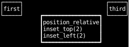
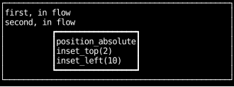
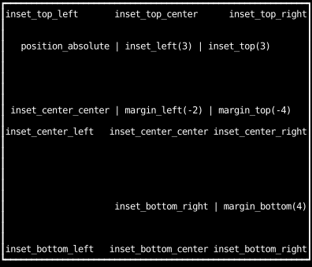
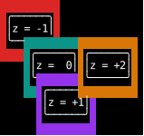
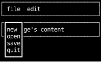
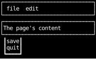
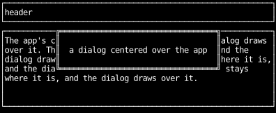
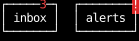

# Layering

Most boxes sit where layout puts them, side by side.
Positioning moves a box off that spot, so it can overlap others,
and `z` decides which of the overlapping boxes is drawn on top.

## Relative positioning

`position_relative` with insets moves a box from where layout placed it,
without moving anything else: its siblings keep the space it would have taken.
Insets are measured in cells, and `inset_top(2)` moves the box down two rows.

```python
--8<-- "layout_layering.py:relative"
```



## Absolute positioning

`position_absolute` takes a box out of the flow:
its siblings are laid out as if it weren't there,
and its insets place it relative to its parent's padding box.

```python
--8<-- "layout_layering.py:absolute"
```



## Placing a box at an edge or corner

The `inset_*` utilities position a box absolutely at one of nine places in its parent.
Their `center` axes leave the insets on that axis unset,
which leaves the box where its parent's alignment puts it,
so they center only in a parent that centers its children, as this one does.
To center a box whatever its parent's alignment, see [A dialog centered over the app](#a-dialog-centered-over-the-app).
Margins push the box away from where it was placed.

```python
--8<-- "absolute_positioning_insets.py:example"
```



## Controlling overlap with `z`

Where boxes overlap, the one with the higher `z` is drawn on top.
Boxes with equal `z` are drawn in the order they appear in the tree, each parent before its children,
and a box that sets no `z` counts as 0.

```python
--8<-- "z.py:example"
```



### Stacking contexts

`z` only orders boxes within a **stacking context**, as CSS's
[`z-index`](https://developer.mozilla.org/en-US/docs/Web/CSS/CSS_positioned_layout/Stacking_context) does.
A box that sets `z`, `z(0)` included, forms one:
it and everything inside it are drawn together, as one layer at its `z`,
and the `z` of a box inside it orders that box only among the others inside it.
A box that sets no `z` forms none, so the boxes inside it are layered alongside it,
among the boxes of the nearest stacking context around it.
The app's root always forms one.

So a box is always drawn beneath the boxes inside it, whatever `z` they set.
A negative `z` puts a box beneath the other boxes of its stacking context,
but still over the box that forms the context.

A `z(1)` dropdown inside a toolbar that sets no `z` joins the stacking context around the toolbar,
so it's drawn over the content below the toolbar:

```python
--8<-- "layout_layering.py:dropdown"
```

=== "Toolbar without `z`"

    

=== "Toolbar with `z(0)`"

    

Give the toolbar `z(0)` and it forms a stacking context of its own,
so the dropdown's `z(1)` raises it only over the toolbar's own content.
The whole toolbar is drawn at 0, and the page's content, which comes after it in the tree, is drawn over the dropdown,
leaving only the part of the dropdown that hangs below the page visible.

## A dialog centered over the app

To center a box over its parent, as CSS does,
position it absolutely with insets of 0, `auto` margins, and a fit-content size.
The insets make its whole parent the space to place it in,
the fit-content size keeps it as small as its content,
and the `auto` margins split the space left over evenly on each side,
whether or not the parent centers its children.
A margin paints nothing unless its element sets `margin_color`,
so the app's content shows around the dialog.
The dialog is drawn over the content because it comes after it;
a dialog that comes earlier in the tree needs a higher `z`.

An absolutely positioned box is always placed in its own parent, never a more distant ancestor or the screen,
so a dialog centers over the whole app only when it's a child of an element that fills the screen,
such as the root component's element here.
A dialog rendered deeper in the tree centers over its own parent.

```python
--8<-- "layout_layering.py:dialog"
```



!!! warning "Known issue: parents with a border, and grids"

    The layout engine, [Taffy](https://github.com/DioxusLabs/taffy), mismeasures `auto` margins
    on an absolutely positioned box in two kinds of parent.
    In a flex parent with a border, the dialog lands one cell right of and below center,
    because the space its margins split includes the parent's border.
    In a grid parent, the `auto` margins are ignored, so the dialog sits at the parent's top-left corner.
    A parent with padding and no border centers it correctly.

## A badge pinned to a corner

Negative insets reach past the parent's padding box onto its border.
`inset_top(-1)` puts a box on the top border, and `inset_right(-1)` on the right border.
`clip_to_border` keeps the badges visible if the parent
[hides its overflow](clipping.md#drawing-on-the-parents-border).

```python
--8<-- "layout_layering.py:badge"
```


