# Scrolling

A box whose overflow is `Scroll` is a **scroll container**:
its content can be larger than it, and it shows the part its offset scrolls into view.
This page covers making one, scrolling it with the wheel, the keyboard and from handlers,
scrolling an element into view, and reading how far it's scrolled.
[Clipping](clipping.md) covers how a scroll container cuts off what's outside its padding box,
which it does as a box with hidden overflow does.

## Scroll areas

Most scrolling boxes want the same things:
the wheel and the keys scroll them, Tab and a click focus them, as browsers make a scroll container focusable,
and a style that scrolls even beside a constraint utility that hides overflow.
[`use_scroll_area`](../headless/use_scroll_area.md) gives a component all of those, and leaves drawing it to the component,
and [`scroll_area`](../headless/use_scroll_area.md#a-styled-scroll-area) is a bordered box built on it:

<!-- example: scroll_area.py:widget -->

The rest of this page covers the pieces they're built from, for a box that needs something they don't do.

## Scroll containers

`overflow_scroll` makes a box a scroll container on both axes,
and `overflow_x_scroll` and `overflow_y_scroll` on one,
as CSS's [`overflow: scroll`](https://developer.mozilla.org/en-US/docs/Web/CSS/overflow) does.
On an axis it scrolls, the box clips its children to its padding box,
and moves them up and left by its offset.

Counterweight holds each scroll container's offset, as a browser holds an element's `scrollTop`,
so a box scrolls without any state in the component that renders it.
It starts at 0, the start of the content.
After every layout, it moves to keep the content in view where it was
(see [Keeping the content in view](#keeping-the-content-in-view)),
and is clamped to how far the content reaches,
so when the content shrinks, the box scrolls back as far as it has to.
A scroll container that unmounts or is hidden loses its offset, and starts at 0 again when it comes back.

How far a box can scroll is how far its content reaches past its padding box, as on the web.
That includes its absolutely positioned descendants, so a dropdown that opens past the bottom of a scrolling form
lets the form scroll down to show it
(see the [autocomplete recipe](../cookbook/autocomplete.md#inside-a-scroll-container)).

A scroll container's automatic minimum size is 0, as one with hidden overflow's is
(see [Content sets a minimum size](how-layout-sizes-things.md#content-sets-a-minimum-size)),
so a flex item that scrolls shrinks to fit beside its siblings instead of growing to fit its content.
That's usually what a scrolling pane wants;
give it a size, or `shrink(0)`, when it should be as large as its content up to some limit.

A `Text` doesn't scroll its own text, nor a `Canvas` what it draws,
so either one whose overflow is `Scroll` raises `ValueError`:
put a long `Text` or a large `Canvas` in a `Div` that scrolls.

## Scrolling with the wheel

Nothing scrolls unless a handler scrolls it, as with every other input,
so a scroll container that the wheel should scroll composes
[`scroll_on_wheel`](../input-handling/handlers.md#scrolling) into its `on_input`.
A titled pane puts its border and title on a box around the part that scrolls,
so they stay put while the content moves:

<!-- example: scrolling.py:pane -->

=== "Before"

    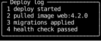

=== "After two wheel notches"

    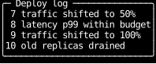

A wheel event goes to the element under the pointer and bubbles from there,
so of nested scroll containers, the innermost under the pointer scrolls.
`scroll_on_wheel` lets an event that would move its container past either end of its range bubble on,
so once the inner one reaches its end, the wheel scrolls the one around it,
as the web chains scrolling from one container to the next.

With Shift held, `scroll_on_wheel` scrolls sideways for the vertical wheel, as browsers on Windows and Linux do,
so a mouse without a sideways wheel can scroll a container that only scrolls sideways, such as a wide code block.
The wheel event still says which way the wheel turned and that Shift was held,
as Firefox's does, rather than reporting a sideways turn, as Chrome's does,
so a handler before `scroll_on_wheel` can give Shift with the wheel a meaning of its own.
Some terminals keep Shift with the wheel for their own scrollback and never report it,
so a sideways wheel or a trackpad's sideways swipe is the only way to scroll sideways there.

## Scrolling with the keyboard

[`scroll_on_keys`](../input-handling/handlers.md#scrolling) scrolls for the keys that scroll a page in a browser:
the arrow keys by a row or a column, PageUp and PageDown by a page, and Home and End to the start and the end.
A key press goes to the [focused](../hooks/use_focus.md) element and bubbles from there,
so a container the keys scroll is usually a focusable component's top-level element,
and the keys scroll it while it, or anything inside it, is focused.
Like `scroll_on_wheel`, it lets a key that would move its container past either end of its range bubble on,
to the next container out.

A page is 87.5% of the height of the view, rounded down, as in Chrome,
so the last lines of one page stay in view at the top of the next, to read on from.
[`page_down`](../input-handling/handlers.md#scrolling) and `page_up` return the `ScrollBy` for a page of any size,
for apps that bind paging to other keys, such as `less`'s Space for a whole page and `d` and `u` for half of one:

<!-- example: scrolling.py:keys -->

=== "After PageDown"

    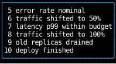

=== "Then d"

    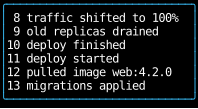

`less_keys` comes first, so its keys win over any `scroll_on_keys` binds,
and anything it doesn't handle falls through to the others.

## Scrolling from a handler

The [`ScrollTo`](../input-handling/controls.md#scrolling) and `ScrollBy` controls scroll a container
to an offset, or by an amount, clamped to its range.
A handler on the scroll container itself names it by its receiver's `subtree`, as `scroll_on_wheel` does.
A handler anywhere else names it by an element handle, an `ElementHandle`,
as a React component reaches a DOM node through a ref:
create one with `use_state(ElementHandle)`, and pass it to the element's `handle`.

<!-- example: scrolling.py:controls -->

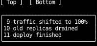

Two mounted elements given the same element handle raise `DuplicateElementHandle`,
and a control whose handle names no mounted scroll container does nothing.

Scroll controls apply to the layout of the render after the handler that returns them, before that render paints,
in the order they were returned,
and after [anchoring](#keeping-the-content-in-view) and [sticking to the end](#following-the-end) have placed the content,
so each moves the view from where those left it.
So a handler that adds a line to a log and returns `ScrollBy(log, y=1)` beside the state change
scrolls by a row of the log that has the new line, in the same frame.
That's where Counterweight differs from the web:
a browser's `scrollBy` scrolls the page as it stands while the handler runs,
before React renders the state change, and a React app that wants to scroll the content that change lays out
calls it from `useLayoutEffect` instead, which is what scroll controls do.
A handler that runs later in the same batch of input sees the controls returned before it:
its receiver's `scroll` is moved by each `ScrollTo` and `ScrollBy` since the last render,
clamped to the range as of that render,
so `scroll_on_keys` passes a key on once an earlier key has scrolled its container to the end.

## Scrolling an element into view

[`ScrollIntoView`](../input-handling/controls.md#scrolling) scrolls to an element rather than to an offset,
as the web's [`scrollIntoView`](https://developer.mozilla.org/en-US/docs/Web/API/Element/scrollIntoView) does:
it scrolls each scroll container above the element, from the innermost out, until the element is in view.
Its `block` says where the element goes vertically: `"start"`, the default, puts its top at the top of the view,
`"center"` in the middle, `"end"` at the bottom,
and `"nearest"` scrolls as little as it takes, and not at all if the element is already in view.
`inline` says the same horizontally, and is `"nearest"` by default.
It stops at an element with [`clip_to_screen`](clipping.md#escaping-every-clip),
since no container above that element clips it, so none has to scroll to show it.

A table of contents scrolls each section's heading to the top of the pane it's in:

<!-- example: scrolling.py:contents -->

=== "Before"

    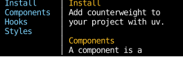

=== "After clicking Hooks"

    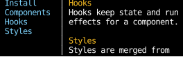

Like the other scroll controls, it applies to the layout of the render after the handler that returns it,
as React's `useLayoutEffect` would call `scrollIntoView` after the DOM updates and before the browser paints.
So a handler that changes state and returns `ScrollIntoView` beside it shows both in the same frame,
and the handle names the element that has it in that render, not the one before.
A list that moves a highlight with Down puts one element handle on whichever item is highlighted,
and returns `ScrollIntoView(handle, block="nearest")` beside the state change that moves it:
the handle has moved to the new item by the time the control applies
(see the [autocomplete recipe](../cookbook/autocomplete.md#a-long-list)).
[`use_text_area`](../headless/use_text_area.md#keeping-the-cursor-in-view) does the same for its cursor:
it returns a `cursor_row` element handle for the element the cursor's row is drawn in,
and its handler returns `ScrollIntoView` for it with `block="nearest"` beside each edit,
so a text area in a scroll container keeps the cursor in view as it moves between rows.

Moving [focus](../hooks/use_focus.md) scrolls the newly focused element into view with `block="nearest"`,
as browsers do, so Tab never leaves focus on something out of sight.
That includes a component that takes focus with `auto_focus` as it mounts.

`ScrollIntoView` scrolls in one step.
The web's `behavior: "smooth"` animates the scroll across frames,
which Counterweight has no design for yet: a fixed number of frames and a fixed duration are both plausible.

## Reading the scroll

[`use_scroll`](../hooks/use_scroll.md) returns a [`Scroll`][counterweight.geometry.Scroll]: how far the calling component's top-level element is scrolled,
how far it can be, and the size of its padding box, the part of the content in view.
Given an `ElementHandle`, it reports on the element with that handle instead,
as a React component reads another element's `scrollTop` through a ref
(see [Jumping to the end](#jumping-to-the-end)).
A handler's [`Receiver`][counterweight.events.Receiver] carries the same for a receiving element that's
a scroll container, which is how `scroll_on_wheel` knows whether its container can move any further.

Like [`use_rects`](../hooks/use_rects.md), `use_scroll` reports the previous frame's scroll,
and a component that calls it renders again as soon as it changes.
A list too long to render whole can render only the rows in view, with empty boxes above and below them
so the content is as tall as every row would make it, as React's windowing libraries do:

<!-- example: scrolling.py:windowed -->

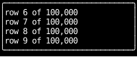

The rows on each side of the view cover the frame between a scroll and the render that follows it,
which would otherwise show the empty boxes.
The rows are keyed components, so each keeps its place as the window moves
(see [Keeping the content in view](#keeping-the-content-in-view)).

## Keeping the content in view

When content changes above what's in view, an offset that stayed put would show different content:
a message dropped from the top of a transcript would pull everything up by its height.
So a scroll container keeps what's in view where it is, as browsers do with
[scroll anchoring](https://developer.mozilla.org/en-US/docs/Web/CSS/overflow-anchor).
Before each layout, it picks an **anchor**: the first node in view,
or, for a node only partly in view, the first of its descendants in view.
After the layout, it moves its offset so the anchor's top edge is as far from the top of the view as it was.
Content that changes below the anchor, or inside it, doesn't move the view;
content that changes above it moves the view with it.

These two feeds show the same alerts, newest first, and a new one arrives at the top every two seconds.
The wheel scrolls both together, a row a notch.
The left one anchors, as every scroll container does unless told otherwise;
the right one has `overflow_anchor_none`, so its offset stays where it was:

<!-- example: scrolling.py:anchoring -->

=== "Scrolled down two rows"

    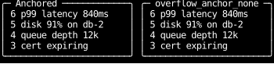

=== "Two alerts later"

    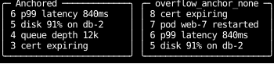

While they're scrolled to the top, new alerts push the rest down in both, since a container at the top doesn't anchor.
Once they're scrolled down, the anchored feed keeps showing the alerts it was showing,
with the new ones arriving out of view above,
while the other's offset stays put, so each new alert pushes what it shows down a row.
Scrolling the anchored feed back up reaches the new ones:

<!-- cast: scrolling-anchoring -->

The anchor is a node, so it follows what each node shows from one render to the next.
Siblings without keys continue the sibling at the same index,
so when items drop off the front of an unkeyed list, every node shows the item after the one it did,
and the view lurches forward by however far that moved the anchor.
Give each item of a list whose front changes its own key, as React asks of a list
(see [When position isn't identity](../components/index.md#when-position-isnt-identity)).

As on the web:

- A container scrolled to the top doesn't anchor, so content added above the top pushes the rest down into view.
- Anchoring moves only the vertical offset.
- `overflow_anchor_none` turns it off: on a scroll container, its offset only gets clamped,
  and on an element inside one, neither it nor anything inside it is picked as the anchor.
  An element with `clip_to_screen` is never picked either.
- A container whose anchor unmounted or was hidden only clamps its offset.

## Following the end

A log or a transcript should stay scrolled to its end as lines arrive, so the newest is always in view,
until the reader scrolls back to read something earlier.
`stick_to_end_y` does that: a container that's scrolled to its end before a layout is scrolled to its end after it,
and one that isn't is anchored as usual.
`stick_to_end_x` does the same horizontally, `stick_to_end` on both axes, and `unstick` turns it off.
A container whose content fits is at its end, so a log that starts short follows its end from its first line,
and one that mounts already overflowing starts at its end.

This log keeps its newest eight lines, adds one a second, and sticks to its end:

<!-- example: scrolling.py:tail -->

=== "Following"

    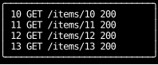

=== "Two seconds later"

    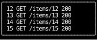

Scrolled back two lines, it stays where the reader left it as new lines arrive below and old ones drop off above:

=== "Scrolled back"

    

=== "Two seconds later"

    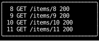

Scrolling back down to the end makes it follow the end again.
The web has no property for this:
a page puts an anchor element after the content, or reverses a column so it starts at its end.
The [chat composer](../headless/use_text_area.md#using-the-hook) keeps its messages scrolled to the newest this way.

Here it is following, scrolled back, and following again:

<!-- cast: scrolling-tail -->

## Jumping to the end

Counterweight doesn't draw scrollbars ([#417](https://github.com/JoshKarpel/counterweight/issues/417)), as most terminal apps don't,
so a reader scrolled back through a log has no sign of how far the end is.
A button over the last line that appears once the log is scrolled back, and jumps to the end, gives them one:

<!-- example: scrolling.py:jump -->

=== "Scrolled back"

    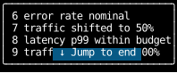

=== "After clicking the button"

    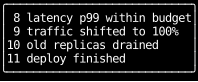

Scrolling back, then clicking the button:

<!-- cast: scrolling-jump -->

The button is a sibling of the log in a box around it, not a child of the log,
because a scroll container moves everything inside it by its offset, absolutely positioned elements included,
so a button inside the log would scroll away with the lines.
Being outside the log, it reads the log's scroll with `use_scroll(log)`.
That's the previous frame's scroll, so the button appears a frame after the scroll that should show it,
which nobody notices for a button that comes and goes.
A wheel event over the button goes to the box around the log, not the log, so the wheel doesn't scroll it there.
[`use_scroll_area`](../headless/use_scroll_area.md) puts its handler on the box around the part that scrolls,
so its `is_at_end` and `to_end` make the same button from inside the component,
and the wheel scrolls the log from over the button too.

## Where scrolled boxes are

Scrolling moves boxes, so everything that reports where a box is reports where it's painted:
[`use_rects`](../hooks/use_rects.md), a receiver's `rects`, the element the mouse is over,
and [`use_hovered`](../hooks/use_hovered.md).
A box scrolled partly out of view is still whole there, with its `visible` region the part in view,
as for any box that's [clipped](clipping.md#clipping-and-the-mouse).

## API

::: counterweight.focus.ElementHandle
::: counterweight.focus.DuplicateElementHandle
