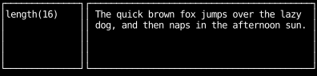
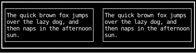
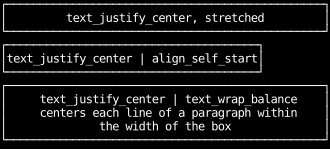
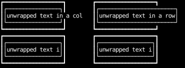

# Text in Layout

A `Text` is sized by measuring its content:
unwrapped, it is as wide as its longest line;
with a wrap mode, its height is the number of lines its content wraps to at the width it gets.
Content that doesn't fit overflows the `Text`'s box and is drawn past it, as text is in CSS,
unless the `Text` or one of its ancestors [clips](clipping.md) it.
[Text wrapping](../styles/text-wrapping.md) compares the wrap modes themselves.

## Wrapping inside a pane

A wrapping `Text` in a column is stretched to the column's width,
and wraps to fit it, taking as many rows as it needs.

<!-- example: layout_text.py:wrap-in-pane -->

## Wrapping beside other text

Wrapping `Text`s side by side in a row shrink to share it, and each wraps to its share.
A flex item can't shrink below its
[automatic minimum size](how-layout-sizes-things.md#content-sets-a-minimum-size),
and a wrapping `Text`'s is the width of its widest word,
so neither needs anything set to give up the space its unwrapped line would take.

<!-- example: layout_text.py:wrap-in-row -->

## Justification needs room

`text_justify_center` and `text_justify_right` align each line within the `Text`'s own width.
A `Text` stretched across its parent has room to move its lines,
but one [sized to its content](sizing-one-box.md#fit-to-content),
like the `align_self_start` one below, has none.
With a wrap mode, each line is aligned separately.

<!-- example: layout_text.py:justify -->

## Long unwrapped text in a narrow pane

In the top panes below, a line too long for its pane overflows it, as unwrapped text does in CSS,
drawing over the pane's border and past it.
In a `col`, the `Text` is stretched to the column's width, however long its content,
so its box fits the column and only its line overflows.
In a `row`, a `Text` can't shrink below its content's width,
so its whole box overflows the row
(see [Content sets a minimum size](how-layout-sizes-things.md#content-sets-a-minimum-size)).

In the bottom panes, `overflow_hidden` on the `Text` fixes both:
it clips the line at the `Text`'s own padding box,
and, as for any box that hides its overflow, lowers its minimum width to zero, so it shrinks to fit the row.
A wrap mode breaks the lines to fit instead.
`overflow_hidden` on the pane clips the `Text` at the pane's padding box (see [Clipping](clipping.md)),
which in a `row` cuts off the `Text`'s own right border with its line.
`overflow_x_scroll` on the pane makes it a [scroll container](scrolling.md)
the reader can scroll along the line, in a `col` or a `row` alike.

<!-- example: layout_text.py:narrow -->

