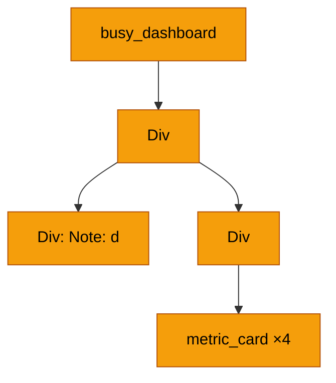
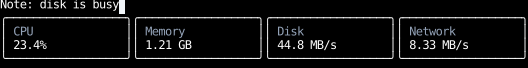
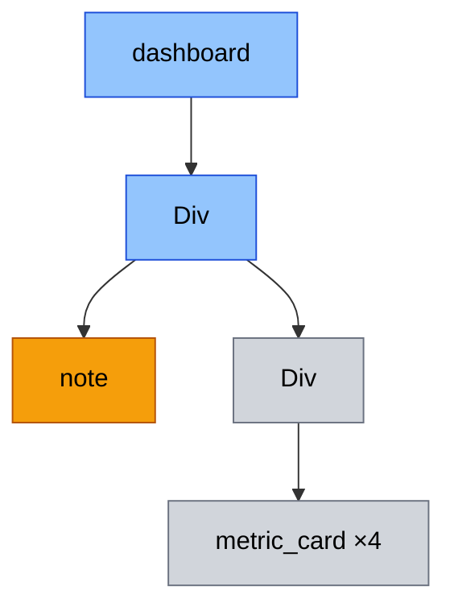
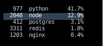

# Performance

This page is for an app that feels slow.
It covers finding where a frame's time goes,
which components a frame runs,
and how to skip the ones whose output can't have changed.
It quotes no frame times, since they depend on the app, the machine and the terminal:
measure your own.

## Where does my frame's time go?

When an event changes state, Counterweight runs a **frame**:
it re-runs the components that need it, lays out the elements, paints the screen,
compares the paint with the previous frame's, and writes the difference to the terminal.

### The devlog

Every app writes a log of each frame to a file.
Run `counterweight devlog` in another terminal to follow it as the app writes it.
It holds counterweight's records and your app's at every level, and other loggers' from `INFO` up;
pass `app` a `log_levels` mapping to change that by logger name,
such as `{"some_library": logging.DEBUG}` to include a library's debug records.
Each frame logs one line per stage, with microsecond timestamps,
so the gaps between lines show where a slow frame went.
Here is the [process table](#how-do-i-skip-a-component-whose-arguments-didnt-change)
below handling one key press:

```text
03:36:29.273368 DEBUG    counterweight.app Updated shadow tree components_run=3
03:36:29.273499 DEBUG    counterweight.app Calculated layout
03:36:29.273592 DEBUG    counterweight.app Generated new paint
03:36:29.273606 DEBUG    counterweight.app Healed borders in new paint hint_cells=0 diff_cells=0
03:36:29.273638 DEBUG    counterweight.app Diffed new paint from current paint diff_runs=2 diff_cells=50
03:36:29.273655 DEBUG    counterweight.app Generated instructions from paint diff
03:36:29.273667 DEBUG    counterweight.app Reconciled effects
03:36:29.273675 DEBUG    counterweight.app Completed render cycle
```

`components_run` counts the components the frame called,
which is the number the rest of this page is about.

### Profiling

Python's sampling profiler, `profiling.sampling`, shows which functions the time went to.
Run the app under it (`-m my_package` profiles a module), use the app until it feels slow, quit,
and open the flamegraph:

```bash
python -m profiling.sampling run --flamegraph -o profile.html my_app.py
```

Below `render_loop`, each stage of a frame is one function:

- `update_shadow` calls your components, so your component functions appear under it.
- `layout_changes` and `LayoutTree.compute` lay out the elements.
- `paint_layout`, `heal_borders`, `diff_paint` and `paint_to_instructions` draw the screen.
- `handle_effects` starts and stops effects.

If most of the time is under `update_shadow`, in your own functions, the rest of this page is for you.
Layout and paint grow with how many elements are on screen and how many of them changed;
if they dominate a profile, please
[open an issue](https://github.com/JoshKarpel/counterweight/issues) with the flamegraph.

## What happens when input arrives faster than frames?

Each frame begins by handling every event waiting for it
(key presses, mouse reports, and the state changes their handlers make),
and only then re-runs components and draws the screen, once.
Input that arrives while a frame is drawing waits for the next frame,
which handles all of it together.

So a slow frame doesn't fall behind fast typing: frames get fewer, not later.
If a [`text_area`](headless/use_text_area.md)'s frame takes as long as three key presses,
it draws about every third key press, and the frame after the last key press shows every edit.
When frames are faster than the input, each key press gets its own frame, with no added delay,
so there's nothing to tune. React batches state updates the same way, rendering once for all the updates in an event.

Every event still reaches its handlers, one at a time and in order.
But the components re-run only after all of them,
so every handler in a frame sees the state the components last rendered with.
A handler that sets `set_count(count + 1)` counts two key presses that land in one frame as one.
Pass the setter a function, which receives the latest value,
as described in [updating state from its previous value](hooks/use_state.md#updating-state-from-its-previous-value):
`set_count(lambda count: count + 1)`.

## Which components run in a frame?

In each frame, every component has one of three outcomes:

- **Re-run:** its function is called again.
  A component re-runs when its own state changed,
  or when the component that returned it re-ran and so built it again:
  calling `metric_card(...)` makes a new `Component` every time.
- **Pass through:** it isn't called, but a component below it re-runs,
  so its previous output is kept and searched for the component that changed.
- **Reuse:** neither it nor anything below it changed,
  so its previous output is kept whole, and layout doesn't reconcile it again.

A component that calls [`use_rects`](hooks/use_rects.md) also re-runs when its rectangles move,
and one that calls [`use_clock`](hooks/use_clock.md) when its next tick starts.
The first frame, and the frames after a resize or a resume from a suspend, re-run every component.

Here's a dashboard whose root holds a note you type into:

<!-- example: performance_state.py:in-root -->

Each key press changes `busy_dashboard`'s state, so it re-runs,
builds a new `metric_card` for each metric, and every card re-runs too,
though none of them shows anything that changed:



Move the state down into the component that shows it:

<!-- example: performance_state.py:moved-down -->



Now each key press re-runs `note` alone.
`dashboard` passes through to it, and the cards are reused:



Orange re-runs, blue passes through, and grey is reused.
Elements are drawn too, since a frame passes through or reuses them the same way.
Holding state in the component that uses it is the first thing to try, and it needs no new API.
The same goes for `use_clock`: call it in the component that shows the time,
and each tick re-runs that component alone.

## How do I skip a component whose arguments didn't change?

State can't always move down.
A process table re-runs whenever the processes or the selection change,
and so builds every row again,
though most rows show the same process with the same selection as before.
Declare the row [`memo`](components/index.md#skipping-a-component-whose-arguments-didnt-change),
and it's reused when its arguments equal the previous frame's:

<!-- example: performance_process_table.py:example -->



Moving the selection re-runs `process_table` and the two rows whose `is_selected` changed,
and reuses the rest.
A new sample in which one process's CPU changed re-runs that process's row alone,
wherever the new order moved it.
Three choices make that work:

- **The rows are keyed by `pid`.**
  An unkeyed `memo` component compares its arguments with whatever item was at its index last frame,
  so when a sort reorders the list, most rows get a different process and re-run.
  A key compares each row with its own previous arguments.
- **Selection is passed as `is_selected`, computed from the `pid`.**
  Passing the selected index instead would change every row's arguments whenever it moved.
- **`select` is the setter itself.**
  A setter is the same object on every render, so it compares equal.
  A handler built while rendering, such as `lambda pid: set_selected_pid(pid)`,
  is a new object every time, so it never does.

## How do I cache a value?

[`use_memo`](hooks/use_memo.md) keeps a value from one render to the next,
computing it again only when its dependencies change. Use it for:

- **A value derived from arguments or state.**
  `process_table` sorts the processes only when they change, not when the selection moves.
- **An unchanging part of a component's output.**
  A component that returns the same element object as last render
  keeps the components inside it from re-running, as a reused component does.
- **A handler passed to a `memo` component** that has to do more than call a setter:
  `use_memo(lambda: handler, deps)` keeps it the same object until `deps` change.

Caching per item goes in the item's own component, as `process_row` does with `memo=True`.
A parent can't call `use_memo` once per item,
because hooks are matched up by the order they're called in,
so the number of calls can't change from one render to the next.
See [`use_memo` or `functools.lru_cache`?](hooks/use_memo.md#use_memo-or-functoolslru_cache)
for when a module-level cache fits better.

## What goes wrong?

Each mistake below either makes a cache miss every time, which is correct but slow,
or makes it hit when it shouldn't, which shows stale output.

### With `memo=True`

**A callback argument built while rendering** never equals the previous one:

```python
process_row(process, process.pid == selected_pid, lambda pid: set_selected_pid(pid))
```

Every row re-runs whenever the table does, as if it weren't `memo`.
Pass the setter itself, or a handler kept with `use_memo`.

**An argument mutated in place** equals itself, since it's the same object:

```python
@component(memo=True)
def key_list(keys: list[str]) -> Text:
    return Text(content=" ".join(keys))


@component
def key_log() -> Div:
    use_focus(auto_focus=True)
    keys = use_ref(list[str]())
    count, set_count = use_state(0)

    def on_input(event: InputEvent, _: Receiver) -> InputResponse:
        if not isinstance(event, KeyPressed):
            return None
        keys.current.append(event.key)
        set_count(lambda count: count + 1)
        return ()

    return Div(on_input=on_input, children=(key_list(keys.current),))
```

`key_list` keeps showing the keys from when it last ran.
Replace the value instead of changing it:
hold a tuple in state, and set a new one with `set_keys(lambda keys: (*keys, event.key))`.

**A hidden input**, such as a module-level setting, isn't one of the arguments:

```python
SETTINGS = {"accent": "amber"}


@component(memo=True)
def title(text: str) -> Text:
    return Text(content=f"[{SETTINGS['accent']}] {text}")
```

Changing `SETTINGS` doesn't show until `text` changes.
Pass the setting as an argument: `title(text, accent=SETTINGS["accent"])`.

**An unkeyed list that reorders** pairs each row with a different item:

```python
process_row(process, process.pid == selected_pid, set_selected_pid)
```

Rows re-run wherever the order changed.
Key each row by its item, as `.with_key(str(process.pid))` does above.

**A large argument rebuilt every render** still hits, but slowly:

```python
line_list(tuple(line.upper() for line in lines))
```

The new tuple is never the same object as last render's,
so every hit compares it item by item with the previous one.
Keep it with `use_memo(lambda: tuple(line.upper() for line in lines), deps=(lines,))`,
so a hit is one identity check.

### With `use_memo`

**A dependency missing from `deps`** keeps the cached value from following it:

```python
busy = use_memo(lambda: [process for process in processes if process.cpu > threshold], deps=(processes,))
```

Changing `threshold` keeps showing the old count.
List every value `compute` reads: `deps=(processes, threshold)`.

**A cached handler that captured state** keeps acting on the value it captured:

```python
count, set_count = use_state(0)
on_input = use_memo(lambda: lambda event, _: set_count(count + 1), deps=())
```

Every key press sets `count` to 1.
Pass a function to the setter, which receives the latest value,
so the handler captures nothing that changes:
`set_count(lambda count: count + 1)`.

**A dependency that's new every render** never equals the previous one:

```python
def submit(event: InputEvent, _: Receiver) -> None:
    if isinstance(event, KeyPressed):
        on_submit(event.key)


on_input = use_memo(lambda: submit, deps=(on_submit,))
```

When the parent passes `on_submit=lambda text: set_query(text)`,
`compute` runs on every render.
Pass something that stays the same object, such as the setter, or keep the parent's handler with `use_memo`.

**`use_memo` in a loop** calls a different number of hooks when the loop's length changes:

```python
labels = [use_memo(lambda: f"{process.name} ({process.pid})", deps=(process,)) for process in processes]
```

When the number of processes changes, the render raises `InconsistentHookExecution`.
Render a component per item and cache inside it.

**Caching something cheap** costs more than it saves:
every render still compares `deps` and keeps a hook,
which costs more than an f-string or a dictionary lookup.
Nothing looks wrong; it only shows in a profile.

### Which mistakes `check_purity` catches

| Mistake | Symptom | `check_purity` |
|---|---|---|
| `memo`: callback argument built while rendering | Always re-runs | Not caught |
| `memo`: argument mutated in place | Stale | Raises `ImpureComponent` |
| `memo`: hidden input | Stale | Raises `ImpureComponent` |
| `memo`: unkeyed list that reorders | Re-runs wherever the order changed | Not caught |
| `memo`: large argument rebuilt every render | Slow hits | Not caught |
| `use_memo`: dependency missing from `deps` | Stale | Raises `StaleMemo` |
| `use_memo`: cached handler that captured state | Stale | Raises `StaleMemo` |
| `use_memo`: dependency that's new every render | Always recomputes | Not caught |
| `use_memo` in a loop | Raises `InconsistentHookExecution` | Not needed |
| `use_memo` on something cheap | Slower than not caching | Not caught |

The ones it doesn't catch produce correct output, only slowly,
so find them with the devlog's `components_run` or a profile.

## How do I catch stale output?

Pass `check_purity=True` to `app` in tests, and drive the app with an autopilot:

```python
async def test_process_table_is_pure() -> None:
    await app(
        root(),
        headless=True,
        dimensions=(32, 7),
        autopilot=[KeyPressed(key=Key.Down), KeyPressed(key=Key.Down), KeyPressed(key=Key.Up), Quit()],
        check_purity=True,
    )
```

After each frame, every component is run again with the same arguments and hooks,
and if that builds a different tree from the one the frame built,
the app raises `ImpureComponent`, naming the first component whose output differs.
That catches output a frame kept from a component that should have re-run,
and a component that returns something different each time it's called.
Every `use_memo` whose `deps` didn't change computes its value again,
and raises `StaleMemo` if the result differs from the cached one.
Elements are compared with `==`, and where that fails, piece by piece,
with handlers compared by their code and the values they captured,
since a re-run builds new ones that never `==` the old ones.

The second run costs about as much as re-running everything, so leave it off outside tests.
It only checks the frames a test drives,
so drive the interactions that change what a component might read without being told,
such as a setting changed from another screen.
[`use_ref`](hooks/use_ref.md#not-reading-or-writing-a-ref-while-rendering) covers what it catches for refs.
