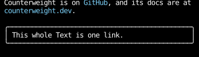

# Hyperlinks

Any text can be a hyperlink that the terminal opens when it's clicked:
set [`link`][counterweight.styles.CellStyle] on a `CellStyle`.
On a `Chunk`'s style, that makes the chunk a link;
on a `Text`'s `text_style`, it makes all of its text one.

```python
--8 < --"hyperlinks.py:example"
```



A link changes how nothing looks, so style it to look like one,
as the example does with an underline and a color.
It merges like any other field, so a `Chunk` inside a linked `Text` can link elsewhere,
or set `link=None` to not be a link at all.

## How terminals handle them

Counterweight writes links as [OSC 8](https://gist.github.com/egmontkob/eb114294efbcd5adb1944c9f3cb5feda)
escape sequences, which most modern terminals support, including iTerm2, kitty, WezTerm, Ghostty, foot,
GNOME Terminal and Windows Terminal.
A terminal that doesn't ignores them, and shows the text as if it weren't a link.

Clicking a link is handled by the terminal, not the app, and the app never sees the click.
Counterweight turns on mouse reporting, so some terminals only open a link
with a modifier held, such as Shift, Ctrl or Cmd, depending on the terminal.

A link's URI must be printable ASCII, so `CellStyle` raises `ValueError` for anything else:
a control character could end the escape sequence and start another.
Percent-encode anything outside ASCII, as `urllib.parse.quote` does.
