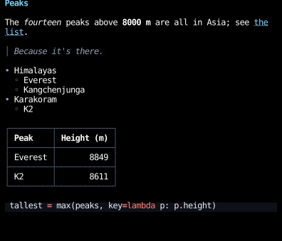
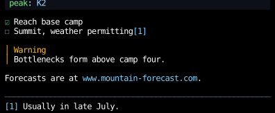
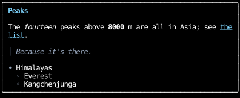
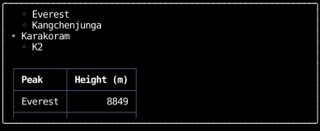

# Markdown

`markdown` renders a Markdown document as a `Div` of elements,
which goes anywhere an element does.
It handles [GitHub Flavored Markdown](https://github.github.com/gfm/),
and YAML front matter at the top of a document.

```python
--8 < --"markdown_document.py:example"
```



- Links, bare URLs, and images are [hyperlinks](hyperlinks.md) to their destinations.
  An image is shown as its alt text, since a terminal can't show the image.
- Fenced code blocks are [highlighted](syntax-highlighting.md) as the language their info string names,
  or shown as written if it names none, or one Pygments doesn't know.
- Math, between `$`s within a line or `$$`s on lines of their own, is shown as written, since a terminal can't typeset it.
  A dollar sign starts math only by [Pandoc's rule](https://pandoc.org/MANUAL.html#math),
  with no space just inside it and no digit right after the closing one, so `$5 and $10` stays text.
- Raw HTML is shown as written.

GitHub's extensions to CommonMark draw like this:

```python
--8 < --"markdown_document.py:github"
```



- Front matter is shown dimmed and highlighted as YAML.
  Pass `MarkdownStyles(front_matter=display_none)` to hide it.
- A task list item's box takes the place of its bullet, or follows its number.
- An [alert](https://docs.github.com/en/get-started/writing-on-github/getting-started-with-writing-and-formatting-on-github/basic-writing-and-formatting-syntax#alerts)
  is a block quote with a title, colored by its kind.
- Footnotes are numbered in the order they're referenced, and their definitions follow the rest of the document.

Rendering is cached by the source and the styles,
so a component can render the same document on every render without parsing it again.

## Scrolling

A document is as tall as its content, so one longer than the space it's given runs past the bottom of it.
Put it in a [scroll container](../layout/scrolling.md), as a browser puts a page in a scrolling viewport,
with [`scroll_on_keys`](../input-handling/handlers.md#scrolling) and `scroll_on_wheel` to scroll it:

```python
--8 < --"markdown_document.py:scrolling"
```

=== "Before"

    

=== "After PageDown"

    

The [Markdown viewer](https://github.com/JoshKarpel/counterweight/blob/main/examples/markdown_viewer.py) example
puts a tree of a directory's Markdown files beside the one it's showing, each in a pane that scrolls,
and the [Markdown gallery](https://github.com/JoshKarpel/counterweight/blob/main/examples/markdown_gallery.py) example
shows the source of each kind of block and span beside how it renders.

## Styles

`MarkdownStyles` holds a `Style` for each kind of block and a `CellStyle` for each kind of inline span.
Pass the fields you want to change, and the rest keep their defaults:

```python
markdown(source, MarkdownStyles(heading_1=text_color("amber", 300), code_theme="monokai", block_gap=0))
```

## API

::: counterweight.markdown.markdown

::: counterweight.markdown.MarkdownStyles
