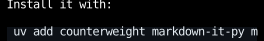
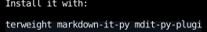

# Markdown

`markdown_document` renders a Markdown document as a component,
which goes anywhere a component does.
It handles [GitHub Flavored Markdown](https://github.github.com/gfm/),
and YAML front matter at the top of a document.

<!-- example: markdown_document.py:example -->


- Links, bare URLs, and images are [hyperlinks](hyperlinks.md) to their destinations.
  An image is shown as its alt text, since a terminal can't show the image.
- Fenced code blocks are [highlighted](syntax-highlighting.md) as the language their info string names,
  or shown as written if it names none, or one Pygments doesn't know.
  Code blocks and tables too wide for the space they're given [scroll sideways](#wide-code-and-tables).
- Math, between `$`s within a line or `$$`s on lines of their own, is shown as written, since a terminal can't typeset it.
  A dollar sign starts math only by [Pandoc's rule](https://pandoc.org/MANUAL.html#math),
  with no space just inside it and no digit right after the closing one, so `$5 and $10` stays text.
- Raw HTML is shown as written.

GitHub's extensions to CommonMark draw like this:

<!-- example: markdown_document.py:github -->


- Front matter is shown dimmed and highlighted as YAML.
  Pass `MarkdownStyles(front_matter=display_none)` to hide it.
- A task list item's box takes the place of its bullet, or follows its number.
- An [alert](https://docs.github.com/en/get-started/writing-on-github/getting-started-with-writing-and-formatting-on-github/basic-writing-and-formatting-syntax#alerts)
  is a block quote with a title, colored by its kind.
- Footnotes are numbered in the order they're referenced, and their definitions follow the rest of the document.

## Parsing

`markdown_document` is a [`memo`](../components/index.md#skipping-a-component-whose-arguments-didnt-change) component,
so it parses its document again only when its arguments change,
and keeps what it rendered while it stays mounted, freed when it unmounts.
A transcript that renders each message with one parses only the message that changed,
however many messages there are, as React apps wrap a Markdown component in `React.memo`.

The function it calls, `markdown`, returns the document's `Div` of elements, and parses the document each time it's called.
Call it to put the elements together with others yourself,
under [`use_memo`](../hooks/use_memo.md) in a component that renders often.

## Scrolling

A document is as tall as its content, so one longer than the space it's given runs past the bottom of it.
Put it in a [scroll container](../layout/scrolling.md), as a browser puts a page in a scrolling viewport,
with [`scroll_on_keys`](../input-handling/handlers.md#scrolling) and `scroll_on_wheel` to scroll it:

<!-- example: markdown_document.py:scrolling -->

=== "Before"

    

=== "After PageDown"

    

The [Markdown viewer](https://github.com/JoshKarpel/counterweight/blob/main/examples/markdown_viewer.py) example
puts a tree of a directory's Markdown files beside the one it's showing, each in a pane that scrolls,
and the [Markdown gallery](https://github.com/JoshKarpel/counterweight/blob/main/examples/markdown_gallery.py) example
shows the source of each kind of block and span beside how it renders.

## Wide code and tables

A code block with lines wider than the space it's given scrolls sideways rather than wrapping them,
as GitHub's styles give a `pre` `overflow: auto`.
`markdown` puts it in a box with `overflow_x_scroll`
and [`scroll_on_wheel`](../input-handling/handlers.md#scrolling), so the wheel scrolls it under the pointer:

<!-- example: markdown_document.py:wide -->

=== "Before"

    

=== "After four wheel notches to the right"

    

A table scrolls the same way once its cells have wrapped as narrow as their words allow,
as GitHub's styles make a `table` a block with `overflow: auto`.
Only a sideways wheel scrolls them, such as a tilting wheel or a trackpad's sideways swipe,
or the wheel with Shift held, as in a browser.
An up or down notch without Shift over one passes on to the scroll container around the document,
so the document scrolls as it does anywhere else.
Some terminals keep Shift with the wheel for their own scrollback and never report it,
so there only a sideways wheel scrolls them.

Browsers also let Tab focus a scroll container with nothing focusable inside, and the arrow keys scroll it.
A code block here isn't focusable, since `markdown` returns elements, not components that could call
[`use_focus`](../hooks/use_focus.md), so only the wheel scrolls it.

To wrap long lines instead, pass `MarkdownStyles(code_block_text=text_wrap_stable)`.

## Line breaks

CommonMark joins the lines of a paragraph with a space, so a document's source can wrap wherever its author likes.
What people type into a chat is different: GitHub's comments and chat apps keep each line break they type.
Pass `keeps_line_breaks=True` to break the line wherever the source does,
as the [chat](https://github.com/JoshKarpel/counterweight/blob/main/examples/chat.py) example does for your messages.

## Styles

`MarkdownStyles` holds a `Style` for each kind of block and a `CellStyle` for each kind of inline span.
A code block and a table are each a box around what they show:
`code_block` and `table` style the box, which scrolls, and `code_block_text` and `table_grid` what's inside it.
Pass the fields you want to change, and the rest keep their defaults:

```python
markdown_document(source, MarkdownStyles(heading_1=text_color("amber", 300), code_theme="monokai", block_gap=0))
```

## API

::: counterweight.markdown.markdown_document

::: counterweight.markdown.markdown

::: counterweight.markdown.MarkdownStyles
