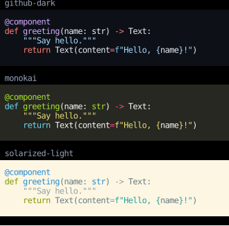

# Syntax Highlighting

`code_block` highlights source code with [Pygments](https://pygments.org/),
in any of the [languages it knows](https://pygments.org/languages/),
and draws it on its theme's background.

```python
--8<-- "syntax_highlighting.py:example"
```



A theme is the name of any [Pygments style](https://pygments.org/styles/),
or a `pygments.style.Style` subclass, which is how to define your own.

To lay the code out yourself, `highlight` returns its chunks,
to put in a `Text` with whatever else you like,
and `code_style` the background and text color to draw them on.

Highlighting is cached by its arguments,
so a component can highlight the same code on every render without lexing it again.
Tabs are expanded, to four columns unless `tab_size` says otherwise.

## API

::: counterweight.highlighting
    options:
      members:
        - highlight
        - code_block
        - code_style
        - CodeTheme
        - DEFAULT_CODE_THEME
