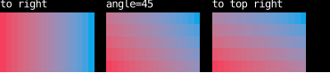
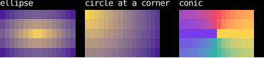
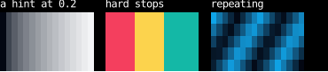
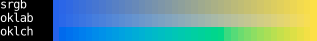
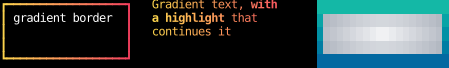
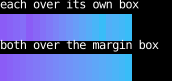
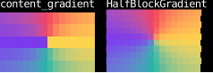

# Gradients

A gradient is a color that changes across a box.
Every place a style holds a color can hold one instead:
`margin_color`, `padding_color` and `content_color`,
and the foreground and background of `border_style`, `text_style`, and a `Text`'s chunks.
This page covers making gradients, where they map, and what drawing them in cells changes.
It doesn't cover transparency or layering one gradient over another, since colors have no alpha.

Counterweight takes gradients from CSS:
a gradient is CSS's `linear-gradient`, `radial-gradient` or `conic-gradient`,
built by a function of the same name with the same parts.
CSS paints a gradient as an image, so only backgrounds and borders take one;
here, as in SVG's `fill` and `stroke`, a gradient goes anywhere a color does,
text included, without CSS's `background-clip: text`.

## Linear gradients

[`linear_gradient`][counterweight.gradients.linear_gradient] takes its colors in order,
and points down unless it's given a side or corner to point `to`, or an `angle`.
An angle is in degrees clockwise from up, so `90` points right, as in CSS.
A corner points the way that puts the gradient's halfway line through the other two corners,
so the corner itself takes the last color whatever the box's shape (CSS's "magic corners").

<!-- example: gradients.py:linear -->



## Radial and conic gradients

[`radial_gradient`][counterweight.gradients.radial_gradient] spreads its colors outward from a center, `at`,
to an ending shape: an ellipse, or a circle,
sized by the side or corner of the box it reaches (`"farthest-corner"` unless it's given another),
or by its radius.
[`conic_gradient`][counterweight.gradients.conic_gradient] turns its colors around a center,
clockwise from its `start` angle.
A center is a fraction of the way across the box on each axis, so `(0.5, 0.5)`, the default, is its middle,
or a number of cells from its top left cell, as a `waxy.Length`.

<!-- example: gradients.py:shapes -->



## Stops

Each color is a stop, which goes wherever the gradient's other stops leave room for it,
or at a position given with it as `(color, position)`, a fraction of the way along the gradient,
or from one position to another as `(color, start, end)`.
Two stops at one position make a hard edge between them.
A [`Hint`][counterweight.gradients.Hint] between two stops moves the point where their colors mix half and half,
and a repeating gradient repeats its stops for as long as the box goes on.
Stops are fixed up as CSS fixes them up: a position smaller than one before it is moved up to it,
and stops without positions are spaced evenly between the ones around them.

<!-- example: gradients.py:stops -->



A stop is a [`Color`][counterweight.styles.Color], not an `IndexedColor` or `TERMINAL_DEFAULT`,
since the terminal decides what those look like, so there's no color to mix them from.

## Mixing colors

A gradient mixes its colors in Oklab unless it's given another color space as its `interpolation`,
as CSS does, which keeps the colors between two stops about as bright as the stops, rather than going muddy.
`"srgb"` mixes them as CSS does colors given in hex, and a polar space such as `"oklch"`
goes around the hue circle the shorter way, or the way its `hue` says.

<!-- example: gradients.py:interpolation -->



## Where a gradient goes

The [utilities](utilities.md#gradients) put a gradient in each place a color goes.
Each place maps its gradient over the box it paints:

| Utility | Field | Maps over |
| --- | --- | --- |
| `margin_gradient` | `margin_color` | the margin box |
| `content_gradient` | `content_color` | the border box, under the border and padding |
| `padding_gradient` | `padding_color` | the padding box |
| `border_gradient`, `border_bg_gradient` | `border_style` | the border box |
| `text_gradient`, `text_bg_gradient` | `text_style`, and a chunk's style | the content box |

<!-- example: gradients.py:slots -->



A chunk's gradient maps over the element's content box too, so a highlighted word in gradient text
continues the text's gradient rather than starting it over.
Text that overflows its box keeps going along its gradient, as does any part of a place outside the box it maps over.

A gradient's `box` names the box it maps over instead,
so two places with the same gradient can share a box and line up,
as CSS's `background-origin` does:

<!-- example: gradients.py:boxes -->



## What cells change

A cell is about twice as tall as it is wide, so a gradient computes its angles and circles as if each row
were two columns tall, which makes `45` degrees look like 45 degrees, and a circle look round.
The ratio is `app`'s `cell_aspect_ratio` parameter, which a font with other proportions can change.
A circle or ellipse given radii in cells keeps them: a circle of radius 10 reaches 10 columns across,
and 5 rows down.

A browser colors each pixel by its center, and so does a terminal each cell,
but a gradient spans from the center of its box's first cell to the center of its last,
so the cells at the ends take the end colors exactly:
a box 3 cells tall shows its first color, the color halfway between, and its last,
where a browser would show neither end.

## On a canvas

A [`Canvas`](../elements/canvas.md) is drawn by its painter, which has no places for a gradient,
so [`HalfBlockGradient`][counterweight.painters.HalfBlockGradient] is a painter that fills it with one,
two pixels to a cell, as [`HalfBlocks`][counterweight.painters.HalfBlocks] draws a picture,
which shows a gradient at twice the vertical resolution of a `content_gradient`.
[`Pixels.from_gradient`][counterweight.painters.Pixels.from_gradient] is a picture of a gradient,
for a picture that draws more on top of it.

<!-- example: gradients.py:canvas -->



### Sampling a gradient's colors

To color something a gradient can't fill, such as one character of a `Text` or a pixel a painter computes,
read the gradient's colors yourself from its [`ramp`][counterweight.gradients.ramp],
which paint draws it from:

```python
colors = ramp(linear_gradient(Color.from_name("red"), Color.from_name("blue")))
halfway = colors.color(colors.index(0.5))
```

[`field_indices`][counterweight.gradients.field_indices] gives the entry of the ramp each cell of a box takes,
as paint maps the gradient over it, for drawing a whole gradient cell by cell.

## Animating a gradient

A gradient is a value, so animating one means building a new one each frame from the time,
which [`use_clock`](../hooks/use_clock.md) reads.
Each of these turns its gradient's angle, or slides its stops along, once every three seconds:

<!-- example: gradients.py:animated -->

<!-- cast: gradients-animated -->

Browsers don't animate one gradient into another,
so a page animates a gradient by sliding an oversized background with `background-position`,
or by registering an angle or a stop position with `@property` so that it can transition.
Here a gradient's angle, center, stops and colors are arguments like any other,
so any of them can change from one frame to the next.
A stop's position can be outside the gradient, as the shimmer's are when its highlight is off either end.
Each animated component reads the clock itself, so a frame re-runs only them,
though each frame draws their gradients again (see [Performance](#performance)).

## Performance

Paint keeps what it builds for each element's gradients from frame to frame,
so a gradient that doesn't change costs about what a solid color does once it's drawn.
What costs is drawing one again:
a gradient whose stops or geometry change, as in an animation, or that scrolls, or whose box changes size,
is drawn again in every frame it changes, at roughly half a millisecond per thousand cells,
and all of its cells' colors are sent to the terminal again too.

## API

::: counterweight.gradients.linear_gradient
::: counterweight.gradients.radial_gradient
::: counterweight.gradients.conic_gradient
::: counterweight.gradients.Gradient
::: counterweight.gradients.LinearGradient
::: counterweight.gradients.RadialGradient
::: counterweight.gradients.ConicGradient
::: counterweight.gradients.Stops
::: counterweight.gradients.Stop
::: counterweight.gradients.Hint
::: counterweight.gradients.StopLike
::: counterweight.gradients.Interpolation
::: counterweight.gradients.HueMethod
::: counterweight.gradients.Box
::: counterweight.gradients.Coordinate
::: counterweight.gradients.SideOrCorner
::: counterweight.gradients.Extent
::: counterweight.gradients.Shape
::: counterweight.gradients.ramp
::: counterweight.gradients.Ramp
::: counterweight.gradients.field_indices
::: counterweight.gradients.Indices
