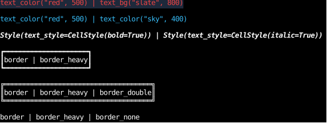
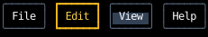

# Styles

Every element takes a `style`, a [`Style`][counterweight.styles.Style] that says how it's laid out and drawn.
Rather than build one field by field, most code merges [utilities](utilities.md),
small styles that each set a few fields, as Tailwind's classes do.

## Merging

Styles are merged using the `|` operator: `left | right`.
Every field starts out unset (the `counterweight.styles.UNSET` sentinel),
and the result takes `right`'s value for every field `right` sets, and `left`'s value otherwise.

A field set to its default value is still set, so it overrides `left`.
`CellStyle(bold=True) | CellStyle(bold=False)` is `CellStyle(bold=False)`,
`border | border_none` draws no border,
and `text_justify_center | text_justify_left` justifies left.
Utilities set only the fields they are about, so they layer without clearing each other:
`text_color("red", 500) | text_bg("slate", 900)` is red text on a slate background.

[`merge`][counterweight.styles.merge] does the same for any number of `Style`s:
`merge(a, b, c)` is `a | b | c`.
It skips `None` wherever it appears, so a style that only sometimes applies can be passed inline,
as in `merge(base, hover_style if hovered else None)`, and `merge()` is an empty `Style()`.

Nested styles merge field by field too:
`Style(text_style=CellStyle(bold=True)) | Style(text_style=CellStyle(italic=True))`
is both bold and italic.
`layout` follows the same rule, field by field.

Each `Text` below is styled by the expression it shows:

<!-- example: styles_merging.py:layering -->



- The first line is red on slate, since each utility sets a different field.
- The second is sky, since both set the text's foreground and the right one wins.
- The third is bold and italic, since the two `text_style`s merge field by field.
- `border_double` replaces `border_heavy`'s characters, and `border_none` takes the border away entirely.

A component usually builds its style from a base and a few variants that apply only sometimes.
Below, every button starts from `BUTTON`;
the selected one merges in `SELECTED`, which overrides its border kind and color and sets a text color,
and the one under the mouse ([`use_hovered`](../hooks/use_hovered.md)) merges in `HOVERED`,
which only adds a background, so it layers over a selected button as well as an unselected one.

<!-- example: styles_merging.py:conditional -->



Any color a style holds can be a [gradient](gradients.md) instead, which colors each cell by where it is in its box.

When an element is drawn, any field still unset takes its default from
[`STYLE_DEFAULTS`][counterweight.styles.STYLE_DEFAULTS]
and [`CELL_STYLE_DEFAULTS`][counterweight.styles.CELL_STYLE_DEFAULTS].

## Text in a filled box

A `Text`'s characters are drawn on its `text_style`'s background,
and where that's unset, on the `Text`'s own `content_color`, as a `Canvas`'s painter's cells are.
They don't take the color of a box the `Text` lies in:
an unset background is the default, black, not transparent as a CSS `background-color` starts out.
Layouts here put elements side by side, or lay a modal over the rest with a fill of its own,
rather than stacking partly painted elements, so each cell's color is decided by the element that draws it.
A `Div` with a `content_color` therefore shows it around a `Text` inside it, but not under the text,
and there are two ways to color text inside a filled box:

```python
Div(style=content_color("slate", 800), children=(Text(content="hi", style=content_color("slate", 800)),))
Div(style=content_color("slate", 800), children=(Text(content="hi", style=text_bg("slate", 800)),))
```

The first colors the `Text`'s whole content box, under its text and below its last line,
and the second colors only its lines of text, each across the content box's width.
Padding takes its `padding_color` either way.
What isn't painted at all still shows what lies beneath it:
a margin without a `margin_color`, and an element with no border, padding, text or `content_color`.

## API

::: counterweight.styles.Style
::: counterweight.styles.merge

::: counterweight.styles.Color
::: counterweight.styles.IndexedColor
::: counterweight.styles.TerminalDefault
::: counterweight.styles.TERMINAL_DEFAULT
::: counterweight.styles.AnyColor
::: counterweight.styles.DEFAULT_PALETTE
::: counterweight.styles.CellStyle
::: counterweight.styles.STYLE_DEFAULTS
::: counterweight.styles.CELL_STYLE_DEFAULTS
::: counterweight.styles.ResolvedCellStyle
::: counterweight.styles.resolve_cell_style
::: counterweight.styles.is_solid_cell_style
::: counterweight.styles.as_solid
::: counterweight.styles.with_colors
::: counterweight.styles.is_solid_color
::: counterweight.styles.rgb_of
::: counterweight.styles.palette
::: counterweight.styles.UNSET
::: counterweight.styles.BorderKind
::: counterweight.styles.ClipTo
::: counterweight.styles.OverflowAnchor
::: counterweight.styles.TextJustify
::: counterweight.styles.TextWrap
::: counterweight.styles.TextOverflow
