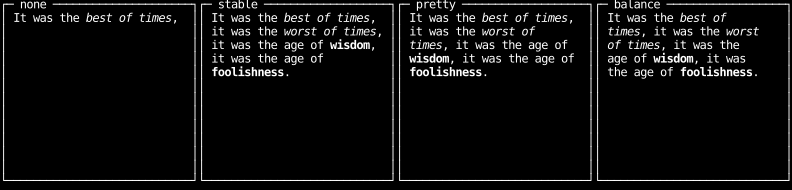
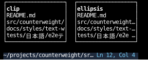

# Text Wrapping

By default, `Text` elements render their content on a single line.
When the content is wider than the available space, it overflows rather than wrapping.
Use the `text_wrap_*` style utilities to control how long text is broken across lines.

## Wrap Modes

Counterweight supports four wrap modes, illustrated below with the same paragraph of
[Markdown](../rich-text/markdown.md), whose paragraphs wrap with the `paragraph` style of `MarkdownStyles`:

<!-- example: text_wrap.py:example -->

### `text_wrap_none` (default)

No wrapping. The text renders as a single line regardless of the available width.
A line wider than its box overflows it and is drawn past it, as text is in CSS,
unless the `Text` or one of its ancestors [clips](../layout/clipping.md) it.
The comparison above gives the `none` paragraph `overflow_hidden`,
which clips its line at the paragraph's own padding box.

### `text_wrap_stable`

Greedy line-breaking — fills each line as much as possible before starting the next.
This is the fastest algorithm and produces consistent, deterministic output.
Use it when performance matters or when you want predictable line breaks.

### `text_wrap_balance`

Attempts to make all lines roughly equal in length by binary-searching for the narrowest
target width that doesn't increase the total line count.
Useful for headings and short paragraphs where visual balance is more important than
filling lines to the edge.

### `text_wrap_pretty`

Dynamic-programming line-breaking ([Knuth–Plass](https://en.wikipedia.org/wiki/Knuth%E2%80%93Plass_line_breaking_algorithm) style) that minimises the sum of squared
slack on non-final lines.
This produces typographically "nicer" output than greedy wrapping — shorter lines near
the end of a paragraph are avoided — at the cost of slightly higher CPU usage for very
long texts.

---

## Ending a Line with an Ellipsis

A line that doesn't wrap can be wider than its `Text`'s content box.
`text_overflow_clip`, the default, draws it whole, for a [clip](../layout/clipping.md) to cut;
`text_overflow_ellipsis` keeps what fits before the box's last cell and draws `…` there,
as CSS's [`text-overflow: ellipsis`](https://developer.mozilla.org/en-US/docs/Web/CSS/text-overflow) does:

<!-- example: text_overflow.py:example -->

The cut is measured in cells, as layout measures text,
so a [wide character](../elements/text.md#wide-characters) the box's edge runs through is left out,
with a space in its place, as `テ` is in the last path.
The `…` is drawn in the `Text`'s own style, rather than its chunks', as CSS draws it in its block's style.

It changes only what's painted, not any element's size,
so it shows only where the `Text`'s content box is narrower than its line.
A `Text` in a column stretches across it, as the paths do.
In a row, a `Text` keeps the width of its line, and only shrinks below it with `overflow_x_hidden`,
as a flex item with `overflow: hidden` does in CSS, so the status bar's path sets both,
and `grow(1)` to take the room the position leaves it.

---

## Layout

A wrapping `Text` wraps to the width layout gives it, inside its border and padding.
In a column that width comes from the column, since children stretch across it by default.
Side by side in a row, wrapping `Text`s shrink to share it, down to the width of their widest word.
[Text in layout](../layout/text.md) shows both cases.

---

## Long Words and Hyphenation

Words longer than the available width are broken with a hyphen (`-`) inserted at the
break point.
This applies to all three wrapping modes.
Words are measured in terminal cells and broken between grapheme clusters, never inside one,
so a line of [wide characters](../elements/text.md#wide-characters) may end a cell short,
and a wide character in a box one cell wide sticks out past it rather than widening the box.

---

## Multi-paragraph Text

Newline characters (`\n`) in the `content` string are treated as paragraph separators.
Each paragraph is wrapped independently, so explicit line breaks in your content are
always preserved.
