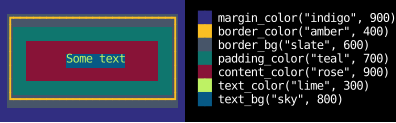
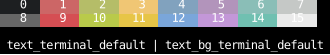
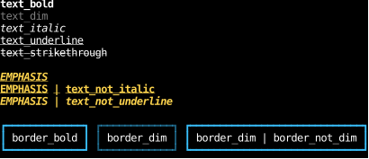
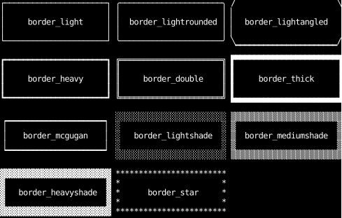

# Utilities

To avoid the tedium of writing out styles explicitly over and over,
Counterweight provides a variety of [Tailwind-inspired](https://tailwindcss.com/) "utility styles".
These utilities are pre-defined styles that can be combined to form more complex styles.

The utilities can be imported from the `counterweight.styles.utilities` module.
We recommend a `*` import for ease of use:

```python
from counterweight.styles.utilities import *
```

That brings in the utilities, the palette's colors, and the `ColorName`, `Shade` and `Side` types the utility functions take,
but not `Style`, `Color` or anything else the module itself imports, which come from `counterweight.styles`.

Each utility is a `Style` that sets just a small set of properties.
Some are constants (e.g., `border_heavy`, `justify_children_center`),
and the rest are functions that return one (e.g., `gap(n)`, `margin_x(n)`, `pad(n)`).
Color utilities take a color name and shade, or any color.
For example, `border_color("rose", 200)` returns a `Style` that sets the border color to rose-200,
as does `border_color(rose_200)`, with the palette's constant for that color:
```python
from counterweight.styles import Style, CellStyle, Color

border_color("rose", 200) == Style(border_style=CellStyle(foreground=Color.from_hex("#fecdd3")))
border_color(rose_200) == border_color("rose", 200)
```

Since they are normal `Style`s, they can be combined to form more complex styles using the `|` operator.
Here we make a new `Style` for a `rose_200`-colored heavy border on the top and bottom sides:

```python
from counterweight.styles.utilities import *

border_heavy_top_bottom_rose_200 = border_y | border_heavy | border_color("rose", 200)
```

Actually giving a name to the new style is optional.
We can also use the expression directly in our component:

```python
from counterweight.styles.utilities import *
from counterweight.components import component
from counterweight.elements import Text


@component
def my_component() -> Text:
    return Text(
        content="Hello, world!",
        style=border_y | border_heavy | border_color("rose", 200),
    )
```

!!! tip "Performance Considerations"

    If you have an expression like `border_y | border_heavy | border_color("rose", 200)` in your component,
    it will be evaluated every time the component is rendered.
    Merging styles with `|` does take some time, though it is aggressively cached inside the framework.
    If you find that this is causing performance issues,
    you should create the style just once,
    ideally outside your component (i.e., at module scope),
    so that it runs only once.

## Reference

Each table below is built from the utilities module when the docs are built.
The constants' tables list every field each one sets.
Fields not listed are left unset, so merging the utility into another style leaves them alone
(see [Merging](index.md#merging)).
The functions' tables give their signatures, since what they set depends on their arguments.

`default` is the empty style, a starting point that sets nothing.

<!-- utilities: default -->

### Colors

The color utilities draw from [Tailwind's color palette](https://tailwindcss.com/docs/colors)
when given a `ColorName` such as `"rose"` and a `Shade` from `50` (lightest) to `950` (darkest).
Given one color instead, they use it, as Tailwind's arbitrary values such as `text-[#fbbf24]` do:
a `Color`, such as a palette constant or `Color.from_hex("#fbbf24")`,
one of the [terminal colors](#terminal-colors), or a [gradient](#gradients).
`text_white` and `text_black` are outside the palette.

Each utility colors one part of a box.
In the box below, every part has its own color, matched by the swatch beside the utility that paints it:

<!-- example: styles_colors.py:places -->



<!-- utilities: text_white text_black text_color text_bg border_color border_bg margin_color padding_color content_color -->

#### Palette

Every palette color is also a `Color` constant named `<color>_<shade>`, such as `rose_200`,
for style fields that take a `Color` directly.
Hover over a swatch to see its name and hex code.

<!-- utilities-palette -->

::: counterweight.styles.utilities.ColorName
::: counterweight.styles.utilities.Shade

#### Terminal colors

A `Color` looks the same in every terminal.
The terminal's own colors follow the user's theme instead, as the colors of a program run in it do:
an `IndexedColor` is an entry of the terminal's 256-color palette,
whose first 16 are the black, red, green, yellow, blue, magenta, cyan and white that themes set, then their bright forms,
and `TERMINAL_DEFAULT` is the terminal's default foreground where it colors text,
and its default background where it fills one.
These utilities set them in each place the color utilities above do,
the `*_indexed` ones taking a palette index from 0 to 255.
Screenshots draw them in `DEFAULT_PALETTE`, and the defaults as white on black,
as the first 16 indexed colors and the defaults are drawn below.
In a terminal, they take whatever colors its theme gives them.

<!-- example: styles_colors.py:terminal -->



<!-- utilities: *_terminal_default *_indexed -->

#### Gradients

A [gradient](gradients.md) in a color place maps over the box that place paints unless the gradient names its own `box`.
The color utilities above take one, and these put one in each place too.

<!-- utilities: *_gradient -->

### Attributes

The `text_*` attributes draw the text bold, dim, italic, underlined or struck through,
and the `border_*` ones draw the border characters that way.
Each has a `not_` form that turns it off when merged over a style that turns it on,
such as a style for a selected row that isn't bold, merged over a table's bold one.
`text_link(uri)` makes the text a hyperlink that the terminal opens when it's clicked,
and `text_link(None)` makes it not a link, inside text that is one.
They're CSS's `font-weight: bold`, `font-style: italic` and `text-decoration`,
with dim, which a terminal draws faint, in place of CSS's lighter weights.

<!-- example: styles_attributes.py:example -->



How each looks is up to the terminal and its font:
some can draw bold text in a brighter color as well as, or instead of, a heavier weight,
and a terminal whose font has no italic face can draw italic text upright.

<!-- utilities: text_bold text_dim text_italic text_underline text_strikethrough text_not_* border_bold border_dim border_italic border_underline border_strikethrough border_not_* text_link -->

### Direction and wrapping

These set the flexbox main axis, and whether children wrap onto more lines when they don't fit.
See [Choosing a layout model](../layout/choosing-a-layout-model.md)
and [Wrapping without a grid](../layout/grids-and-wrapping.md#wrapping-without-a-grid).

<!-- utilities: row row_reverse col col_reverse flex_* -->

### Splitting space

These size children along their parent's main axis.
See [Splitting space](../layout/splitting-space.md).

<!-- utilities: grow shrink length percentage ratio fill -->

### Alignment

`justify_children_*` distributes children along the main axis, `align_children_*` places them on the cross axis,
and `align_self_*` overrides that for one child.
`justify_items_*` and `justify_self_*` place grid items within their cells along the row.
The `center` and `end` forms are safe: content that doesn't fit overflows past the end edge only.
The `_unsafe` forms overflow both edges.
See [Alignment and distribution](../layout/alignment.md).

<!-- utilities: justify_children_* align_children_* align_self_* justify_items_* justify_self_* center_children -->

### Sizing

See [Sizing one box](../layout/sizing-one-box.md).

<!-- utilities: width height size min_width min_height max_width max_height aspect_ratio min_content_* max_content_* fit_content_* stretch_* full full_width full_height border_box content_box -->

### Spacing

See [Gap, margin and padding](../layout/spacing-and-borders.md#gap-margin-and-padding).

<!-- utilities: margin margin_x margin_y margin_top margin_bottom margin_left margin_right margin_sides margin_*auto gap gap_width gap_height pad pad_* -->

### Borders

A side is drawn where its border width is 1, and each width utility has a `_0` form that takes its sides away.
See [Borders on some sides](../layout/spacing-and-borders.md#borders-on-some-sides).

<!-- utilities: border border_top border_bottom border_left border_right border_x border_y border_0 border_*_0 border_sides border_collapse border_contract -->

::: counterweight.styles.utilities.Side

#### Border kinds

The border kind only chooses the characters, and draws nothing without a border width.
`border_none` removes the border along with its space.
Every other kind is drawn below, each around its own name:

<!-- example: styles_borders.py:example -->



The light, rounded, heavy and double kinds use box-drawing characters,
which [border healing](../cookbook/border-healing.md) joins where borders meet.
The rest don't join, and draw their edges with block elements, shades, slashes or asterisks.

<!-- utilities: border_none border_light border_heavy border_double border_thick border_lightrounded border_lightangled border_lightshade border_mediumshade border_heavyshade border_star border_mcgugan -->

### Display and grids

`display_none` hides a box and everything in it: they take no space and aren't drawn.
See [Grids and wrapping](../layout/grids-and-wrapping.md) for the grid utilities.

<!-- utilities: display_* grid_* fr span -->

### Positioning and layering

See [Layering](../layout/layering.md).
The `inset_*` utilities with a `center` axis, such as `inset_bottom_center`, center a box on that axis
only in a parent that centers its children, such as with `center_children`.
To center a box in any parent, see [A dialog centered over the app](../layout/layering.md#a-dialog-centered-over-the-app).

<!-- utilities: position_* inset inset_* z -->

### Overflow, clipping and scrolling

`overflow_hidden`, `overflow_clip` and `overflow_scroll` clip a box's children (and a `Text`'s own lines) to its padding box, on both axes or, with `_x` or `_y`, on one,
and `overflow_scroll` makes the box a [scroll container](../layout/scrolling.md) there.
`clip_to_border` lets a child, such as a border title, draw on its parent's border instead,
and `clip_to_screen` lets one, such as a dropdown, escape every clip above it.
See [Clipping](../layout/clipping.md).

`overflow_anchor_none` turns off [scroll anchoring](../layout/scrolling.md#keeping-the-content-in-view),
and `stick_to_end` makes a scroll container [follow its end](../layout/scrolling.md#following-the-end),
on both axes or, with `_x` or `_y`, on one; `unstick` undoes it.

<!-- utilities: overflow_* clip_to_* stick_to_end* unstick* -->

### Text

See [Text wrapping](text-wrapping.md) and [Text in layout](../layout/text.md).

<!-- utilities: text_justify_* text_wrap_* -->
